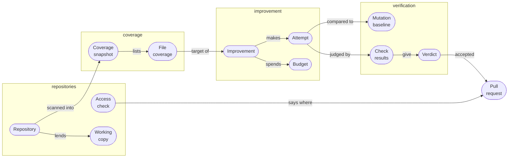
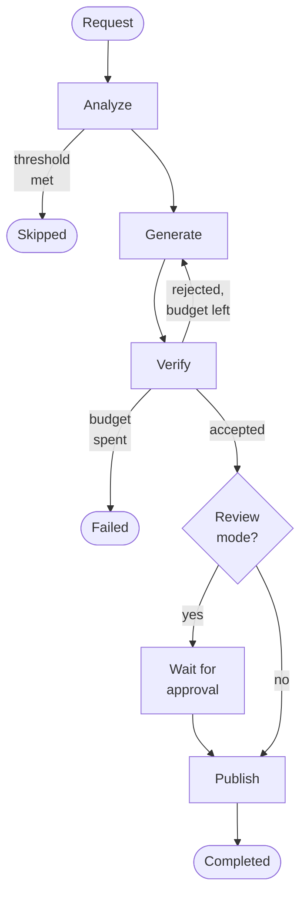

# coverage-autopilot

A NestJS service with a terminal client that raises the test coverage of
TypeScript repositories on GitHub. It finds the files that are poorly
covered, has an AI CLI write tests for one of them, proves that the tests
are worth having, and opens a pull request that holds the tests and
nothing else.

## Quick start

You need Node.js 26, a running Docker, the GitHub CLI logged in
(`gh auth login`) and a token for Claude Code (`claude setup-token`
prints one).

```sh
git clone https://github.com/daitkhev/coverage-autopilot
cd coverage-autopilot
npm ci
npm run build
```

Give the token to the shell. The line below reads it without showing it:
paste the token and press Enter.

```sh
read -rs CLAUDE_CODE_OAUTH_TOKEN && export CLAUDE_CODE_OAUTH_TOKEN
```

Start the client, which starts the service by itself:

```sh
npm start
```

Then, on the screens:

1. Press `a`, paste the URL of a repository, press `enter`.
2. Press `s` to scan it.
3. Press `enter` to open the files below the threshold, move to a file and
   press `i`.
4. Press `enter` to start. Nothing is spent before that.
5. When the work asks for your approval, press `p` to read the patch and
   choose "Approve and open the pull request".

The first start builds two container images, which takes a few minutes,
and the first scan waits for them. `?` shows every key and `q` quits; the
service keeps running.

The same from the command line:

```sh
npm start -- repo add https://github.com/owner/name
npm start -- scan owner/name --wait
npm start -- files owner/name
npm start -- improve owner/name src/some/file.ts --review --wait
```

Nothing has to be set for a first run. Every setting is described in
[.env.example](.env.example), and the guides go deeper:

- [The first run, step by step](docs/guidelines/first-run.md)
- [Working with repositories](docs/guidelines/working-with-repositories.md)
- [Settings](docs/guidelines/settings.md)
- [The sandbox and the secrets](docs/guidelines/sandbox-and-secrets.md)
- [Troubleshooting](docs/guidelines/troubleshooting.md)
- [Contributing](docs/guidelines/contributing.md)

The design is in [docs/plan](docs/plan/system-design.md), and the decisions
made on the way are in
[docs/implementation/decisions.md](docs/implementation/decisions.md).

## A first run, recorded

A real run from the first command to the pull request: the build, the
token, the start, a repository added, a scan, a file chosen, tests written
and checked, the patch read and approved. Only the waits are shortened:
the run took fifteen minutes.


## Examples

Every pull request below was opened by the service in a real run, with
the default settings unless the row says otherwise. Each holds one commit
with test files only. They are inside forks, because the account that ran
the tool may not push to these repositories, and the tool never opens a
pull request in a repository of someone else by itself.

### Kraken

| Repository | File | Lines | Mutants detected | Cost | Pull request |
| --- | --- | --- | --- | --- | --- |
| [krakenfx/react-native-oauth-kraken](https://github.com/krakenfx/react-native-oauth-kraken) | `src/sign-in/sign-in.ts` | 95.7 % → 100 % | 22 of 28 | 1 attempt, 5.6k tokens, 7 min | [daitkhev/react-native-oauth-kraken#1](https://github.com/daitkhev/react-native-oauth-kraken/pull/1) |
| [tiagosiebler/kraken-api](https://github.com/tiagosiebler/kraken-api) | `src/lib/requestUtils.ts` | 35.3 % → 100 % | 53 of 57 | 1 attempt, 3.3k tokens, 3 min | [daitkhev/kraken-api#1](https://github.com/daitkhev/kraken-api/pull/1) |

- The first is a project of yarn 3 that takes a package from a git
  repository, so it was installed as trusted, and its threshold was raised
  to 100 % to find a file worth improving.
- In the second, 33 of the 53 tests of the repository call the real API
  and fail in the sandbox. They were left out, and the new tests were
  judged against the 20 that pass.

### Others

| Repository | File | Lines | Mutants detected | Cost | Pull request |
| --- | --- | --- | --- | --- | --- |
| [pmndrs/zustand](https://github.com/pmndrs/zustand) | `src/middleware/ssrSafe.ts` | 0 % → 100 % | 6 of 8 | 1 attempt, 2.4k tokens, 6 min | [daitkhev/zustand#1](https://github.com/daitkhev/zustand/pull/1) |
| [binance/binance-connector-typescript](https://github.com/binance/binance-connector-typescript) | `src/modules/restful/convert/convert.ts` | 11.5 % → 100 % | 35 of 37 | 1 attempt, 6.8k tokens, 13 min | [daitkhev/binance-connector-typescript#3](https://github.com/daitkhev/binance-connector-typescript/pull/3) |

- The first is a project of pnpm and Vitest that is 95.6 % covered, so its
  threshold was raised to 100 % and its files were queued one after
  another: the queue runs one job of a repository at a time.
- The second is the run of the recording above.

## The problems it solves

| Problem | How this repository solves it | Where |
| --- | --- | --- |
| Know which TypeScript files of a GitHub repository need tests | A repository is connected by its URL and scanned: the service clones it, installs its packages, runs its own tests with coverage in a sandbox and stores a snapshot. Every source file is listed, also the ones no test imports, and each is judged against a threshold (80 % of lines unless set otherwise) | `backend/src/modules/repositories`, `backend/src/modules/coverage` |
| See the coverage of each file, the progress of the work and the pull request | A terminal client built with React shows the repositories, the files with their percentages, each improvement step by step, the patch, and the link of the pull request. The same is there as commands for scripts | `frontend/src/screens`, `frontend/src/commands` |
| Improve a file on request, with no manual step | One request does it all: a fresh copy of the repository at the scanned commit, tests written by the AI CLI, seven checks of the patch, a branch, a push and a pull request. Without push access the service makes a fork in the account and opens the pull request there | `backend/src/modules/improvement`, `backend/src/modules/verification` |
| Work in the background, and say how far it is | Scans and improvements are jobs of a queue in SQLite. A request answers at once with an id; the client follows the status, the step and the budget used, and shows the result when it is there | `backend/src/shared/infrastructure/queue` |
| Tests that are worth merging, not only a higher number | A patch is accepted only if it changes test files alone, the tests pass three runs in a row, the tests that passed before still pass, the file is better covered, and the new tests detect mutants of the file that no test detected before | `backend/src/modules/verification/domain` |
| Run the AI CLI and foreign code safely | The AI CLI runs in a container of its own that never runs code of the repository. The code of a repository runs in containers with no network, no credential, a read-only root and hard limits. Tokens live only in the memory of the service and are never stored or logged | `backend/src/shared/infrastructure/sandbox`, `backend/src/modules/improvement/infrastructure/generator` |
| Never two jobs on one repository at once | The queue hands out one job per repository at a time, and jobs of different repositories run side by side | `backend/src/shared/infrastructure/queue` |
| Survive a crash, a restart and a slow tool | A job is held by a lease that a heartbeat extends; a job whose worker died is run again, up to three runs; every external call has a time limit and kills its whole process group; a request repeated with the same key is answered once | `backend/src/shared/infrastructure/queue`, `backend/src/shared/infrastructure/processes` |
| Work on a repository as it is | npm, yarn and pnpm at the versions the repository names, Jest and Vitest, repositories whose own tests fail without a network, and repositories that need their install scripts once the user trusts them | `backend/src/modules/coverage/infrastructure/detection` |

The stack is NestJS on Node.js 26, SQLite through `node:sqlite`, and React
with Ink in the terminal. The pull requests it opened are listed under
[Examples](#examples).

## Design

### Layers and modules

The service is four modules, one per part of the domain, and each has the
same three layers:

- `domain/` holds entities, value objects and domain services. It imports
  no framework, no database and no other module.
- `application/` holds one handler per command or query, the ports the
  domain needs, and the public contract other modules call.
- `infrastructure/` holds the adapters: HTTP controllers, SQLite
  repositories, git, gh, the container engine, the AI CLI.

A module calls another one only through its public contract, and a check
of the harness fails the build when an import crosses a layer or a module
the wrong way. `api-contracts/` holds the schemas the client and the
service share, so neither can drift.

### The domain



| Term | Meaning |
| --- | --- |
| Repository | A GitHub repository the service knows, with its own threshold and install mode |
| Access check | Whether git and gh work and where a result may go: the repository itself, or a fork in the account |
| Working copy | A clean clone at one commit, lent to one job and removed after it |
| Scan | The job that installs a repository, runs its tests with coverage and stores a snapshot |
| Coverage snapshot | The coverage of every source file at one commit, with the threshold it was judged by |
| Threshold | The percent of lines below which a file can be improved |
| Improvement | The job that takes one file from a request to a pull request |
| Attempt | One round of generation and verification inside an improvement |
| Generator | The AI CLI that writes the tests |
| Patch | What an attempt changed: test files only |
| Gate | The seven checks every patch passes before it is published |
| Mutant | A small change of the file under test; a good test fails on it |
| Mutation baseline | The mutants of the file that no existing test detects |
| Verdict | Accepted, or rejected with the reason the next attempt hears |
| Budget | The attempts, minutes and tokens an improvement may spend |
| Sandbox | The container the code of a repository runs in |

### Code quality

One command judges the tree, `node harness/bin/check.ts`, and the git hooks
run it before a commit and a push:

- format, lint with hard limits (50 lines a function, 300 a file, one class
  a file), strict types;
- the architecture: layers, module borders, and a ratchet that only lets
  findings go down;
- unused code and copy and paste;
- unit, integration and end-to-end tests with at least 95 % coverage in
  each workspace, stress tests of the queue and the start of the service,
  and mutation tests of the harness itself.

## How it works



- **Analyze**: a fresh copy at the scanned commit, the install, the tests,
  the type check, and the mutation baseline of the file.
- **Generate**: the AI CLI reads the code and writes test files. It cannot
  run anything.
- **Verify**: the seven checks, in a sandbox.
- **Publish**: a branch, one commit, a push and the pull request, in the
  repository or in a fork.

A rejected attempt is not thrown away: the next one is told which check
failed and how, down to the first failing test and the mutants that
survived.

### The main metric

Coverage alone is easy to raise with tests that assert nothing, so a patch
is judged by two numbers of the target file.

**Coverage.** A file is below the threshold when

$$
\frac{\text{covered lines}}{\text{all lines}} \times 100 < \text{threshold}
$$

and a patch improves it when more lines are covered than before and none of
the four counters (statements, branches, functions, lines) covers less.

**Mutants.** Before any test is written, a mutation tool changes the file
in small ways and runs the existing tests. Then:

- $U$: the mutants no existing test detects;
- $\Delta K$: how many mutants of $U$ the new tests kill;
- $R$: how many mutants of $U$ the new tests run at all, timeouts left
  out.

$$
\Delta K \ge 1
\qquad\text{and}\qquad
\frac{\Delta K}{R} \ge 50\%
$$

The new tests must notice at least half of the changes of the code they
run. A test without an assertion runs the code, kills nothing, and is
rejected.

## Limits of the approach

1. **It is slow.** The mutation runs take most of the time: about seven of
   the twelve minutes of the recorded run. The cost grows with the size of
   the file and of the test suite.
2. **The tests pin what the code does, not what it should do.** The
   generator reads the code and asserts its behaviour, a bug included. A
   person still reads the patch, which is why review mode exists.
3. **Only what runs offline is measured.** Tests that need a network or a
   service fail in the sandbox and are left out of the comparison, so such
   a repository is judged by the tests that are left.
4. **One file at a time.** An improvement covers one file, and the
   generator cannot run a test itself: it learns from the gate, one attempt
   after another, which spends the budget on a hard file.

## What can be improved

### Performance

- **Mutation runs are the cost.** They are run twice for every file: once
  before any test is written and once for each patch. A run that reuses
  the results of the run before it, and mutates only the code the new
  tests reach, would cut most of the wait.
- **One preparation for many files.** Every improvement installs and
  measures its own copy. The files of one commit could share one install
  and one baseline.
- **Cheap checks first, everywhere.** A patch that fails to compile is
  rejected in seconds; a patch whose tests assert nothing is found only by
  the mutation run, minutes later. A quick look for tests with no
  assertion would reject it at once.

### Better verification

- **A classifier of good and bad tests.** Every run leaves a labelled
  example: a patch and the verdict of the gate. A small model trained on
  them could tell a clearly bad test before the expensive checks, and say
  which mutants are worth running, so far fewer mutants are needed. It may
  only save work: it adds an error of its own, so it never accepts a patch
  by itself.
- **Are the assertions right?** The gate proves that the tests pass, stay
  stable, cover more and notice changes of the code. It cannot prove that
  what they assert is what the code should do. Where a repository has a
  specification a machine can read (types, contracts, documented examples),
  the assertions could be checked against it.
- **Calibrated numbers.** The least kill rate of 50 % and the number of
  surviving mutants shown to the generator are choices, not measurements
  yet.

### Spending the budget where it pays

The generator is a black box that answers differently each time. What the
tool controls is everything around it: what to ask next, which check to
run next, and when to stop. Today that policy is fixed: generate, run the
checks from the cheapest to the dearest, try again with what the gate said,
at most three times. It can be made to choose:

- **Hard rules stay rules.** A test with wrong assertions is not made good
  by a high mutation score, so correctness is a condition and never a term
  of one mixed score. Only among the patches that pass is there something
  to maximise.
- **Each new test finds less.** The faults a set of tests detects grow
  more slowly with every test added. So there is a point where one more
  attempt costs more than it gives, and a good rule stops there instead of
  at a fixed number of attempts.
- **Pick the next step by gain for its price.** With $\Delta U(a)$ the
  expected gain of an action $a$ (another generation, a repair of the last
  test, a mutation run) and $c(a)$ its cost:

$$
a^* = \arg\max_a \frac{\mathbb{E}[\Delta U(a)]}{c(a)}
$$

- **A check can be worth more than a generation.** A mutation run writes
  no test, but it shows which changes of the code nothing notices, and the
  next request aims there. The tool does this already in a simple form;
  choosing when the information is worth its minutes is the next step.

Two limits no policy removes: the generator cannot be made to write a test
it never writes, and without a specification the correctness of an
assertion can be estimated but not proven. Solving the whole problem
exactly is far too dear, so the practical form is a greedy rule on measured
numbers, which is where this project would start.

### Reach

- Other generators beside Claude Code, behind the same port.
- A whole repository in one request: file after file until the threshold
  is met or the budget is spent.
- A hint when a refusal would go away with a trusted install, a network
  for the tests of a trusted repository, and a token for a private
  registry.
- A pull request in the repository itself, after a separate approval.
