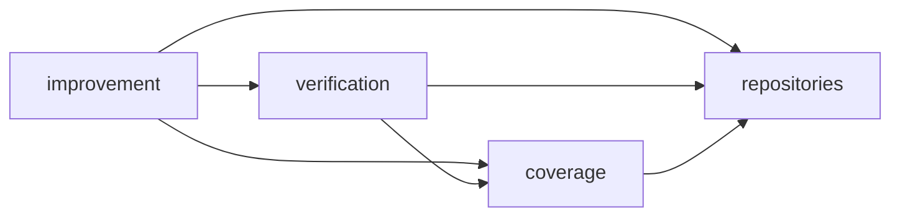
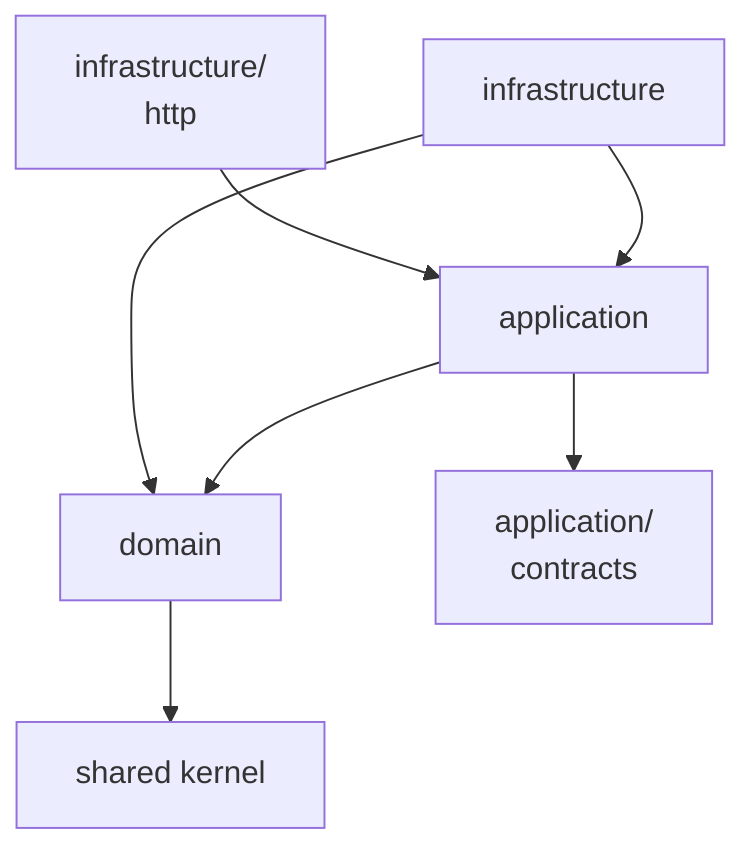

# Contributing

This guide is for a person who changes this repository. The rules are in
[AGENTS.md](../../AGENTS.md) and hold for a person and an AI agent alike.
This guide does not repeat them: it shows how to set up a clone, how to
run the gate and read it, how a commit and a branch are named, where code
and tests go, and what the policy is. The design behind the code is in
[System design](../plan/system-design.md), and why it is so in
[Decisions](../implementation/decisions.md).

## Set up a clone

1. Use Node.js 26. `.npmrc` makes npm refuse another version, and it
   runs no install script of any package.
2. Install the exact packages of the lockfile:

   ```sh
   npm ci
   ```

3. Switch on the hooks of the repository. git keeps hooks outside what it
   clones, so each clone needs this once:

   ```sh
   git config core.hooksPath harness/git
   ```

4. Run the quick part of the gate to see that the clone is sound:

   ```sh
   node harness/bin/check.ts fast
   ```

   It ends with `check fast: passed`.

From then on git runs the `fast` profile before each commit, holds each
commit message to the rules below, and runs the `full` profile before a
push. It refuses a push to `main` and a push that rewrites history.

## The gate

One command judges the tree. It takes a profile or the name of one step,
and `npm run check -- <name>` does the same:

```sh
node harness/bin/check.ts fast
node harness/bin/check.ts full
node harness/bin/check.ts lint
```

| Profile | When | Steps |
| --- | --- | --- |
| `fast` | After each small group of edits; before each commit | `format`, `lint`, `types`, `architecture` |
| `full` | Before you call the work done; before each push | `fast`, then `compare`, `unused`, `duplication`, `build`, `unit`, `integration`, `e2e`, `coverage`, `documents`, `secrets` |
| `ci` | In CI, or when a person asks for it | `full`, then `workflows`, `runners`, `stress`, `mutation` |

What each step holds:

| Step | What it checks |
| --- | --- |
| `format` | Prettier formatting of the code; Markdown is not formatted by it |
| `lint` | ESLint with no warning allowed: at most 50 lines a function, 8 branches, a depth of 3, 3 parameters, 300 lines a file, one class a file, sorted imports, no focused or skipped test |
| `types` | The TypeScript compiler over each project of the tree |
| `architecture` | The architecture rules described below, and the recorded lists of contracts and migrations |
| `compare` | The tree against the commit it stands on: a recorded migration may not change, and a limit may not loosen |
| `unused` | Files, exports and packages nothing uses (knip) |
| `duplication` | Copy and paste in TypeScript, at most 0.9% (jscpd) |
| `build` | The bundle of client and service into `dist/` |
| `unit`, `integration` | The tests of that kind, in every workspace and the harness |
| `e2e` | Builds, then runs the client and the service end to end |
| `coverage` | 95% of statements, branches, functions and lines in each area, with every source file in the report |
| `documents` | Markdown lint, lines of at most 80 characters, and links that lead somewhere |
| `secrets` | gitleaks over the commits and the files |
| `workflows` | actionlint and zizmor over the workflows |
| `runners` | Tests of the harness that start the real outside programs |
| `stress` | The service under load: a killed service, a storm of requests, a race of starts |
| `mutation` | StrykerJS over the harness, with a floor of 88% |

`secrets` and `workflows` download their program once into
`node_modules`, checked against the checksum the policy names. The
policy has them for macOS on Apple silicon and for Linux on x64.

A red step is fixed in the code. A step is never switched off, and no
limit or rule is changed to make the gate green, as
[AGENTS.md](../../AGENTS.md) says.

## The mutation step on a small machine

`mutation` takes minutes and a lot of memory. Three variables size it to
the machine. Set them in your shell or in a `.env` file at the root,
which git ignores; a variable of the shell wins over the file.
[.env.example](../../.env.example) lists them.

| Variable | Default | What it does |
| --- | --- | --- |
| `HARNESS_MUTATION_WORKERS` | 4, or the processors when fewer | Test runners at once |
| `HARNESS_MUTATION_MEMORY_MB` | 4096, at least 1280 | Memory of the whole run |
| `HARNESS_MUTATION_TIMEOUT_MS` | 15000 | Time a mutant may run past its expected time |

The step fits the runners to the memory $M$ in megabytes. With $W$ the
runners you asked for, it starts $w$ runners with a heap of $h$
megabytes each:

$$w = \min\left(W, \left\lfloor \frac{M - 512}{768} \right\rfloor\right)$$

$$h = \left\lfloor \frac{M - 512}{w} \right\rfloor - 256$$

Less memory gives fewer runners and a longer run, never a runner too
small to work. On a laptop with 8 GB, `HARNESS_MUTATION_MEMORY_MB=2048`
and `HARNESS_MUTATION_WORKERS=2` give two runners.

## Commits and branches

A commit is one logical step, and its message follows the Conventional
Commits rules in `harness/configs/commitlint.json`:

- the type is one of `build`, `chore`, `ci`, `docs`, `feat`, `fix`,
  `perf`, `refactor`, `revert`, `style` and `test`, in lower case;
- a scope is allowed only as `deps` or `deps-dev`;
- the subject starts in lower case and ends with no full stop;
- the header is at most 80 characters, and a body follows a blank line.

```text
fix: name the branch of a patch on the decision panel
chore(deps-dev): update the tools of the gate
```

A branch is named `type/short-description`, with a type of the list
above and a description in lower case words joined by hyphens, such as
`docs/guidelines`. Work goes to `dev`, and `dev` is merged into `main`.
Nobody pushes to `main`. CI checks the message of each new commit, and
the name of the branch of each pull request.

## The policy

The policy is what decides how the tree is judged: everything in
`harness/` except `harness/baseline.json`, every file at the root except
`README.md` and `package-lock.json`, every `tsconfig*.json`, `.github/`,
`.claude/` and `.codex/`. The list is `harness/policy/frozen.json`.

1. A change of the policy is the owner's call. Ask before you make one.
2. A change of the policy goes in a pull request of its own. The
   workflow `frozen.yml` runs from the default branch, so a pull request
   cannot change the check it is judged by, and it fails a pull request
   that mixes the two:

   ```text
   guard: a change of the policy and a change of anything else do not land together. Split them into two pull requests.
   ```

3. `harness/baseline.json` and `package-lock.json` may land on either
   side.

The baseline records lists, never a number: the public contracts of each
backend module and the checksum of each database migration. When you add
to a contract or add a migration, `architecture` asks you to record it:

```sh
npm run ratchet:write
```

A recorded migration is never edited: write a new one.

## Where code goes

The service is four modules. A module reaches another only through that
module's `application/contracts`, and only along these arrows:



Inside a module, each layer may import only the layers below it:



- `domain` holds entities, value objects and domain services, and knows
  the shared kernel alone.
- `application` holds commands, queries, their handlers and the ports.
- `infrastructure` holds adapters, persistence and schemas, and
  `infrastructure/http` the controllers, which reach the application
  and not the adapters.
- A file says what it is by its suffix, in its folder: `.entity.ts`,
  `.vo.ts`, `.service.ts`, `.error.ts`, `.repository.ts`, `.port.ts`,
  `.adapter.ts`, `.command.ts`, `.query.ts`, `.handler.ts`, `.dto.ts`,
  `.schema.ts` and `.controller.ts`.
- Names are in kebab-case. `index`, `utils`, `helpers`, `common` and
  `misc` are refused as names. Imports use the `#` aliases of each
  workspace and never a relative path.

The `architecture` step holds all of this, together with the folders of
the client, a file kind it does not know, and an import cycle. Its
finding names the rule and the file.

## Where tests go

Each workspace has a `tests/` folder with one folder for each kind:

| Folder | What it tests |
| --- | --- |
| `tests/unit/` | One class or function in memory, with no database, file, network or child process, through any chain of imports |
| `tests/integration/` | An adapter against the real thing it wraps |
| `tests/e2e/` | The built service and client together |
| `tests/stress/` | A guarantee of the service under load; the backend alone |
| `tests/support/` | Test doubles and builders; no tests |

- A test file ends in `.test.ts` or `.test.tsx`.
- The path under `tests/unit/` repeats the path under `src/`:
  `src/modules/coverage/domain/value-objects/coverage-percentage.vo.ts` is
  tested by
  `tests/unit/modules/coverage/domain/value-objects/coverage-percentage.vo.test.ts`.
- A test in any other folder is refused, since the gate would never run
  it.
- The outer `describe` names the unit, a nested `describe` names a method
  or a context that starts with `when`, and each `it` starts with
  `should`. No tool checks this naming, so a review does.
