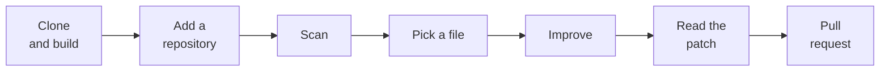

# First run

This guide is for a person who has never used coverage-autopilot. It
takes you from a fresh clone to a first pull request that adds tests to
one file of a GitHub repository: first through the screens, then along
the same path on the command line. The settings are in
[Settings](settings.md), and what can go wrong is in
[Troubleshooting](troubleshooting.md).



- Clone and build: once per clone, described in the next two sections.
- Add a repository, scan, pick a file: the Repositories and Files screens.
- Improve, read the patch: the Improvement and Patch screens.
- Pull request: the service pushes a branch and opens it for you.

## What you need

- Node.js 26. `package.json` accepts 26.1.0 and later versions of 26, and
  `.npmrc` makes npm refuse any other version.
- Docker, running. Every command of a repository and the AI CLI run in
  containers.
- git 2.36 or newer and the GitHub CLI `gh`, both on your `PATH`. The
  service reads the repository, pushes the branch and opens the pull
  request with your own git and gh.
- gh signed in to github.com: run `gh auth login`. git pushes with your
  own git configuration, so `git push` to GitHub must work from your
  shell. `gh auth setup-git` makes git use the login of gh.
- A token of your Claude Code subscription. Run `claude setup-token` with
  the Claude Code CLI on your machine and keep the token it prints. The
  CLI of the service runs in a container and cannot reach the login of
  your machine, so it needs this token. To pay with an API key instead,
  see [Settings](settings.md).

## Build the tool

1. Clone this repository and go into its folder.
2. Install the exact packages of the lockfile:

   ```sh
   npm ci
   ```

3. Build the client and the service into `dist/`:

   ```sh
   npm run build
   ```

   The last lines say `build: dist was written.` and
   `check build: passed`.

4. Give the token to this shell without writing it into the history.
   Paste the token and press `enter`; nothing shows while you paste:

   ```sh
   read -rs CLAUDE_CODE_OAUTH_TOKEN && export CLAUDE_CODE_OAUTH_TOKEN
   ```

5. Open the screens:

   ```sh
   npm start
   ```

   The client looks for the service and, when none answers, starts one in
   the background with the variables of this shell, the token among them.
   It waits up to 20 seconds for it. The service keeps running after you
   quit the client. A service that was started before you exported the
   token does not have it: see [Settings](settings.md) for a restart.

## Walk through the screens

The header names three sections, `Repositories`, `Improvements` and
`Service`, and says `● service up` on the right. The last line of the
screen lists the keys that work now. A few work everywhere: `1`, `2` and
`3` open a section, `?` shows every key, `:` lists the commands of the
screen, `esc` goes back and `q` quits.

1. Add a repository. On the Repositories screen press `a`. The dialog
   `Connect a repository` asks for the HTTPS address, such as
   `https://github.com/owner/name`. Press `enter`. The service connects it
   and runs the access check: `git installed`, `gh signed in` and
   `push access`. When every step passes, the dialog closes, the last line
   says `owner/name is connected.`, and the row says `not scanned` and
   `main · press s to scan`. When a step fails, the dialog shows
   `THE TOOL SAID` and `WHAT TO DO`. Fix it and press `enter` to check
   again.
2. Scan it. Press `s`. The row turns into a spinner and names the step:
   `cloning`, `installing the packages`, `running the tests`,
   `reading the report`, with the time spent and `updated 1s ago`. When
   the scan ends, the row shows the percent of lines, how many files are
   `below` the threshold, the commit and `scanned 1m ago`. Press `tab` for
   the panel of the repository: `COVERAGE` with the threshold and the
   lines, branches, functions and statements, `FILES` with the counts
   below and at or above it, and `WORK`.
3. Open its files. Press `enter`. The top line repeats the repository, the
   commit, the totals and the threshold. The list has four tabs, `Below`,
   `All`, `Not measured` and `No code`: `[` and `]` switch them and `/`
   filters by path. The panel beside the list shows the covered and total
   count of each counter, `NOT COVERED` with the lines, the open branches
   and the functions, `LATEST WORK`, and `NEXT` with `i improve this
   file`.
4. Start an improvement. Choose a file below the threshold and press `i`.
   The dialog `Improve <path>` checks the access again under `READY`.
   `LIMITS` shows `Attempts 3 up to 10` and `Time 30 min up to
   120 min`, and `Tokens no limit` under a subscription. `PUBLISHING` lets
   you choose `Wait for my approval` or `Open the pull request without
   asking`, and says where the result goes: `It goes to the repository
   itself.` or to a fork in your account. `tab`, `up` and `down` move
   between the fields, `-` and `+` or `left` and `right` change one,
   `enter` starts and `esc` closes.
   Keep `Wait for my approval` for a first run and press `enter`. The line
   `Nothing is spent until you start.` holds until then.
5. Watch the steps. The Improvement screen opens. The top line shows
   `Analyze`, each attempt and `Publish`, with the status and the time on
   the right. `Analyzing` measures the file again and counts the mutants
   no test detects. Each attempt writes a test, then runs seven checks:
   `only test files changed`, `project type-checks`, `new tests pass`,
   `earlier tests still pass`, `new tests pass on repeated runs`,
   `coverage of the file went up` and `mutants detected`. A rejected
   attempt says why, and the reasons go to the generator for the next
   attempt. The panel on the right shows what was `USED`, the `TARGET`,
   the `SETTINGS` and the `OUTPUT` files. `c` cancels and asks first.
   Closing the screens stops nothing: `q` says, for example,
   `1 improvement keeps running. See them with: coverage-autopilot list`.
6. Read the patch. When the status turns to `? REVIEW`, the history says
   `press p to read the patch and decide`. Press `p`. The Patch screen
   shows the diff on the left and the `Evidence` on the right: the
   accepted attempt and the patch hash, the coverage of the file before
   and after, the mutants the new tests detect, and every check with its
   time. `pgdn`, `pgup`, `j`, `k`, `g` and `G` scroll, and `[` and `]`
   move between files when the patch has more than one.
7. Approve it. The panel `Your decision` asks `Approve the patch and open
   the pull request?` with `1. Decide later`, `2. Approve and open the
   pull request` and `3. Reject the patch and cancel the improvement`.
   Pick `2` with the arrows or the digit and press `enter`. `esc` decides
   later.
8. Open the pull request. The status moves to publishing, then to
   `✓ DONE`. The Improvement screen says `✓ Pull request opened` with its
   address and the branch, `coverage-autopilot/<improvement id>`. `o`
   opens it in your browser, `p` shows the patch again and `n` goes on to
   the next file below the threshold.

## What the first run costs in time

The service starts to build its two container images as soon as it
starts, and does not wait for them. A first build takes minutes. The first
scan waits for the image of the sandbox, and the first improvement for the
image of the generator as well. Later runs reuse both, and an image is
built again only when the file the service ships for it changes.

Every scan clones the commit, installs the packages and runs every test
with coverage, so a large repository takes as long as its own test run.
An improvement does that once more for a fresh measurement, then installs
the mutation tool and runs it on the file before the first attempt. Each
attempt runs the seven checks, the tests three times and the mutation
tool once more. The whole improvement is held to its time limit, 30
minutes by default.

## The same path on the command line

Every screen has a command. `npm start --` passes the words after it to
the client. npm prints two lines of its own first, so a script that reads
the output runs `node dist/bin/client.js` instead, the same program.

```sh
npm start -- doctor
npm start -- repo add https://github.com/owner/name
npm start -- repo check owner/name
npm start -- scan owner/name --wait
npm start -- files owner/name
npm start -- improve owner/name src/billing/invoice.ts --review --wait
npm start -- list
npm start -- status <id>
npm start -- patch <id>
npm start -- approve <id> --hash <hash>
npm start -- cancel <id>
```

- `doctor` shows the service, the versions of the service and of the
  contract, the generator and who pays for it, the worker and the running
  work.
- `repo add` connects and prints one line: the name, `not scanned` and
  the branch. `repo check` prints each step, such as
  `✓ passed  git_present`, and then `publishes    to the repository
  itself`.
- `scan --wait` writes each step on standard error, such as
  `running      test_run`, and prints the four totals at the end, such as
  `lines       71.4%  1142/1600`.
- `files` prints one line for each file, the least covered first: path,
  percent, covered and total, `below 80.0%` or `at or above 80.0%`, and
  its latest improvement. `--below 70`, `--metric branches` and
  `--unmeasured` show other cuts.
- `improve` checks the access first and says where the result goes. With
  `--wait` it writes each change on standard error, such as
  `attempt 1    writing a test`. With `--review` it stops at the approval
  and prints the exact command that approves the patch you can read with
  `patch`. That command names the program `coverage-autopilot`; from a
  clone, type it after `npm start --`.
- Without `--review`, `improve` publishes the pull request without asking.
  The screens choose the approval first; the command line does not.
- `list` prints every improvement with its repository, status, id, file,
  age and next step. `status <id>` prints one with every attempt and its
  budget. `patch <id>` prints the hash and the diff.
- `approve <id> --hash <hash>` publishes the patch with that hash. The
  service refuses another hash, so you approve exactly what you read.
- `cancel <id>` cancels an improvement, or a scan with that id.

The exit code is `0` when the command did what was asked, and with
`--wait` when the work completed or was skipped. It is `1` when the work
failed or was cancelled, or the service could not be reached, and `2`
when the command line was wrong. `--json` prints the value of the
contract as one document. The next guide is
[Working with repositories](working-with-repositories.md).
