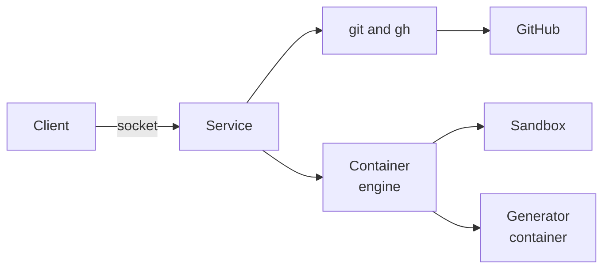

# Sandbox and secrets

This guide is for a person who wants to know what the service does with
the code of a repository and with their credentials before they connect
one: what runs where, what a container can and cannot reach, where each
token lives, and what the trusted install mode gives away. Every claim
here is what the code does. The variables named here are in
[Settings](settings.md).

## What runs where



- Client: the screens and the commands. It talks to the service over the
  socket `service.sock` in the instance folder. The folder and the socket
  are open to their owner alone.
- Service: one process on your machine, as your user. It never runs code
  of a repository itself.
- git and gh: your own programs, on the host. They fetch the repository,
  push the branch and open the pull request with your login.
- Sandbox: one container for each command of a repository: the install,
  the tests, the type check and the mutation tool.
- Generator container: Claude Code, which writes the tests. It runs in a
  second kind of container, with the same engine, user and limits.

The service clones a repository into a bare mirror under the instance
folder, and makes a working copy for each piece of work from that mirror.
A working copy has two folders: the files of the commit, and its git
folder beside them. A container gets the files alone.

## What a container gets

Every container, of either kind, starts with these limits:

- no capability, and no way to gain a privilege;
- a user that is not root, the user of the service unless
  `AUTOPILOT_SANDBOX_UID` and `AUTOPILOT_SANDBOX_GID` name another; the
  service refuses `0`;
- a root file system it cannot write;
- one mount, the files of the working copy, at the path they have on the
  host; no socket of the engine, no data of the service, no git folder
  and no file of your home;
- a `/tmp` in memory of `AUTOPILOT_SANDBOX_SCRATCH_MB`, which is also the
  home folder of every command;
- memory, swap included, processors and processes held to the limits of
  [Settings](settings.md);
- an image that is never pulled at the time of the run.

A command of a repository gets exactly three variables, `PATH`,
`HOME=/tmp` and `CI=true`, and the install gets the settings of its
package manager as well. The engine reads them from standard input, so
they are not on its command line. No credential is among them.

Each container is removed when its command ends, on every path. A
container that might survive is a fault, `sandbox_container_left`. When
the service starts, it removes the containers and working copies that a
service of the same folder left behind, and never a mirror.

## When a container has the network

| Command | Network |
| --- | --- |
| The install of the packages | Open |
| The install of the mutation tool, with no script | Open |
| Claude Code, the generator | Open |
| Every run of the tests, in a scan and in an improvement | None |
| The type check | None |
| Every run of the mutation tool | None |

The install is the one command of a repository with the network. In the
default mode, `sandboxed`, no code of the repository or of its packages
runs while it has it: scripts are off for every manager, and a project
whose install would run code all the same is refused with
`install_runs_code`. The tests run later, with no network at all, which
is why tests that call the network fail in the sandbox.

## What trusted changes

`repo trust owner/name trusted`, or `AUTOPILOT_INSTALL=trusted` for every
repository, changes the install alone. It runs as the developers of the
project run it: the install scripts of the repository and of its
packages, a `.pnpmfile.cjs`, the `yarnPath` and plugins of yarn, and
packages built from git.

That code runs with the network open and can read the working copy, so
it can send the code of the repository away. It cannot reach a
credential of your computer, since none is in the container, and every
other limit holds: no network after the install, no root, no mount but
the copy, and the same memory and processes. Trust a repository only
when you would run `npm install` in it on your own machine.

## Where your tokens live

| Token | Where it is | Who gets it |
| --- | --- | --- |
| `CLAUDE_CODE_OAUTH_TOKEN` or `ANTHROPIC_API_KEY` | The environment of the shell, the client, then the service it starts | The generator container alone |
| The login of gh | The configuration of gh under your home, or its keyring, or `GH_TOKEN` | gh on the host alone |
| The credentials of git | Your git configuration and its credential helper | git on the host alone, to fetch and push |

The service stores no token. No token enters a sandbox of a command, so
the output of a command cannot hold one. The output of git and gh that
the service keeps has the values of `GH_TOKEN` and `GITHUB_TOKEN` hidden,
and the output of the generator has its credential replaced.

The service starts gh and git with a short list of variables, and the
engine program with another; [Settings](settings.md) names them. git on
the host turns off any hook and file system monitor your configuration
names, for every call:

```sh
git -c core.hooksPath=/dev/null -c core.fsmonitor=false ...
```

git on a working copy reads no global or system configuration at all.
A file of the repository, such as `.gitattributes`, therefore cannot
start a filter or a driver that your own configuration defines.

## What the generator container gets

The generator runs Claude Code with the network open, since it calls the
model, and with your credential in its environment. Everything else is
held down:

- Its variables are `PATH`, the one credential variable,
  `HOME=/tmp`, `CLAUDE_CONFIG_DIR=/tmp/.claude` and
  `CLAUDE_CODE_DISABLE_CLAUDE_MDS=1`, so no `CLAUDE.md` of the
  repository is read.
- It starts with `--restricted`, the tools `Read`, `Write`, `Edit`, `Glob`
  and `Grep` alone, no shell and no tool of the web, edits taken without
  a prompt, no tool server, every hook off, reads outside the working
  copy blocked, and no session kept.
- After the run, the service reads the report the CLI gave at its start.
  A start with other tools or with a tool server is a fault, and nothing
  the run wrote is used.
- The service lists the working copy before and after the run, and
  searches each file the run wrote, up to 100 files of up to 1 MiB each,
  for the exact value of the credential. A hit ends the improvement with
  `credential_exposed`, and nothing the run wrote is kept.
- A run that writes a `.git` into the copy was steered by content of the
  repository. It ends the same way, with `credential_exposed`, because it
  held the credential while it obeyed.
- The raw output is stored with the credential replaced.

After `credential_exposed`, treat the credential as known to others:
make a new one with `claude setup-token` or a new key, export it, and
restart the service as [Settings](settings.md) shows.

## How the pull request is published

Publishing happens on the host, with your git and your gh, never in a
container.

1. gh asks GitHub whether your account may push to the repository.
2. The service clones the commit the work started from into a clean
   folder made for this alone, never one a test or the generator
   touched, and applies the stored patch there.
3. git commits it as `AUTOPILOT_GIT_AUTHOR_NAME` and
   `AUTOPILOT_GIT_AUTHOR_EMAIL`, and pushes the branch
   `coverage-autopilot/<improvement id>` with your credentials.
4. gh opens the pull request: in the repository when your account may
   push to it, or else in a fork in your account.

Each step first looks for what an earlier try made, so a repeated
publication pushes nothing new and opens nothing new. In review mode,
the service publishes only the patch whose hash you approved.

## What is logged and stored

The log is one JSON object a line, with `time`, `level`, `message` and
`fields`. When the client started the service, the log is
`service.log` in the instance folder. At `AUTOPILOT_LOG_LEVEL=debug`
there is one line `A program ended.` for each program the service
starts, with the program, its arguments, its exit code and how long it
ran. Arguments that may carry a prompt or the text of a file are left
out, and the line never holds the environment, the input or the output.
The values of `GH_TOKEN`, `GITHUB_TOKEN`, `ANTHROPIC_API_KEY`,
`ANTHROPIC_AUTH_TOKEN` and `CLAUDE_CODE_OAUTH_TOKEN` are replaced with
`[redacted]` wherever they would appear in a line.

The output of each command is stored under `artifacts/` in the instance
folder, in folders only you can read and files only you can read and
write. It holds what the tools printed, and so what the tests of the
repository printed. How to read it is in
[Troubleshooting](troubleshooting.md).

## See it for yourself

1. Export `AUTOPILOT_LOG_LEVEL=debug` and start the service with it, as
   [Settings](settings.md) shows.
2. Scan a repository: `npm start -- scan owner/name --wait`.
3. Read the lines of the engine program:

   ```sh
   grep '"program":"docker"' ~/.coverage-autopilot/service.log
   ```

   Each `run` line shows the arguments of one container: `--cap-drop ALL`,
   `--read-only`, the `--mount` of the working copy, the limits, and
   `--network none` on every run of the tests. The command inside the
   container is shown by its program alone, since its arguments may carry
   a prompt.
