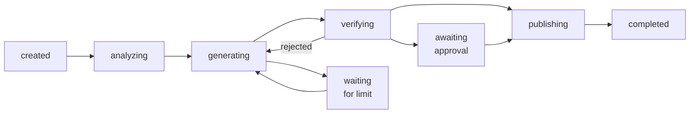

# Working with repositories

This guide is for a person who has made a first run and wants to know
what the service does with a repository: what the access check proves,
what a scan measures, how the threshold and the install mode are chosen,
which projects are refused, and how an improvement becomes a pull
request. [First run](first-run.md) shows the keys and the commands.

## Connect and check access

A repository is named by its HTTPS address on github.com, such as
`https://github.com/owner/name`, with or without `.git` and a trailing
slash. An address with a user, a password, a port, a query or a fragment
is refused, and so is any other host. The same owner and name typed again,
in any case of letters, give the repository that was connected first.

The access check runs when you connect in the screens, before every start
of an improvement, and with `repo check owner/name`. It has three steps,
and a step that fails stops the ones after it, which say `not checked`.

1. `git_present`: git is on the `PATH` of the service and is 2.36 or
   newer. Every call of git turns off its file system monitor, which an
   older git cannot do.
2. `gh_authenticated`: gh is logged in to github.com. The step keeps what
   gh answered, which the screens show under `THE TOOL SAID`.
3. `push_allowed`: gh asks GitHub whether your account may push to the
   repository, and git reads the head of its default branch. The step
   fails when the branch is gone. The head is kept, so the list can say
   `outdated: main moved since the scan` without asking GitHub again.

The last step decides where results go. When your account may push, a
branch and a pull request go to the repository itself. When it may not,
they go to a fork in your account, named by your gh login. The screens
say `It goes to a fork in the account <login>.` and `repo check` prints
`publishes    to a fork in the account <login>`. A pull request is never
opened in a repository your account may not push to.

Publishing to a fork asks GitHub for the fork each time, so a second run
makes no second fork, and waits up to 60 seconds for git to reach a new
one. It pushes the branch of the tests and a branch
`coverage-autopilot/base-<commit>` at the commit the work started from,
and opens the pull request between the two, in the fork.

## Scans and snapshots

A scan is a job of the queue, and one repository runs one job at a time.
Its four steps, `clone`, `install`, `test_run` and `read_report`, clone
the head of the default branch into a working copy of its own, install
the locked packages, run every test with coverage and read the report.
The working copy is removed afterwards.

A finished scan stores a snapshot. It holds:

- the commit, the test runner and its locked version, the package
  manager, the configuration file of the runner, the coverage provider,
  and the rule that chose the files, `typescript-sources-v2`;
- for each measured file, the covered and total lines, branches,
  functions and statements, and which of them no test runs;
- the files that could not be measured, each with its reason;
- how many tests ran and failed, and where their raw output is kept.

A snapshot is judged by the threshold of its repository when it is read,
so a new threshold judges every snapshot again at once.

## Which files are measured

A file counts when it ends in `.ts`, `.tsx`, `.mts` or `.cts`. These are
left out, because they hold nothing to test or are not part of the
product:

- declarations, such as `.d.ts` and `.d.mts`, tests, such as `.test.ts`,
  `.spec.tsx` and `.test.mts`, and tool settings, such as `.config.ts`;
- folders whose name starts with a dot, and folders named exactly
  `node_modules`, `dist`, `build`, `out`, `coverage`, `test`, `tests`,
  `__tests__` or `__mocks__`;
- folders of code that calls the product from outside, in any case of
  letters: `examples`, `example`, `demos`, `demo`, `samples`, `sample`,
  `benchmarks`, `benchmark`, `bench`, `fixtures` and `__fixtures__`.

A link is not followed. The coverage settings of the project are not
read, because a configuration in JavaScript would have to run to be read,
and no code of the repository runs on the host.

A file is in one of three states. `measured` has numbers. `no code`, shown
as `0/0`, holds only types and interfaces, imports and exports of types,
or `declare` statements. `not measured`, shown as `N/A`, has no numbers
and is not at 0%: `parse_failed` means a syntax error,
`missing_from_report` means the runner left the file out of its report,
and `no_counters` means it was reported without numbers. Only a measured
file can be improved.

## The threshold

A file below the threshold can be improved. The threshold is a whole
percent of lines from 1 to 100. The service default is 80, set by
`AUTOPILOT_COVERAGE_THRESHOLD`. To give one repository its own:

```sh
npm start -- repo threshold owner/name 90
npm start -- repo threshold owner/name default
```

The first prints `owner/name  threshold 90.0% of lines  own`, and
`default` gives the service default back. In the screens, `t` opens a
`Percent` field: type a number and press `enter`, or leave it empty for
the default. `files owner/name --below 70` or `--metric branches` show
another cut without changing anything.

## The install mode

The install of the packages is the one command of a repository that has
the network. How it runs is the install mode, `sandboxed` by default
(`AUTOPILOT_INSTALL`). To choose for one repository:

```sh
npm start -- repo trust owner/name trusted
npm start -- repo trust owner/name sandboxed
npm start -- repo trust owner/name default
```

In the screens, the command `Choose how it is installed` (`i` on a
repository, listed under `:`) opens the same choice. The mode counts from
the next working copy, and a trusted repository is marked
`trusted install` wherever it shows.

Sandboxed, no code of the repository or of its packages runs while the
network is open. npm runs `npm ci --ignore-scripts`. pnpm runs with
`--ignore-scripts --ignore-pnpmfile`. yarn 1 runs with `--ignore-scripts`
and ignores a `yarn-path` of the repository. yarn 2 and later read the
settings of the repository without `yarnPath`, `plugins` and
`enableConstraintsChecks`, with scripts off and `--mode=skip-build`.
A project whose install would run code all the same is refused with
`install_runs_code`, and the message ends with the `repo trust` command
that lifts it: a package taken from a git repository, the
`configDependencies` of pnpm, a lockfile written with the hooks of a
`.pnpmfile.cjs`, a yarn package that a script makes, or yarn settings the
service cannot read.

Trusted, the install runs as the developers of the repository run it:
the scripts of the repository and of its packages, a `.pnpmfile.cjs`,
the `yarnPath` and plugins of yarn, and packages built from git, all
while the network is open. That code can send away what is in the working
copy. Trusted changes the install alone. These stay forbidden, as
[Sandbox and secrets](sandbox-and-secrets.md) explains:

- the network for every later command: tests, type check and mutations;
- any credential of your computer, the socket of Docker, and the data of
  the service;
- root, new privileges, and writing outside the copy and `/tmp`;
- more memory, processors and processes than the limits allow;
- an install with Plug'n'Play, which is refused in both modes.

## Tests that fail in the sandbox

Tests that call the network or need a credential fail in the sandbox.
A scan still measures what ran, and says so: `repo list` adds
`2 of 120 tests fail in the sandbox`, and `scan --wait` prints the same
line after the totals.

An improvement leaves such tests out of its checks and of the mutation
runs while `AUTOPILOT_BASELINE_TESTS` is `may_fail`, the default. With
`must_pass`, one failing test ends the improvement at its analysis with
`existing_tests_fail`. A runner that fails and names no failed test ends
it with `existing_tests_fail` in both modes, since no test can be left
out.

## npm, yarn and pnpm

A project of one package is supported, installed with npm, pnpm or yarn
and tested with Jest or Vitest. Vitest needs `@vitest/coverage-v8` or
`@vitest/coverage-istanbul`; Jest measures with Babel.

The manager is the one the `packageManager` field of `package.json` names
with an exact version, or else the one whose lockfile is in the
repository: `package-lock.json` or `npm-shrinkwrap.json`,
`pnpm-lock.yaml`, or `yarn.lock`. Its lockfile must be there, since it
decides every version. npm is the one in the image. Corepack fetches the
exact pnpm or yarn the field names while the install has the network.
Without a field, the service takes the pnpm or yarn that writes the format
of the lockfile.

A project the service cannot measure fails its scan with
`unsupported_project` and a sentence that names the reason. The reasons
and what to do about each are in [Troubleshooting](troubleshooting.md).

## Improve a file



- `analyzing` checks that the file did not change on the default branch
  since the snapshot (`stale_snapshot` otherwise), measures it again, and
  skips with `threshold_met` when it is no longer below the threshold. It
  then counts the mutants no test detects, and skips with
  `no_undetected_mutants` when there are none.
- `generating` starts Claude Code, which may only read, write, edit and
  search files. A patch may only add new files that end in `.test.ts` or
  `.test.tsx`.
- `verifying` runs the seven checks. A rejected patch sends its reasons
  to the next attempt while the budget allows one.
- `waiting_for_limit` and `awaiting_approval` spend none of the budget.
- Any step that is not final may end in `failed` or `cancelled`.

The mutation check counts $U$, the mutants no existing test detects,
$\Delta K$, those of them the new tests kill, and $M$, those of them a new
test runs, timeouts left out. The share of 50% is fixed. It passes when:

$$\Delta K \ge 1 \quad \text{and} \quad \Delta K \ge 0.5 \cdot M$$

A start that is refused spends nothing. The refusals, such as
`improvement_in_progress` for a file that is improved already, are in
[Troubleshooting](troubleshooting.md).

## Review mode and approval

Review mode stops before publishing and waits for you. The screens choose
it first; the command line takes it with `--review` and otherwise
publishes without asking. Read the patch with `p` in the screens or
`patch <id>`, and approve with answer `2` or with
`approve <id> --hash <hash>`. The hash is the one of the patch you read:
the service refuses another with `patch_hash_mismatch`, and the screen
then loads the patch again. Rejecting the patch cancels the improvement.

## Cancel, and go on

`c` on the Improvement screen or in the Improvements list asks first,
then cancels. `cancel <id>` does the same for an improvement or a scan.
Attempts and tokens already spent do not come back, and nothing is
published. Work that had ended stays as it was.

After an ending, `n` opens the start dialog of the next file of the same
snapshot that is below the threshold and has no improvement yet, in the
order of the files list, or says
`No other file below the threshold waits for work.` A failed improvement
whose budget ran out offers `Request it again with larger limits`, one
step above each earlier limit.

## Where the results are

The address of the pull request is on the Improvement screen, in the
`DONE` row of `list`, and in `status <id>`. The raw output of every tool
is kept under `~/.coverage-autopilot/artifacts/`, and the `OUTPUT` section
of the Improvement screen lists the files of an improvement. How to find
and read them is in [Troubleshooting](troubleshooting.md).
