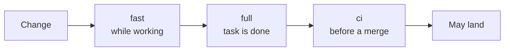
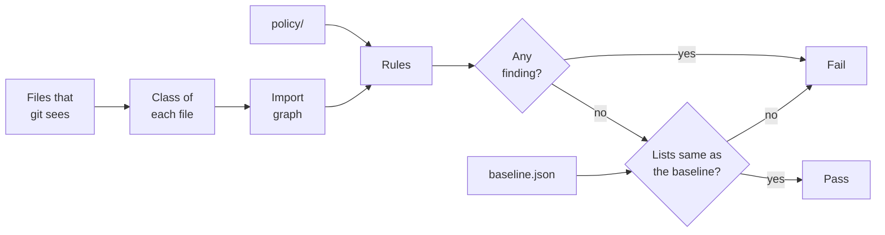

# Harness

Author: Valentin Daitkhe

The harness is the set of checks that decides whether a change may land.
Every rule of this project is held by a tool that gives the same answer on
every machine. The tools, their configuration and the settings of the AI
agent live in one folder, `harness/`. This document describes that folder,
lists the rules with the tool behind each one, names the tests the design
depends on, and says what three trial runs showed. It builds on
[Project structure](project-structure.md) and
[System design](system-design.md).

This is the description. The files in `harness/` will be the policy itself,
and where the two disagree the files win.

## Principles

1. **A rule has a mechanism.** A rule that no tool checks is listed apart,
   under [Rules a tool cannot hold](#rules-a-tool-cannot-hold), and that
   list is kept short.
2. **The same tree gives the same verdict.** No check of the `fast` and
   `full` gates uses the network, the clock, a random number or a language
   model. Tool versions are exact. The stress tests are the one exception,
   and they are kept apart for that reason.
3. **Zero, from the first commit and after.** Every rule is an error. There
   are no warnings and no list of known findings. A rule added later
   arrives after the code already passes it.
4. **Numbers move one way.** A floor can rise and a ceiling can fall. A
   number that went green because its limit moved is worse than a red one.
5. **One command.** `harness/bin/check.ts` with a profile is what a hook,
   an agent and CI start. Nothing passes in one place and fails in another.
6. **An exception is written in the policy**, as a group of files with a
   reason. A comment in the code cannot turn a rule off.
7. **A change does not choose the rules it is judged by.** A change of the
   policy and a change of the code never land together.
8. **A check that did not run has failed.** A missing report, a partial
   report or a missing baseline is a failure, not a pass.

## The harness folder

```text
harness/
├── bin/
│   ├── check.ts
│   ├── ratchet.ts
│   ├── types.ts
│   ├── coverage.ts
│   ├── duplication.ts
│   ├── documents.ts
│   ├── mutation.ts
│   ├── before-push.ts
│   └── guard.ts
├── policy/
│   ├── structure.json
│   ├── packages.json
│   ├── mutation.json
│   ├── frozen.json
│   └── limits.json
├── baseline.json
├── architecture/
│   ├── files.ts
│   ├── load-project.ts
│   ├── imports.ts
│   ├── exports.ts
│   ├── aliases.ts
│   ├── places.ts
│   ├── patterns.ts
│   ├── edges.ts
│   ├── graph.ts
│   ├── import-rule.ts
│   ├── rules.ts
│   ├── rules/
│   ├── lists.ts
│   ├── baseline.ts
│   ├── limit-changes.ts
│   ├── git.ts
│   ├── commands.ts
│   └── ratchet-command.ts
├── gate/
│   ├── steps.ts
│   ├── tools.ts
│   ├── host.ts
│   ├── exit-code.ts
│   ├── run-gate.ts
│   ├── run-types.ts
│   ├── type-projects.ts
│   ├── run-coverage.ts
│   ├── coverage-files.ts
│   ├── run-duplication.ts
│   ├── run-documents.ts
│   └── run-mutation.ts
├── documents/
│   └── links.ts
├── mutation/
│   ├── report.ts
│   ├── kill-rate.ts
│   ├── verdict.ts
│   └── resources.ts
├── eslint/
│   ├── config.ts
│   └── rules/
├── configs/
├── shared/
├── agents/
│   ├── hooks/
│   │   ├── before-command.ts
│   │   ├── before-edit.ts
│   │   └── done.ts
│   ├── before-command.ts
│   ├── denied-command.ts
│   ├── shell-words.ts
│   ├── before-edit.ts
│   ├── edit-of-policy.ts
│   ├── edited-files.ts
│   ├── when-done.ts
│   ├── done-verdict.ts
│   ├── tree.ts
│   ├── last-verdict.ts
│   ├── full-gate.ts
│   ├── red-step.ts
│   ├── before-push.ts
│   ├── hook-call.ts
│   ├── hook-answers.ts
│   ├── claude/
│   │   └── settings.json
│   └── codex/
│       └── hooks.json
├── git/
│   ├── pre-commit
│   └── pre-push
├── fixtures/
└── tests/
    ├── unit/
    ├── integration/
    ├── runners/
    └── support/
```

| Part | Holds |
| --- | --- |
| `bin/` | What a person, a hook or CI starts. `check.ts` is the gate. `ratchet.ts` is the architecture linter. `types.ts` runs the compiler on the root and on every workspace that has source. `coverage.ts` measures coverage and checks the report. `documents.ts` lints the documents and checks their links. Each of these files is one line that calls a function, so the code behind it is tested in the same process. `mutation.ts` reads the report of a mutation run and gives the verdict. `before-push.ts` is what git runs before a push. `guard.ts` sorts the files of a change into policy and the rest |
| `policy/` | The rules as data, written by hand. `structure.json` has the modules, the layers, who may import whom and which folder a file suffix belongs to. `packages.json` has every outside package and where it may be imported. `mutation.json` has the runs of the mutation engine and the areas each report is read for. `frozen.json` names the files that are policy. `limits.json` has every number |
| `baseline.json` | The lists the ratchet recorded last. Written by the ratchet and never by hand |
| `architecture/` | The code of the ratchet. `rules.ts` is the list of rules, and a rule that is not in it does not run. `commands.ts` holds check, write and compare |
| `gate/` | The steps of the gate and its profiles, as data that a test can read. `tools.ts` has the path of every tool. `host.ts` is what a command needs from the machine: a tree, a way to start a program, a way to print, its settings and the number of its processors. It is the only file that reads the environment. A test gives a stand-in |
| `documents/` | The link check of the documents |
| `mutation/` | Reading a report of the mutation engine, the kill rate and the verdict of an area. `resources.ts` works out how many test runners a machine starts |
| `shared/` | Reading the files of `policy/`, the answer to whether a file is policy, and the one error class of the harness |
| `eslint/` | The lint configuration and the project's own lint rules |
| `configs/` | The configuration of every other tool: TypeScript base, Prettier, Knip, Vitest, StrykerJS, jscpd, commitlint, markdownlint |
| `agents/` | What holds whoever changes the tree: an agent of any maker, or a person. The checks are written once and know no agent. `hooks/` has the three files of one line that an agent starts. `claude/` and `codex/` hold nothing but the settings file of that agent, which names those hooks |
| `git/` | The hooks of git: before a commit and before a push. They hold a person and an agent alike |
| `fixtures/` | Small repositories, some wrong on purpose and some right. The harness is tested on them. `projects/` has one small project for Jest and one for Vitest, each with a file no test imports, a file of types alone and a file that cannot be parsed |
| `tests/` | The tests of the harness itself. `runners/` starts the real test runners on the fixture projects. Those tests run no code of the harness, so coverage and mutation leave them out |

- The harness is TypeScript and Node runs it as it is, with no build step.
  That limits it to syntax that can be erased: no `enum`, no parameter
  properties. The compiler holds this with `erasableSyntaxOnly`.
- It belongs to the root package. The root `package.json` lists the tools
  with exact versions and has one alias, `#harness/*`. That file is part of
  the policy, because it says which tools run and where the alias leads.
- The harness obeys its own rules: the same formatting, lint, types,
  coverage floor and mutation tests as the product code. Only `fixtures/`
  is left out.
- `check.ts` gives every tool the path of its configuration, so no tool
  goes looking for one. A file of one line at the root points an editor to
  the same configuration. Nothing at the root holds a rule.

## The gate



The gate has three profiles. Each one holds the one before it.

| Profile | Run when | Takes |
| --- | --- | --- |
| `fast` | After a small group of edits, and before a commit | Seconds |
| `full` | When an agent says its task is done, and before a push | Minutes |
| `ci` | Before a merge | Longer. Its jobs run side by side |

| Step | Tool | Fails when | From |
| --- | --- | --- | --- |
| Format | Prettier | A file differs from its formatted form | `fast` |
| Lint | ESLint with typescript-eslint | There is any finding | `fast` |
| Types | `tsc --noEmit`, once for the root and once for each workspace | There is any error | `fast` |
| Architecture | The ratchet | A rule has a finding, or the lists differ from the baseline | `fast` |
| Compare | The ratchet, `--compare` | A recorded migration changed, or a limit got looser than the base has it | `full` |
| Unused code | Knip | A file, an export or a dependency is unused, or a dependency is not declared | `full` |
| Copy and paste | jscpd | Duplication is above its ceiling | `full` |
| Unit tests | Vitest | A test fails | `full` |
| Integration tests | Vitest | A test fails | `full` |
| Coverage | Vitest over the unit and the integration tests, then a check of the report | A counter is below its floor, or a source file is not in the report | `full` |
| Build | `tsc` | The build fails | `full` |
| Documents | markdownlint, a link check that stays offline | A rule is broken, or a link or an anchor points nowhere | `full` |
| Secrets | gitleaks | Something that looks like a credential is in the diff | `full` |
| End-to-end tests | Vitest | A test fails | `ci` |
| Stress tests | Vitest | An invariant is broken | `ci` |
| Runners | Jest and Vitest, started on the fixture projects | A runner no longer reports coverage the way the design relies on | `ci` |
| Mutation tests | StrykerJS with its Vitest runner, `mutation.ts` | A kill rate is below its floor, or the report is not complete | `ci` |
| Workflows | actionlint, zizmor | An action is not pinned to a commit, or a job has more permissions than it uses | `ci` |
| Frozen files | A workflow that GitHub takes from the default branch | A change touches the policy and something else | `ci` |
| Commit message | commitlint | The message is not a Conventional Commit | On commit, `ci` |

- `node harness/bin/check.ts fast` runs the steps of a profile in this
  order and stops at the first red one. It can also run one step by name,
  and that is what a job of CI calls. The hooks and CI start it by its
  path. `npm run check` is a shortcut for a person and nothing depends on
  it.
- The `fast` profile formats and lints staged files only. Types and the
  ratchet always look at the whole tree, because one file can break another.
- An agent is not done after `fast`. Code can pass lint and types and still
  break a transaction, a cancellation or a recovery, so the task ends with
  `full`.
- A step never repairs anything. Formatting is fixed by a separate command.
- The gate remembers a hash of the tree it last passed and does not judge
  the same tree twice. This is safe only because of principle 2.

One tool holds one concern. A second tool for the same concern is not added.

| Concern | Tool | Version tried |
| --- | --- | --- |
| Formatting | Prettier | 3.10.1 |
| Structure, layers, modules, cycles, packages, frozen lists | The ratchet, on the TypeScript parser | 6.0.3 |
| Language, size, naming, banned syntax | ESLint | 10.15.0 |
| Type-aware rules | typescript-eslint | 8.73.0 |
| Types | TypeScript | 6.0.3 |
| Unused code and dependencies | Knip | 6.47.0 |
| Tests and coverage | Vitest, with `@vitest/coverage-v8` | 4.1.12 |
| Rendering the client in a test | `ink-testing-library` | 4.0.0, with Ink 8.0.0 |
| Mutation tests | StrykerJS as the engine, with `@stryker-mutator/vitest-runner` | 10.1.1, on the harness itself |
| The second runner of the fixture projects | Jest, with `@swc/jest` | 30.5.2 |
| Copy and paste | jscpd | 5.4.3 |
| Documents | markdownlint-cli2, and the harness's own link check | 0.24.2 |
| Focused and skipped tests | `@vitest/eslint-plugin` | 1.6.28 |
| Commit messages | commitlint | Not tried yet |
| Git hooks | Two files of the project's own in `harness/git/` | None |

## The ratchet

The ratchet is the architecture linter. It answers one question: is the
shape of the repository still the one this project agreed on. It is the
project's own tool, because the shape is the project's own.



1. **Files.** It takes the tracked files and the new files that git does
   not ignore, sorted. A file counts from the moment it is written, not
   from `git add`.
2. **Class.** Each file gets a class from its path: workspace, module,
   layer, role, and whether it is source or a test.
3. **Imports.** Each file is read with the TypeScript parser. No type
   checker runs, so a file with a type error is still measured. Every import
   is followed through the aliases to the file it names. A re-export and
   `import()` count as imports.
4. **Two graphs.** Every import is an edge of the design graph. An import
   that is not `import type` is also an edge of the runtime graph. The
   compiler runs with `verbatimModuleSyntax`, so what the text says is what
   Node loads.
5. **Rules.** Each rule looks at the classes, a graph and `policy/`, and
   gives findings. A rule is one small file. A finding is an error.
6. **Lists.** A few facts are collected and compared with `baseline.json`.

A rule here is about the file an import leads to, not about the text of the
import. The ratchet also sees the whole graph, so it can hold rules that a
linter of single files cannot: a cycle, or what a test reaches through a
chain of imports.

### What it checks

A tick means the rule was planted as a violation and the ratchet reported
it, in the trial run or in a fixture of the repository.

| Rule | Fails when | Graph | Tried |
| --- | --- | --- | --- |
| `unknown-module` | A folder under `modules/` is not one of the four modules | | ✓ |
| `unknown-layer` | A module has a folder that is not one of the five layers. Or the shared code has a folder the policy does not list. Or a file of the service is in none of its places: a module, a shared folder, the root of the source | | ✓ |
| `misplaced-file` | A suffix is outside its folder: `.entity.ts` outside `domain/entities/`, `.adapter.ts` outside `infrastructure/`. Or the root of a module holds a file other than its `<module>.module.ts` | | ✓ |
| `file-name` | A name is not kebab-case, or it is `index.ts`, `utils`, `helpers`, `common` or `misc` | | ✓ |
| `relative-import` | An import starts with a dot, `./` included | Design | ✓ |
| `unresolved-import` | An alias leads to no file | Design | ✓ |
| `layer-direction` | A layer imports a layer or a shared folder it may not: `domain` imports `infrastructure`, `application` imports `presentation`. Or the shared code imports a module, or a shared folder imports one above it | Design | ✓ |
| `module-boundary` | A module imports another module outside its `contracts/`, or from a layer other than `application` and `contracts`. Or a module file or a root file of the service imports inside a module instead of its module file | Design | ✓ |
| `module-direction` | A module uses a module it is not allowed to use, such as `repositories` using `coverage` | Design | ✓ |
| `package-placement` | A package or a `node:` module is imported where `packages.json` does not allow it, or a `package.json` declares a package that is not in `packages.json` | Design | ✓ |
| `import-cycle` | Files import each other in a circle | Design | ✓ |
| `workspace-boundary` | An alias leads from one workspace into another, or between a workspace and the root. As a package only `api-contracts` is listed, so `package-placement` refuses the other ways across | Design | ✓ |
| `client-direction` | A folder of the client imports one that the table in [Project structure](project-structure.md#frontend-folders) does not allow: a command imports a screen, `api/` imports a component, a screen imports another screen. Or a component reaches `api/` through a chain of imports | Design | |
| `package-manifest` | The `package.json` of a workspace has a field the policy does not list, such as `scripts` or `overrides`. Or its aliases differ from the alias table, or a version is not one exact number. Or a workspace has a second `package.json` below its root | | ✓ |
| `lockfile-source` | An entry of the lockfile does not come from the npm registry under its own name and version, or has no checksum. A `file:` path, a `git` address and a bare archive address are refused | | |
| `unknown-file` | A workspace holds a file of a kind that `structure.json` does not list for that place, such as a second configuration of a tool. Or the repository holds a symbolic link that the policy does not list with its target | | |
| `test-placement` | A `.test.ts` file is outside `tests/`, a file under `tests/unit/` has no source file on the same path, or `tests/support/` holds a test | | |
| `unit-test-reach` | A unit test reaches, through any chain of imports, a file of `infrastructure` or a `node:` module that does I/O | Runtime | |

- A type imported across a boundary is a dependency of the design, so the
  boundary rules read the design graph. `import type` does not get around
  a module boundary.
- A type is not I/O. A unit test that only imports a type from
  `infrastructure` runs nothing of it, so `unit-test-reach` reads the
  runtime graph.
- `client-direction` checks two things. Each import must be in the table,
  and no chain of imports may lead from `components/` or `hooks/` to
  `api/`. The table alone already makes such a chain impossible. The
  second check keeps it so when the table changes.
- A symbolic link is read as a link and never followed. The path of a file
  says where it is, and for a link that is not enough: its target is
  checked too. The project has two links, `.claude/settings.json` and
  `.codex/hooks.json`, and the target of each is inside `harness/`.

`lockfile-source` says where a package comes from and that what is
downloaded is what the lockfile names. It does not say that the package is
safe. A harmful version that the policy allowed is still harmful. This rule
is not a scan of dependencies, and the project has none.

`package-placement` holds several rules of
[Project structure](project-structure.md#dependency-rules) at once. In
`packages.json` every outside package has the places where it may be
imported:

- `domain` and `contracts` import no package and no `node:` module.
- `application` imports `Injectable` and `Inject` from NestJS, and nothing
  else from outside.
- The SQLite driver is imported in `infrastructure/persistence` and in the
  shared database code.
- Zod is imported in `api-contracts`, in configuration and in adapters.
- `node:child_process`, `node:fs` and `node:net` are imported in
  `infrastructure`.
- A package that is not in the file may not be imported anywhere. An ORM or
  a query builder is simply not there.

### The baseline

Findings are not counted and not stored: the only allowed number is zero.
`baseline.json` holds lists, which are facts with no good or bad direction
that still must not change unseen.

```json
{
  "schema": 1,
  "lists": {
    "contracts": {
      "coverage": ["CoveragePublicApi", "CoverageSnapshotDto"]
    },
    "migrations": {
      "backend/migrations/0001-initial.sql": "a5470296f0d0…"
    }
  }
}
```

- `contracts` is the public surface of each module: the names its
  `contracts/` folder exports.
- `migrations` is the hash of every SQL migration.

The file has no date and no machine name. Its keys are sorted. Two runs on
the same tree write the same bytes.

### Check, write, compare

| Command | Does | Run by |
| --- | --- | --- |
| `npm run ratchet` | Runs the rules and compares the lists with the baseline | The gate |
| `npm run ratchet:write` | Records the lists of the tree as the new baseline | A person or an agent, as part of a change |
| `npm run ratchet:compare` | Compares the baseline and `limits.json` of a change with those of its base | The `full` profile and CI |

| The tree | Check | Write |
| --- | --- | --- |
| A rule has a finding | Fails | Refuses. A finding cannot be recorded |
| A recorded migration changed or is gone | Fails | Refuses |
| A new migration, or the surface of a module changed | Fails: the baseline is stale | Records it |
| The baseline is missing or cannot be read | Fails | Writes it |

A file that is not there counts for the lists. A module with no `contracts/`
yet is recorded with an empty list, so the first export is a change of the
baseline like any other.

- A change of a list is always a change of `baseline.json`, so it is in the
  diff where a reviewer sees it.
- `ratchet:compare` reads the baseline of the base, which is the target
  branch in a pull request and the commit before the push otherwise. It
  fails when a recorded migration changed, a ceiling in `limits.json` went
  up or a floor went down. A baseline edited by hand does not get past it:
  the migrations of the base are compared with the files of the tree, not
  with the baseline of the tree.
- On a desk the `full` profile compares with `HEAD`. A new branch has no
  commit before its first push, and then there is nothing to compare. A
  base that git does not have is an error and not a pass. That is the case
  after history was rewritten, and the job stays red until the next push.
- A number in `limits.json` is a ceiling or a floor by its group. A number
  of a group that `compare` does not know fails, so a new kind of limit
  cannot arrive without a direction.
- A new rule is not added over code that breaks it. The code is fixed
  first, and the rule lands after it, with nothing to forgive.

## The policy

The rest of the rules are about the code inside a file. They are held by
ESLint, the compiler and the other tools of the gate. A tick means the rule
was planted as a violation and the tool caught it, in a trial run or in a
fixture of the repository. No tick means the rule is planned and not tried
yet.

### TypeScript

- The compiler runs with `strict`, `noUncheckedIndexedAccess`,
  `exactOptionalPropertyTypes`, `noImplicitReturns`, `noImplicitOverride`,
  `noFallthroughCasesInSwitch`, `noPropertyAccessFromIndexSignature`,
  `noUnusedLocals`, `noUnusedParameters`, `useUnknownInCatchVariables`,
  `verbatimModuleSyntax`, and with unreachable code and unused labels as
  errors.
- ESLint starts from the `strictTypeChecked` and `stylisticTypeChecked`
  sets of typescript-eslint. They already forbid `any`, a non-null `!`, a
  promise that nobody awaits and a thrown value that is not an error.

| Rule added on top | Held by | Tried |
| --- | --- | --- |
| Exported functions and public methods state their parameter and return types | `explicit-module-boundary-types` | ✓ |
| A cast with `as` is allowed in `infrastructure` and `presentation` only | `no-restricted-syntax` | ✓ |
| A condition is a boolean, not a value that happens to be truthy | `strict-boolean-expressions` | ✓ |
| `interface` for an object, `type` for a union | `consistent-type-definitions` | ✓ |
| A type is imported with `import type` | `consistent-type-imports` | ✓ |
| Every class member says `public` or `private` | `explicit-member-accessibility` | ✓ |
| One class in a file | `max-classes-per-file` | ✓ |
| No default export | `no-restricted-exports` | ✓ |

### Errors and outcomes

| Rule | Held by | Tried |
| --- | --- | --- |
| An error class extends one of the three base errors, never `Error` itself | `no-restricted-syntax` | ✓ |
| `new Error(...)` is not written in `domain` or `application` | `no-restricted-syntax` | ✓ |
| No type named `Result` or `Either` | `id-denylist` | ✓ |
| Only an error object is thrown | `only-throw-error` | |
| Every error class has its own code | A unit test | |

An expected outcome is a value with an `outcome` field, as
[System design](system-design.md#rules) says. No tool can tell an outcome
from an error by its meaning, so that part stays with review.

### The outside world

Code that reaches outside the process lives in adapters. The ratchet holds
the imports. These calls need no import, so ESLint holds them:

| Banned | Allowed in | Held by | Tried |
| --- | --- | --- | --- |
| `new Date()`, `Date.now()` | The system clock adapter | `no-restricted-syntax` | ✓ |
| `randomUUID()` | The id generator adapter | `no-restricted-syntax` | |
| `process.env` | The configuration loader | `no-restricted-properties` | ✓ |
| `console` | Nowhere in the service. The commands of the client print through one writer | `no-console` | ✓ |
| `setTimeout` as a pause, a retry loop | The shared retry and sleep code | `no-restricted-syntax` | |

### Size and shape

| Rule | Limit | Held by | Tried |
| --- | --- | --- | --- |
| Lines in a function, blank lines and comments not counted | 50 | `max-lines-per-function` | ✓ |
| Branches in a function | 8 | `complexity` | ✓ |
| Nesting | 3 | `max-depth` | ✓ |
| Parameters. A constructor is exempt, because it lists dependencies | 3 | `no-restricted-syntax` | ✓ |
| Lines in a file | 300 | `max-lines` | ✓ |
| A boolean parameter | None | `no-restricted-syntax` | ✓ |
| `.then(` | None | `no-restricted-syntax` | ✓ |
| A ternary inside a ternary | None | `no-nested-ternary` | ✓ |
| A number in the middle of logic, other than 0, 1 and -1 | None | `no-magic-numbers` | ✓ |

### Naming

| Rule | Held by | Tried |
| --- | --- | --- |
| A class is not called `Manager`, `Helper`, `Processor`, `Provider` or `Util` | `no-restricted-syntax` | ✓ |
| An interface has no `I` prefix | `naming-convention` | |
| The outer `describe` names the unit, a nested one a method or a `when`, and every `it` starts with `should` | `vitest/valid-title` | |
| Imports are sorted in groups: Node, packages, the contracts workspace, aliases | `simple-import-sort` | ✓ |

### The client

| Rule | Held by | Tried |
| --- | --- | --- |
| Hooks are called by the rules of React, with complete dependency lists | `react-hooks` | |
| A colour name or a symbol is written only in `theme/` | The project's own lint rule | |
| A folder of the client imports only what its row allows, and only `api/` opens the socket | The ratchet, `client-direction` and `package-placement` | |

### Text

| Rule | Held by |
| --- | --- |
| Width 80, single quotes, trailing commas, two spaces, semicolons, LF | Prettier, `.editorconfig` |
| A line of a document is at most 80 characters, tables and code aside | markdownlint. Built, and tried on a planted line |
| A link to a file or a heading leads somewhere | A link check that reads local files only. Built, and tried on two planted links |
| No `TODO`, `FIXME` or `HACK` | `no-warning-comments` |
| No tool is turned off by a comment: lint, types, formatting, coverage or mutation | Inline configuration is disabled in ESLint. A lint rule bans the comments of the other tools |

### Packages, Git and CI

| Rule | Held by |
| --- | --- |
| Versions are exact, with no `^` and no `~` | `save-exact`, and a check of every `package.json` |
| Installing uses the lockfile only | `npm ci` |
| CI runs one exact version of Node. A version outside the range that was tried is refused | `.nvmrc`, `engines` with `engine-strict` |
| A commit message is a Conventional Commit in lower case with no scope, `deps` aside | commitlint |
| A branch is named `type/short-description` | A check in CI |
| An action is pinned to a commit, and a job lists the permissions it uses | zizmor, actionlint |
| CI has one job per step and calls the same `check.ts` as a developer | The workflow file |
| Dependencies are updated weekly, a week after their release at the earliest | Dependabot |

## Tests

Vitest runs every test of the project. It was Jest until the mutation
tests showed what Jest costs: the reports are in
[Known problems](project-structure.md#known-problems). The kinds of tests
and their folders are in [Project structure](project-structure.md#tests).

| Rule | Held by | Tried |
| --- | --- | --- |
| Coverage of each workspace and of the harness is at least 95% of statements, branches, functions and lines | The coverage floors, which the coverage step gives to Vitest | ✓ |
| Every source file is in the coverage report, imported by a test or not | A check that compares the report with the files the ratchet measures. A file of types alone has nothing to run and may be absent | ✓ |
| No `.only` and no `.skip` | `vitest/no-focused-tests`, `vitest/no-disabled-tests` | ✓ |
| A unit test touches memory only | The ratchet, `unit-test-reach` | |
| A test does not read the real time or make a real id | The same bans as in the source, with the fixed clock and the id sequence from `tests/support/` | |
| A test that fails is not run again | Retries are off | |
| No test reaches the network. `git`, `gh` and the AI CLI are stand-ins that ship with the tests | The sandbox of the test job has no network | |
| A kept frame or snapshot is not written by the gate | Vitest runs with `--update=none` | ✓ |
| No file, export or dependency is unused, and every imported package is declared | Knip | ✓ |

Coverage says that code ran. The next three parts say what must be proved.

### Invariant tests

The design leans on a few guarantees that hold when something goes wrong.
A structure check cannot see them, and 95% coverage does not prove them.
Each row below is a set of tests that exists before its module is called
done.

| Area | What must hold | Source |
| --- | --- | --- |
| Queue | One claim takes one job. A repository has one leased job at most. A lease that ran out is taken again with a new token. A save with an old token is refused, and every job is saved exactly once. A job whose runs are spent ends as `dead`. A heartbeat extends a lease | [Queue and transactions](system-design.md#queue-and-transactions) |
| Requests | The five answers for the request key and the fingerprint. One open improvement per repository and file | [Two keys of an improvement](system-design.md#two-keys-of-an-improvement) |
| Improvement | Every allowed move between statuses and no other. A save with an old version of the improvement changes no row, so a cancel or an approval from the API and a save from the worker never overwrite each other. A cancellation against a finish gives one outcome. The limits of attempts and of time. The deadline is an absolute time that a restart does not reset. Each of the four reasons to stop gives its result | [Stopping a running job](system-design.md#stopping-a-running-job) |
| Recovery | A crash in `analyzing`, `generating`, `verifying` and `publishing` is followed by what the design says. Publishing twice makes one branch and one pull request | [Recovery after a crash](system-design.md#recovery-after-a-crash) |
| Migrations | An empty database gets the committed schema. A migration that fails in the middle leaves the version and the schema as they were, and the next start applies it again. A database with a higher version is refused and left as it was. No request sees a database that is half migrated | [Migrations](system-design.md#migrations) |
| Stored documents | A stored sample of every version of every JSON document is read by the current code. A job that the previous version left in the queue is picked up after an update. An unknown version is a typed error and is not retried | [Migrations](system-design.md#migrations) |
| Coverage | A file that no test imports is listed at zero. A file that cannot be parsed fails the measurement and does not vanish. Jest and Vitest projects give the same kind of numbers. An unmeasured file is never a target | [The coverage contract](system-design.md#the-coverage-contract) |
| Verification | A test that checks nothing is rejected. No newly killed mutant means rejected. A mutant that timed out is neither killed nor reached. A report that is not complete gives `inconclusive`, never `accepted` or `rejected` | [Mutation gate](system-design.md#mutation-gate) |
| Isolation | A sandboxed command cannot reach the socket, the database or a credential. Its environment is exactly the listed variables. A token is in no log and in no stored output | [Test generator](system-design.md#test-generator) |
| Client | The rows of [Tests of the client](#tests-of-the-client) | [Terminal UI](terminal-ui.md#rules-that-can-be-checked) |

They are written at two levels.

| Level | Uses | Runs in | Passes when |
| --- | --- | --- | --- |
| Controlled | The fixed clock, a database in a temporary folder, stand-in child processes, a fault placed at a named point | `tests/integration/`, the `full` profile | The exact expected state is reached. The same on every run |
| Stress | Real processes, real SQLite, `SIGKILL`, real `git`, real test runners, real sockets | `tests/stress/`, the `ci` profile | The invariant holds: every job is saved exactly once. The order of events is not checked |

- The stress level depends on the scheduler of the operating system. That
  is why it is outside `fast` and `full`.
- A stress test that fails is a finding about the code or about the test.
  It is not run again to see whether it passes.
- The lease token and the version of an improvement guard different
  things, so each has its own tests. The token stops a worker that lost
  its lease. The version stops a writer that read the improvement before
  someone else changed it.
- The earlier trial runs become the first stress tests: eight workers on
  120 jobs with `SIGKILL`, described under
  [What the database run showed](system-design.md#what-the-database-run-showed),
  two services racing for one socket, and files that no test imports.

### Tests of the client

The client is tested like the service: its logic alone, its parts against a
real socket, and the whole tool from the outside.

| Kind | Tests | How |
| --- | --- | --- |
| Unit | The tables of `theme/`, and the functions that turn a number into a bar or a width into a layout | Plain tests of values |
| Unit | Components and screens | Rendered to text in memory by `ink-testing-library`, at a given width. Keys are written to a stand-in input |
| Unit | Hooks that ask the service again, and the spinner | Fake timers. No test waits for real time |
| Unit | Commands | A stand-in client, and output caught in memory |
| Integration | `api/` | A small stand-in service on a real socket in a temporary folder: answers that break the schema, another contract version, a service that is absent or still starting |
| End to end | The built tool against the real service | Commands by their exit code and output. One walk through the screens from connecting a repository to a published patch |
| Terminal | Sizes, the width of every symbol, the ASCII replacements, colour switched off | Rendering at each width, and a test over the symbol table |

What these tests must show, on top of the table in
[Terminal UI](terminal-ui.md#rules-that-can-be-checked):

- Every status of the API is drawn, on every screen that shows it.
- When the service is asked again and the list changes, the selection and
  the focus stay where they were.
- With colour off, every status is still a symbol and a word.
- At 80, 96 and 112 columns nothing is wider than the terminal, and below
  80 by 24 the message for a small window is shown.
- One rendered text per screen is kept in the repository. A change of a
  screen is then a change of a text file in the diff.

A kept text shows what is drawn. It does not show where a key goes: the
picture can be right while `enter` reaches the panel behind a dialog. So
focus is tested by sending keys and checking what happened:

- `tab` moves the focus to the next panel, and the keys that follow act
  there.
- `enter` and `esc` in a dialog act on the dialog. Nothing behind it moves.
- Changing the section keeps the selection of the section that was left.
- A key for an action that is inactive does nothing.

The one test that needs a real pseudo-terminal, the resize, runs in the
`ci` profile.

### Mutation tests

StrykerJS is the engine. The verdict is the project's own, for the reason
the product gives in [Mutation gate](system-design.md#mutation-gate): the
score that StrykerJS prints counts a mutant that timed out as detected.
`harness/bin/mutation.ts` reads the report and computes the kill rate:

$$
\text{kill rate} =
\frac{\text{Killed}}
{\text{Killed} + \text{Survived} + \text{NoCoverage} + \text{Timeout}}
$$

- A timeout is not a kill. A test that hangs on a mutant proves nothing.
- A mutant that does not compile is left out, as StrykerJS leaves it out.
  So is a mutant that breaks the run before any test starts, which
  StrykerJS reports as an error of the run.
- A mutant that was switched off is not left out. The run counts as not
  measured, so a comment in the code cannot take a mutant out of the rate.
- With no mutant to count, the rate is not 100 and not 0. The area is
  `not_applicable`. That is the result of a complete run that found nothing
  to mutate. A missing report is never `not_applicable`.
- The step fails as not measured, with no rate at all, when the report is
  missing, the run was interrupted, a mutant has a status the code does not
  know or no final status, or a file in the scope is absent from the
  report. The scope of an area is its source files that have something to
  run. StrykerJS does not list a file with nothing to mutate, and a file
  of types alone is not expected in the report.
- An old report is removed before the run, so a run that was stopped
  leaves nothing that could be read as its result.
- The rate is compared with the floor on whole numbers. A rate that is
  shown as 90.00% and is a little below 90 does not pass a floor of 90.

The floor is a decision, not a measurement. After the first full run the
owner sets a floor for each area, and the area is held to it. The first
measured score does not become the floor by itself, because it can be zero.

| The area has | Result |
| --- | --- |
| A rate at or above its floor | Passes |
| A rate below its floor | Fails |
| A rate and no floor | Fails. A floor must be decided |
| `not_applicable` and a floor | Fails. The owner expected mutants there |
| `not_applicable` and no floor | Passes, and the report says so |

| Area | What its tests must kill |
| --- | --- |
| `improvement` | Budgets, moves between statuses, the two keys, the decision to publish |
| `coverage` | The threshold, the numbers taken from a report, which files count |
| `verification` | The three verdicts, the gain in killed mutants, a timeout that is not a kill |
| `repositories` | Checks of a commit, allowed paths, publishing once |
| Shared queue and kernel | Leases, lease tokens, the saving transaction |
| The harness | Every rule of the ratchet. A changed rule must be caught by a fixture |
| The client | The logic in `theme/`, `hooks/`, `api/` and `commands/`. Layout is not mutated: the rendered texts hold it |

The areas do not share one floor. The code that guards a lease is held
higher than the code that draws a panel.

### Settings of one machine

A mutation run is the one step that can take a whole machine. How much it
takes is a setting of that machine, not a rule, so it is not in
`harness/policy/`. A setting comes from the environment, or from a file
`.env` at the root that is never committed. A variable that is already set
wins over the file. `.env.example` lists every setting.

| Variable | Says | When it is not set |
| --- | --- | --- |
| `HARNESS_MUTATION_WORKERS` | How many test runners work at once | 4, or the number of processors when there are fewer |
| `HARNESS_MUTATION_MEMORY_MB` | The memory the run may take in all | 4096 |
| `HARNESS_MUTATION_TIMEOUT_MS` | How long a mutant may run past its expected time before it counts as timed out | 15000 |

- The run is given 512 MB for the engine and 768 MB for each test
  runner. When the memory does not hold the test runners that were asked
  for, fewer start and the run takes longer. The heap of a test runner
  is never set below 512 MB, because a test runner that reaches its limit
  ends the whole run.
- With less than 1280 MB not one test runner fits. The step says so and
  does not start, which is a refusal and not a crash in the middle.
- A value that is not a whole number above zero fails the step before
  the engine starts.
- These settings change how long a run takes and how much it holds. They
  do not change which rules apply or what a floor is, so principle 7
  stands. One of them can move a result at its edge: a mutant that is
  slow and not endless is a timeout under a short limit, and a timeout is
  never a kill. A shorter limit can only lower a rate.
- `host.ts` is the only file that reads the environment, and the lint
  policy names it. Every other file gets a value.

## Numbers

Every number of the policy is in `harness/policy/limits.json`. The tools
read their limits from it, so a number is written once.

| Number | Starts at | May move |
| --- | --- | --- |
| Coverage floor, four counters | 95 | Up |
| Kill rate floor of the harness | 88. The first rate on Vitest was 90.28% | Up |
| Kill rate floor of every other area | Set by the owner after its first full run | Up |
| Duplication ceiling | 0.9% of lines. The first measured share was 0.89% | Down |
| Lines in a function | 50 | Down |
| Branches in a function | 8 | Down |
| Nesting | 3 | Down |
| Parameters | 3 | Down |
| Lines in a file | 300 | Down |

`ratchet:compare` fails a change that moves any of them the other way.

## The harness tests itself

A green gate can mean that nothing is wrong, or that nothing is checked.
The trial runs met three cases of the second kind. So the harness is
tested like product code, and first of all on fixtures.

Every rule of the ratchet and every lint rule of the policy has cases of
both kinds in `harness/fixtures/`:

| Case | Expected |
| --- | --- |
| Wrong on purpose | Exactly the expected rule fires, on the expected line, and nothing else |
| Right | No finding. It guards against a rule that fires on allowed code |

For `module-boundary` that is at least four cases: an import of the domain
of another module fails, an `import type` of it fails too, an import of its
`contracts/` passes, and an import inside one module passes. For
`unit-test-reach` a type from `infrastructure` passes and a value fails.
For `client-direction` a command that imports a screen fails, and so does
`api/` that imports a component. Those are the two an agent is most likely
to write when it reuses a piece of the interface.

A rule without both kinds of cases fails the tests of the harness.

| What is switched off | What notices |
| --- | --- |
| A rule is removed from the list, or its pattern stops matching | Its wrong case passes, and the test expects a failure |
| The ratchet stops reading imports | Every wrong case of the graph rules passes |
| Type-aware lint is switched off | The wrong case of a rule that needs types passes |
| A folder is left out of coverage | The check that every source file is in the coverage report |
| A rule is changed so that it still fires on its one fixture | The mutation tests of the harness |
| A step is dropped from a profile | A unit test of `check.ts` that holds the list of steps of each profile |

## The AI agent

An agent is held by the same gate as a person, and a person by the same
hooks as an agent. Nothing here depends on who made the agent.

| Level | Holds | Where |
| --- | --- | --- |
| The hooks of git | Everyone who commits or pushes: a person, Claude Code, Codex, any other agent | `harness/git/` |
| The hooks of an agent | What git does not see: a command before it runs, an edit before it happens, the moment the agent says it is done | `harness/agents/` |
| The text for an agent | The rules that no tool holds | `AGENTS.md` at the root |

| File | Where | Holds |
| --- | --- | --- |
| `AGENTS.md` | The root | A short text for whoever changes the tree: how the hooks are switched on, the profiles of the gate and the rules a tool cannot hold. It repeats no rule that a tool holds |
| `settings.json` | `harness/agents/claude/` | The settings of Claude Code: which hook it starts and when. `.claude/settings.json` is a link to this file, because Claude Code reads its settings from that one place |
| `hooks.json` | `harness/agents/codex/` | The same for Codex. `.codex/hooks.json` is a link to this file |
| Hooks | `harness/agents/hooks/` | The three programs that both files start. Each is one line that calls a function, like a command in `bin/` |
| `frozen.json` | `harness/policy/` | Which files are policy. The hook before an edit reads it |

There is no `CLAUDE.md`. Claude Code reads `AGENTS.md` itself when no
`CLAUDE.md` stands beside it or above it, and Codex reads `AGENTS.md`
only. So one text serves every agent. A test fails when a `CLAUDE.md`
appears at the root.

A link in `.claude/` and in `.codex/` is all that an agent gets outside
`harness/`. Each tool looks for its settings in its own folder and
nowhere else, so the file cannot be in `harness/` alone.

A person's own settings stay in `.claude/settings.local.json`, which git
ignores. They are not part of the policy. Prettier leaves that file alone,
so the gate gives one verdict with it and without it.

### The hooks of git

A person who writes by hand gets the same answers as an agent, from git:

| Hook | Refuses |
| --- | --- |
| `pre-commit` | A commit of a tree that `fast` does not pass |
| `pre-push` | A push to `main`. A push that rewrites history on the remote. A push of a tree that `full` does not pass |

- Git gives the hook before a push the names it is about to update, with
  the commit the remote has and the commit it gets. So the hook does not
  read the command: it does not matter how the push was written.
- A push rewrites history when the commit of the remote is not in the
  history of the new one. That is what a forced push does, and nothing
  else does it.
- The verdict of `full` is kept with the fingerprint of the tree, the
  same way as for an agent. A tree that passed is pushed without a second
  run.
- Both hooks judge the tree as it stands on the disk, like the gate does,
  and not only what is staged or committed.
- A hook that runs inside a run of the gate does not start the gate
  again. A test of the gate may start git, and git starts the hook: with
  no stop that is a loop of processes with no end.
- Git does not clone a setting, so each clone switches the hooks on once:
  `git config core.hooksPath harness/git`. `AGENTS.md` says so. No package
  is needed for it and no install script.

A person can still skip a hook with `--no-verify`. An agent cannot: that
is the first thing its own hook refuses. For both, CI and the settings of
the branch on GitHub judge again.

### One set of hooks for every agent

Claude Code and Codex give a hook the same JSON and read the same answers,
so a hook is written once. The settings file of an agent only says which
program to start at which moment.

| Moment | Program | Claude Code | Codex |
| --- | --- | --- | --- |
| Before a shell command | `hooks/before-command.ts` | On | On |
| Before an edit | `hooks/before-edit.ts` | Waits for the last stage | Waits for the last stage |
| When the agent says it is done | `hooks/done.ts` | On | On |

What differs between the two is small, and it is the only code that knows
an agent:

| Difference | Claude Code | Codex |
| --- | --- | --- |
| How an edit names its files | One path in a field | The text of a patch, which may change several files |
| A question to the person | Supported | Not supported, so the edit is refused and the agent is told to ask |
| How the settings start a program | Node with a list of arguments, the folder of the project put in by the tool | One shell line, the root found by `git rev-parse` |
| Before the hooks run | Nothing | The person marks the project as trusted and approves each hook once, and again when its line changes |

A third agent needs one more settings file, and no new check.

### The hook before a command

It reads the text of a shell command and refuses:

| Refused | Recognised as |
| --- | --- |
| A commit that skips the hooks | `git commit` with `--no-verify`, or with `-n` among its short options |
| A push that skips the hooks | `git push` with `--no-verify` |
| A forced push | `git push` with `--force`, `--force-with-lease`, `-f`, or a name that starts with `+` |
| A push to `main` | `git push` whose target is `main`, however the name is written, or a push that names no branch while the tree is on `main` |
| A move of the hooks of git | `core.hooksPath` set to anything but `harness/git`, or removed |
| The merge of a pull request | `gh pr merge` |

- The command is split into its simple commands the way a shell splits
  it: at `;`, `&&`, `||`, `|`, a new line and brackets. Quotes hold a
  word together.
- The options of git itself are stepped over, so `git -C . push --force`
  is a forced push.
- Words that only stand before a program are stepped over too: a variable
  that is set, `env`, `command`, `time`, `then`, `do`.
- A script given to `bash -c`, `sh -c` or `eval` is read the same way.
- The lines of a here-document are the content of a file and are not
  read. Without this, writing a document that names a denied command
  would be refused.
- A command the hook cannot read is refused.

It reads a text and is not a shell. A script file that pushes, a variable
that holds the command and an alias are not seen. What stops those is the
hook of git before a push, and after it the settings of the branch on
GitHub.

### The hook before an edit

The agent gives the hook the call of its edit tool. For a file of the
policy the edit waits for the owner: Claude Code puts the question to the
person with the reason, and Codex is refused and told to ask.

- A file is judged by where it really is. An edit through a link is an
  edit of the file that the link reaches.
- A patch that changes several files waits when one of them is policy.
- A file outside the repository is not judged.
- An edit that the hook cannot read waits as well. A check that did not
  run has failed.

The hook is built and tested, and no settings file starts it yet. It is
switched on as the last step of the last stage.

### The hook when the agent says it is done

- A tree is named by its fingerprint: every file git sees, with what is
  in it. A file that git ignores is not part of the name.
- The last verdict is kept with that fingerprint in `reports/gate/`, which
  git ignores. A tree with the same fingerprint is not judged again.
- A new tree is judged by `check.ts full`. Both streams of the gate go to
  one file, so the output is read in the order it was printed.
- Green: the agent stops and nothing is said.
- Red: the agent is sent back to work. It gets the name of the red step
  and what the step printed, at most the last 8,000 characters.
- Red, and the agent stops again with no change to the tree: it is let
  go, and the person is told which step is red.

The last rule is there on purpose. One tree sends the agent back one time
only. An agent that cannot make a step green would else be held for ever,
and the person would pay for every round. A red tree is never called
green: the hook before a push refuses it every time, and CI judges it
again.

Only the last verdict is kept, so a tree the agent comes back to after
another one is judged again.

While it works, the agent runs `fast` after each small group of edits.
`AGENTS.md` says so. Only the `full` run at the end is forced.

## Who judges the judge

An agent gets `module-boundary` on its change. The shortest way to green is
to edit the rule. Principle 7 exists for this case, and one guard is not
enough to hold it.

Not everything in `harness/` is a rule. The files of the repository are of
four kinds, and only the first is frozen:

| Kind | Files | With code in one change | Held by |
| --- | --- | --- | --- |
| Policy | Everything in `harness/` except `baseline.json`. Every file at the root except `README.md` and the lockfile: the root `package.json`, `.npmrc`, the files that point into `harness/`, `AGENTS.md`. Every `tsconfig`, `.github/`, `.claude/`, `.codex/` | No | The frozen files check |
| Recorded state | `harness/baseline.json` | Yes | The ratchet: it must be exactly what the tree gives. `ratchet:compare`: a recorded migration did not change |
| Package lists | The `package.json` of each workspace, the lockfile | Yes | The ratchet: `package-placement`, `package-manifest` and `lockfile-source`, read against a policy that the same change cannot touch |
| Product | The three workspaces, the migrations, the documents | Yes | The gate |

The first row is written as data in `harness/policy/frozen.json`: the
frozen places, the names that are frozen in any folder, and the files
inside them that are free.

The baseline is written from the tree and checked against the tree, so it
cannot say anything the code does not. That is why it may travel with the
code, and a rule may not.

| A change that | Lands as |
| --- | --- |
| Adds an export to `contracts/` | One change: the code and `baseline.json` |
| Adds a migration | One change: the SQL file and `baseline.json` |
| Adds a dependency | Two changes. First `packages.json` alone. Then the `package.json` of the workspace, the lockfile and the code that uses the package. Knip sees no unused dependency, because the first change declares none |
| Updates or adds a tool | One change of the policy: the root `package.json`, with the lockfile |
| Adds a rule that existing code breaks | Two changes. First the code is fixed. Then the rule and its fixtures |
| Loosens a rule | One change that does only that, in the open |

Since policy and code never land together:

- Code is always judged by a policy that the owner already merged.
- A change of the policy is judged on code that did not change. It cannot
  hide a violation, because it brings none. Its own tests and fixtures run.

The lockfile is the one file that may travel with either.

A check can also be switched off without touching a rule. These are the
ways I know, and what closes each:

| Way around | Closed by |
| --- | --- |
| A script in `package.json` is redefined: `check` prints "passed" | The hooks and CI start `check.ts` by its path. The root `package.json` is policy. A workspace has no `scripts` at all |
| An alias is pointed elsewhere, so `#harness/*` loads other code | The root `package.json` is policy. The aliases of a workspace must equal the alias table |
| A tool is swapped: another version, a name that stands for another package, `overrides`, another registry, an edited lockfile | The tools are in the root `package.json`, and `.npmrc` is policy. `package-manifest` and `lockfile-source` hold the rest |
| A second configuration is placed nearer to the code, and the tool prefers it | `check.ts` names the configuration of every tool. `unknown-file` finds the stray one |
| A comment switches a tool off for a line or a file | The rule in [Text](#text) |
| A script of a package runs at install time and edits a tool or the harness, before any check starts | Install scripts are off for everyone: `.npmrc`, which is policy, says so. A workspace has no `scripts` |
| A test edits a tool, and a later step uses it | In CI every step is a job on a fresh machine. On a developer's machine this is not held |

| Guard | Holds | Does not hold |
| --- | --- | --- |
| The hook before an edit | The edit tools of the agent | A shell command that writes the file |
| The hooks of git | Every commit and every push of a clone where they are switched on, by a person or an agent | A person who passes `--no-verify`, and a clone where nobody switched them on |
| The hook before a command | A commit or a push of an agent that skips the hooks of git or moves them | A command hidden in a script file or a variable |
| The frozen files check | A change that touches policy and anything else is red | A change that touches policy only |
| The owner's merge | A change of policy alone lands only when the owner merges it | Nothing, as long as the owner reads it |
| `ratchet:compare` | A number that loosened, a migration that changed | A weaker rule |
| The settings of the repository on GitHub | The checks are required, and `main` takes no direct push | They are set by hand |

Install scripts need their own words, because they run before the harness
does. A package can carry a script that `npm ci` runs, and a change can add
such a package deep in the lockfile. So no install script runs at all. A
tool that cannot work without its script is named in the policy, and only
its script is run, as a step of its own. Nothing in the project needs that
today: the database driver is the one built into Node.

The frozen files check must not belong to the change it judges:

- It runs on `pull_request_target`. GitHub takes that workflow from the
  default branch, whatever branch the pull request targets and whatever
  the pull request contains.
- It asks the API of GitHub for the files of the pull request and compares
  their names with the list of policy paths, which is written in the
  workflow itself. A test holds that it is the list of `frozen.json`, which
  the hook before an edit reads. A renamed file counts under both names,
  and a deleted file counts.
- It never checks the change out and never runs a line of it. What it runs
  is `harness/bin/guard.ts` of the default branch, which imports no
  package, so nothing is installed. Its token can read the pull request and
  nothing else.
- It is a required check.
- It stays this small: a list of names, a comparison, an exit code. What
  needs the content of a file is the ratchet's work, not the guard's.
- `guard.ts` has unit tests like any code of the harness. Among them: a
  policy file renamed into a workspace is still a policy file, a deleted
  policy file counts, policy with the lockfile passes, policy with one
  line of code does not.

Every other job runs the code of the change, so it gets a read-only token
and no secret. CI holds no secret at all: no test needs one. CI calls
`check.ts` directly, not an `npm` script that a change could redefine.

The hook before an edit is switched on as the last step of building the
harness. Until then the harness is built in the open, change by change.

What stays outside the repository is listed under
[Rules a tool cannot hold](#rules-a-tool-cannot-hold).

## Where it runs

| Moment | Runs | Started by |
| --- | --- | --- |
| Before a commit | `fast` | The hook of git, `pre-commit` |
| On the commit message | commitlint | A hook of git, when commitlint is added |
| Before a push | The refusal of a push to `main` and of a rewritten history, then `full` | The hook of git, `pre-push` |
| Before a shell command of an agent | The denied commands | The hook in the agent settings |
| When an agent says it is done | `full` | The hook in the agent settings |
| On a pull request | `ci` but the mutation tests, one job per step, and the frozen files check | GitHub Actions |
| On a push to `dev` or `main` | `ci` but the mutation tests | GitHub Actions |
| On a pull request into `main`, or when a person starts the workflow | The mutation tests as well | GitHub Actions |

These are three different things, and only the last one forbids:

| Level | What it is | What it cannot do |
| --- | --- | --- |
| The local gate | Fast feedback for a person and an agent | Stop someone who skips it |
| CI | A judgement of the result | Stop a push that already happened |
| Branch protection | The refusal to merge a result that CI did not pass | Anything, until it is switched on for the branch |

One risk is accepted for now and is not a guarantee of the harness. While
work is pushed straight to `dev`, an agent that can push can send a commit
that did not pass the gate, and CI reports it afterwards. The denied
commands in the agent settings lower the chance. They are not a permission
on GitHub: an agent that works under the owner's account can do what the
owner can. The point that blocks is the merge into `main`.

## What the trial runs showed

All runs used small projects with the planned layout and the aliases, on
Node 25. Tools and versions are in the table under [The gate](#the-gate).

### The small ratchet

I wrote a small version of the ratchet, about 400 lines, with nine rules
and two lists.

- Node ran `harness/bin/ratchet.ts` as it is, with the `#harness/*` alias
  from the root `package.json`. An `enum` stops Node, and the compiler
  with `erasableSyntaxOnly` reports it first.
- Seven rules reported the violations planted for them: the rows with a
  tick under [What it checks](#what-it-checks). A handler written by the
  rules got no finding.
- A new file was measured before `git add`. A file that git ignores was
  not.
- The baseline written twice was the same byte for byte, and so was the
  output of two checks. A run over 16 files took 0.2 seconds.
- An edited migration failed the check. So did a new migration and a new
  export in `contracts/`, until the baseline was written again. A missing
  baseline failed it too.
- A root `eslint.config.mjs` of one line loaded a TypeScript configuration
  from `harness/eslint/` through the alias.
- Git stored a link as a link, and both git and Node told a link from a
  file without following it.
- With install scripts off, both trial projects installed and worked:
  ESLint, Knip and the ratchet in one, Jest with SWC and Ink in the other.
  The lockfile marks the packages that carry an install script. There were
  two, and neither needed it.

The small version had one graph and its `write` recorded anything. The
refusal to write and `ratchet:compare` are built since then and tested on
a temporary repository. The runtime graph is designed here and not tried.

### ESLint and Knip

- Eight planted violations of the rules inside a file were reported: the
  rows with a tick under [The policy](#the-policy). Knip reported an unused
  file, an unused export, a missing and an unused dependency.
- The compiler and Knip follow the aliases in the `imports` field of
  `package.json`. Imports were written without a file extension, as
  [Project structure](project-structure.md#imports) shows them.
- Two runs of ESLint on the same tree gave the same output byte for byte.
- ESLint can hold the layer rules too, as patterns on the text of an
  import, and it reported the ones that were planted. The ratchet holds
  them instead: it follows an import to its file, it sees the whole graph,
  and one concern has one tool.

Three times a lint rule checked nothing and said nothing:

| What was written | What happened | The fix |
| --- | --- | --- |
| An import pattern that starts with `#` | The pattern syntax reads `#` as the start of a comment, so no import ever matched | A regular expression in place of the pattern |
| The same rule in two blocks of the configuration | The later block replaced the earlier one. The lists were not joined | One list per group of files, built in one place |
| A cycle rule without the TypeScript settings of its plugin | No cycle was found | The settings were added, and both files of the cycle were reported |

One more fact shapes the setup: typescript-eslint 8.73 accepts TypeScript
below 6.1. The project uses 6.0.3, not 7.

### Jest and the client

I wrote one Ink component that asks a stand-in service again on a timer and
moves a selection with the arrow keys, and four tests for it.

- Ink 8 is published as ES modules only. Jest in its usual mode cannot
  load it. Jest runs it in its ES module mode, which Node still starts
  with a flag it calls experimental. The project accepts this, and the
  flag is set in one place, in `check.ts`.
- The tests resolved `#components/*` and `#theme/*` from the `imports`
  field of `package.json`, with no second list of aliases for Jest.
- A component rendered to text in memory at a fixed width. A key written
  to the stand-in input moved the selection.
- Fake timers drove the second request. After it the list had changed and
  the selection had stayed. Ink redraws a moment after a change, so a test
  moves the fake time a little further before it reads the frame.
- With `--ci` Jest refused to write a rendered text that was not kept yet,
  and the test failed.
- The coverage floor of 95 failed the run at 89%.
- Five runs gave the same result.

Not tried there: colour in a rendered text, a screen of the real size, and
a resize.

This trial was made with Jest, and the project has moved to Vitest since.
The ES module mode of Jest is the one that keeps every module in memory,
so the flag is gone from the project.

The same component and the same four tests then ran under Vitest. What
changed in the tests is the import and the name of the timer functions.

- All four passed, in a third of a second. Five runs gave the same result.
- Vitest compiled the `.tsx` files with no setting for it, and resolved
  the same two aliases from `package.json`.
- With `--update=none` Vitest refused to write a rendered text that was
  not kept yet, and the test failed.
- The coverage floor of 95 failed the run at 90%.
- `ink-testing-library` draws on a terminal of 100 columns, and that
  number cannot be set. A screen of 80, 96 and 112 columns was drawn by
  Ink itself on a stand-in terminal of that width, and the widest line
  was exactly as wide each time. So the tests of the three widths need a
  stand-in of the project's own, about twenty lines.
- A rendered text has no colour codes by default and with `NO_COLOR`.
  With `FORCE_COLOR=1` it has them. So a kept text is plain, and a test
  of colour sets the variable itself.

Still not tried there: a whole screen of the client, and a resize.

### Not tried and not claimed

Vitest for the service, NestJS under Vitest, a whole screen of the client
under Vitest, StrykerJS on the code of the service, commitlint,
actionlint, zizmor, gitleaks, the workflows, the frozen files check and
the policy that allows its event, `guard.ts`, every row of the table of
ways around except the install scripts, running the script of one named
package, Linux, and every row without a tick. For the agent: the hook
before an edit inside a live session, what Claude Code does with its
question when no person is there to answer, and a new session that finds
`AGENTS.md` with no `CLAUDE.md` beside it. Codex was not run at all: its
part is written from its documentation and its source, and the hooks got
the input that the documentation describes. Not tried there: whether it
reads `.codex/hooks.json` through a link, how it shows the approval of a
hook, and the hooks in a run without a terminal. No agent other than
these two was looked at.

## Rules a tool cannot hold

- One level of abstraction inside a method. A handler loads, applies, saves.
- A comment says why, never what.
- A commit is one logical step.
- No abstraction without a second use: no base class, no interface with one
  implementation unless it is a real boundary, no factory for one
  constructor.
- Search, then reuse, then extend, and only then create.
- An expected outcome is a value, and a fault is an exception.

They go into `AGENTS.md` and into review. Nothing in this list is allowed
to grow into a second policy.

The settings of the repository on GitHub are not files, so no check in the
repository can hold them. They are set by hand, once:

- `main` takes changes through a pull request only, with no forced push.
  `dev` gets the same rule when work moves to feature branches.
- The jobs of `ci` and the frozen files check are required.
- `pull_request_target` is allowed for the one workflow of the frozen
  files check. From December 2026 GitHub blocks this event in public
  repositories unless a policy of the repository allows it.
- A review by the code owner is required for frozen files. An author
  cannot approve their own pull request, so this rule works only when the
  agent has an identity of its own. Until then the owner's merge is the
  review, and the agent is denied the merge.

## Order of work

The harness is built by priority. A small gate runs in CI from the first
stage, and the last stage only makes CI strict.

The first five stages are built, the third, the fourth and the fifth as
far as they go without product code. What the harness holds today:

- The ratchet with 13 of its 18 rules. Stage one gave `file-name`,
  `relative-import`, `unresolved-import` and `import-cycle`. Stage two
  gave `unknown-module`, `unknown-layer`, `misplaced-file`,
  `layer-direction`, `module-boundary`, `module-direction`,
  `package-placement`, `workspace-boundary` and `package-manifest`. Each
  has fixtures of both kinds, 56 small repositories in all, and they are
  judged by the real policy.
- `structure.json` with the four modules, the five layers, the shared
  folders, the role suffixes and the alias table of each workspace.
  `packages.json` with every allowed package and its places. No ORM and
  no query builder is in it, and a test names the ones that must stay out.
- The lists, the first `baseline.json`, and the three commands: check,
  write and compare. Write refuses while a rule has a finding and never
  accepts a recorded migration that changed. Compare is a step of `full`
  and a job of CI.
- The three workspaces as shells: a `package.json` with the aliases and a
  `tsconfig.json`, and no source. The compiler refuses a project with no
  file, so `types.ts` names such a workspace and runs it from its first
  source file on.
- The lint policy with the rules that need no layers. Each of the 26 rules
  it adds has a wrong file and a right file in `harness/fixtures/lint/`,
  and a test fails when a rule has none.
- `check.ts` with `fast`, and with `full` but two of its steps: compare,
  unused code, copy and paste, the unit and integration tests, coverage
  and the documents. The build waits for something to build, and the
  search for secrets for the stage that makes CI strict. Formatting and
  lint look at the whole tree, not at staged files, and no passed tree is
  remembered. `ci` adds two steps so far: the runners and the mutation
  tests.
- Coverage of the harness is held at the floor of 95 for all four
  counters. It stands at 99% of statements, 97% of branches and 100% of
  functions. The floors go to Vitest from `limits.json`, and its
  configuration holds no number.
- Knip with one configuration for the root and the three workspaces.
  jscpd with the ceiling from `limits.json`. markdownlint and the link
  check over the documents git sees.
- Two lint rules for tests: no focused test and no skipped test.
- The mutation step. `mutation.json` names a run of the engine and the
  areas its report is read for. `mutation.ts` removes the old report,
  starts StrykerJS, reads the new report and prints one verdict for each
  area. One area exists, `harness`: everything in the folder but `bin/`,
  the fixtures and the tests.
- The settings of one machine: how many test runners a mutation run
  starts, how much memory it may take and how long a mutant may run.
  They come from the environment or from `.env`, and `.env.example`
  describes them.
- Two fixture projects, one for Jest and one for Vitest, with the same
  four source files. The tests in `tests/runners/` start the real runners
  on them and hold what each one writes in its coverage report.
- The hooks of git, `pre-commit` and `pre-push`, which hold a person and
  an agent alike.
- The agent. `AGENTS.md` at the root. One set of hooks in
  `harness/agents/`, and a settings file for Claude Code and for Codex
  that names them, each reached through a link. On: the hook before a
  shell command, and the hook that runs `full` when the agent says it is
  done. The hook before an edit, with `frozen.json` as its list of policy
  files, is built and tested and not switched on.
- Things were switched off on purpose, one at a time. In stage one: a lint
  rule, type-aware lint, a rule of the ratchet, and the pattern of a banned
  shape. In stage two: a rule taken out of the list, `domain` allowed to
  import `infrastructure`, an ORM added to `packages.json`, and the
  baseline removed. In stage four: StrykerJS told to skip the mutants
  that run when a file is loaded, a test of a fixture project made to
  import the file that nothing imports, an engine that cannot start while
  an old report lies in its place, and a floor of the kill rate lowered
  against the base. In stage five: the link to the settings made a copy,
  a `CLAUDE.md` put beside `AGENTS.md`, a hook taken out of the settings
  of an agent, a hook file that nothing starts, `harness/` taken out of
  the policy files, a fingerprint that forgets the content of a file, a
  red gate that does not send the agent back, a red tree that holds the
  agent for ever, an edit or a command the hook cannot read let through,
  a push to `main` let through by the hook of git, a hook of git that is
  no program any more, a gate allowed to start a gate, and a profile
  removed from `AGENTS.md`. Each time
  a test of the harness or the gate went red.
- CI runs on Node 26.13.1. The harness was written and run on 25.2.1, so
  `engines` allows both lines until the workflow has passed.

What stage two showed and changed:

- The ignore pattern `coverage/` hid the module `coverage` from git, and
  so from the ratchet: every fixture of that module came back empty. The
  pattern now names the report folders only, `/coverage/` and
  `/*/coverage/`.
- The entry file of the client is `main.tsx`. `index` is a banned name
  with no exception, and the service already starts from `main.ts`.
- An alias of the client ends in `.tsx` for `app/`, `screens/` and
  `components/`, and in `.ts` for the other folders. An alias has one
  ending, so a file with the other ending is not reached through it, and
  `unresolved-import` reports the try.
- Tests are outside the source of the service, and the rules of layers and
  modules do not judge them. `test-placement` and `unit-test-reach` will.
- Five rules are not built: `client-direction`, `test-placement` and
  `unit-test-reach` wait for the code they judge, `lockfile-source` and
  `unknown-file` for the stage that makes CI strict.

What stage three showed and changed:

- Coverage is its own step and counts the unit and the integration tests
  together. The unit tests alone never touch a disk or git, so they
  cannot cover the code that does, and the service will be the same. The
  price is that `full` runs the tests twice.
- A command in `bin/` runs as a separate process, and coverage does not
  count it. Each command became one line, and its code moved to a
  function that takes the machine as an argument. Five statements stay
  uncovered: those five lines.
- A file of types alone is not in the report of Jest at all. The check of
  the report reads the file with the parser and lets it be absent only
  when nothing in it runs.
- Knip found an export that nothing used on its first run, and it was
  removed. It counts a tool as unused when the gate starts it by a path,
  so four tools are named as used in its configuration. A test allows
  only tools from `tools.ts` in that list.
- Knip reports an alias of a workspace that nothing imports yet. The
  alias table belongs to the ratchet, so this one kind of finding is
  switched off for Knip, and a test holds that it is the only one. Its
  hints about patterns that match nothing are hidden while the workspaces
  are empty. They should become errors when the workspaces have code.
- jscpd 5 is one compiled program with its own options, not the earlier
  JavaScript tool. It found six copies, 0.89% of the lines: three rules
  with the same loop, two rules with the same start, and one helper
  written in four tests. All six were removed, so the tree stands at 0%
  under a ceiling of 0.9%. The ceiling is a share, so a single small copy
  still passes. Lowering it to 0 is the owner's call, and it cannot be
  raised afterwards.
- markdownlint found 25 things in the documents: table cells without a
  space, code blocks without a language, three formulas longer than 80
  characters and one heading used twice. All are fixed.
- The documents are taken from git, not from a pattern. A document that
  exists on one machine only is not judged, so a desk and CI give the
  same verdict.
- Prettier rewrites a `.jsonc` file with trailing commas, and then a test
  cannot read it as JSON. The configurations in `configs/` are plain
  `.json`.
- The invariant tests of the queue, the requests, the improvement, the
  recovery and the migrations are not written: they come with the code
  they guard.

What stage four showed and changed:

- The tests moved from Jest to Vitest. Jest ran them as ES modules, and
  in that mode it keeps every module it loaded: one run of the tests left
  about 290 MB that no collection freed. StrykerJS runs the tests
  thousands of times in one process and started 15 processes on a machine
  with 16 processors, and together they took more than 40 GB. Compiled
  to CommonJS the tests kept nothing, but the client cannot go that way,
  because Ink 8 is ES modules only. The reports of others are in
  [Known problems](project-structure.md#known-problems).
- The move changed little in the tests: the import in 44 files and three
  calls. All of them passed on the first run, in under two seconds.
- The same mutation run on the same machine. Every row but the first
  had four test runners:

  | Runner | Time | Most memory | Kill rate |
  | --- | --- | --- | --- |
  | Jest as ES modules, 15 test runners | 16 min 50 s | Over 40 GB | 89.19% |
  | Jest compiled to CommonJS | 9 min 12 s | 4.9 GB | 89.41% |
  | Vitest | 4 min 43 s | 2.8 GB | 90.13% |
  | Vitest, after the changes below | 4 min 28 s | 2.8 GB | 90.24% |
  | Vitest, with 2048 MB allowed, so two test runners | 7 min 35 s | 1.5 GB | 90.28% |
  | Vitest, on a machine of CI | 14 min 33 s | Not measured | 90.36% |

  The first row is the tree of stage three, with 2173 mutants. The others
  are the tree of this stage, with about 2,450. The last row is the
  standard machine of GitHub Actions, with four test runners. It is about
  three times slower than the desk, so the time of a run in CI is not
  guessed from the desk.
- Jest and Vitest gave the same verdict on 2379 mutants they both had,
  but for four that Vitest killed and Jest did not. They name a mutant
  that breaks the load of a file differently: 118 were an error of the
  run under Jest and 59 under Vitest, and the others were killed. The
  rate leaves the errors out, so it depends a little on the runner.
- StrykerJS changes the files where they are. Its usual way is a copy of
  the tree in a temporary folder. The tests of the harness ask git which
  files exist, and git does not see a copy inside an ignored folder. The
  engine keeps a backup while it runs and puts the files back when it
  ends. Its folder is ignored by git, or the ratchet would judge the
  backup.
- By default StrykerJS writes a comment that switches the type checks off
  as the first line of every file in a source or a test folder. Every line
  of the fixtures moved down by one, and each test that expects a finding
  on a line failed. The comment is switched off.
- A file with nothing to mutate is not in the report of StrykerJS. The
  scope of an area is found the same way as in coverage: by reading each
  file with the parser.
- A mutant in code that runs while a file is loaded cannot be tied to a
  test, so every test that can reach the file runs for it. A quarter of
  the mutants were of this kind. Three things made it so, and each was
  changed: a test that built a rule or read the policy at the top of its
  file, a test that took its list of cases from the ratchet, and the list
  of steps, which read a limit while it was loaded. Copy and paste is now
  its own command for that reason. 440 such mutants are left of 610. Most
  of the rest are the tables of the lint policy and the patterns of the
  link check, which are data. They are not skipped, because the tables
  are the policy.
- A mutant that hangs costs the whole time limit. With a limit of 60
  seconds, eight endless mutants held a test runner for eight minutes in
  all. The limit is 15 seconds now. The eight are in the walk over the
  files, in the search for a cycle and in the start of a program, and
  they count as not killed.
- The time that is left is mostly not the tests. The tests themselves
  take 413 seconds of the 1,070 that four test runners work. The rest is
  what Vitest does before a test runs, for each of 2,450 mutants.
- The kill rate of the harness is 90.28%: 2220 killed, 214 survived, 17
  not reached by any test and 8 timed out. 59 broke the run before a
  test started and are left out. By folder: `mutation/` 97.3%, `shared/`
  95.6%, `architecture/` 91.6%, `gate/` 90.9%, `documents/` 90.9%,
  `eslint/` 33.7%. The lint configuration has 55 of the survivors: a
  fixture holds that a rule fires, and not every option of the rule.
- The owner set the floor of the harness at 88, two points under the
  rate, because the rate moves a little from run to run and a floor does
  not go down. CI runs the mutation step as a job of its own, with a
  time limit of 30 minutes, beside the other jobs and not before them.
  Four runs gave rates from 90.24% to 90.36%.
- The mutation job runs on a pull request into `main` and when a person
  starts the workflow, not on every push. On a push it took 15 minutes
  for a change of one document, while every other job takes half a
  minute. So a rate below its floor is seen when the pull request is
  opened, and `main` is still not reached without it.
- A test runner under Vitest that reaches the limit of its heap ends the
  run: with 48 MB and with 96 MB the engine stopped with an error, and
  with 200 MB it finished. So the memory that is allowed decides how
  many test runners start, and never how small one of them is.
- Vitest takes the configuration of a folder above when a project has
  none. The fixture project for Vitest ran with the configuration of the
  root until it got its own. The product must name the configuration of
  the repository it works on.
- The configuration of Vitest is a module, not a JSON file. It is in
  `configs/vitest.ts`, a test holds every line of it, and two files of
  one line at the root point to it, as for Prettier and ESLint.
- The lint rules for tests come from `@vitest/eslint-plugin` now. The
  fixture of a skipped test lost one case, `xit`, which Vitest does not
  have.
- Vitest 5.1.1 refuses Node 25, and the install is strict about the
  engine. The project uses Vitest 4.1.12 until the desk moves to Node 26.
- Jest and Vitest agree on the facts the product stands on, when each is
  given the list of files. A file that no test imports is in the report
  at zero. A file that cannot be parsed is in neither report, the run
  still ends with 0, and only a line of the log names it. So the product
  compares the list of files with the report and does not trust the exit
  code. Without the list, each of them reports the imported file alone.
- They differ in two facts. A file of types alone is absent from the
  report of Jest and is in the report of Vitest with nothing to count.
  The same file has six statements for Jest and four for Vitest, so a
  share of one is not compared with a share of the other.
- Not done in this stage. The fixture projects are not mutated: the
  facts of verification in the table of invariants need the code of the
  product. The areas of the product have no code and no run. Nothing
  holds the number of mutants that run while a file is loaded, so it can
  grow again unseen. A test runner is not started again after a number
  of runs: under Vitest its memory did not grow.

What stage five showed and changed:

- The owner asked for three things after the first version, and each
  changed the design. The settings of an agent stay in `harness/`. The
  harness does not depend on the maker of an agent. A person who writes
  by hand is held by the same rules as an agent.
- So the checks moved out of the code for Claude Code. They know no
  agent now, and the two settings files only name them. Claude Code and
  Codex turned out to speak the same JSON to a hook, so the difference
  between them is about thirty lines: how an edit names its files, and
  that Codex cannot put a question to the person.
- The denied commands were a list of patterns in the settings of Claude
  Code. Ten spellings were refused when tried, and the forced push
  written as `git -C . push --force` went through. Codex has rules of
  its own for commands, which match the start of a command only. Both
  were replaced by one hook that reads the command, with a test for each
  spelling. In a live session of Claude Code it then refused that same
  forced push, a push onto `main`, a commit with `--no-verify`, the merge
  of a pull request and a move of the hooks of git, each tried as a dry
  run, and let an ordinary push to `dev` through.
- The first run of that hook refused its own author. A command that
  wrote a test file held a denied command inside a here-document, and
  the hook took the line of the file for a command. The lines of a
  here-document are left out now.
- The person got the hooks of git. The design had named lefthook for
  them. Two files of three lines do the same with no package and no
  install script, and install scripts are off in this project anyway.
  What stays by hand is one setting of git in each clone.
- The hook before a push reads the names git is about to update, so it
  cannot be gone around by the way a command is written. With real git
  it refused a red tree with the output of the red step and let a green
  one through, both as a dry run. A test starts real git and sees the
  push to `main` refused.
- A test started real git, git started the hook before a push, and the
  hook asked for the full gate, which runs the tests. While the hook
  refused the push first, nothing more happened. When that refusal was
  broken on purpose, the gate started itself again and again, and it was
  stopped by hand. Two things changed. The test with real git is with
  the runners now, which neither `full` nor the mutation step starts. And
  a gate leaves a mark in the environment of everything it starts: a
  hook that finds the mark does not start a gate, and keeps no verdict.
- The owner chose to keep the two links in git. The other way was to
  ignore `.claude/` and `.codex/` and make the links with a command in
  each clone. With the links in git an agent is held from the first
  minute in a new clone.
- Claude Code reads its settings through the link. The link was made
  inside a running session, and the next denied command was refused with
  no restart. On Windows git writes a link as a plain file unless links
  are switched on, and then the settings are not read. This is not
  solved.
- The design had a `CLAUDE.md` of two lines that included `AGENTS.md`.
  The documentation of Claude Code says that from version 2.1.277 it
  reads `AGENTS.md` itself when there is no `CLAUDE.md`, so the file was
  dropped. An older version reads neither.
- The hook of the end ran for real when a session of Claude Code ended a
  turn. On a green tree it wrote the verdict and said nothing. On a tree
  with one line too long in a document it sent the agent back with the
  output of the red step, and the agent fixed the line. A judged tree
  takes 0.08 seconds, a new one 9 to 15, which is the `full` profile.
- "A tree that already passed is not judged again" became "a tree is
  judged once". A red tree sends the agent back one time, or an agent
  that cannot fix a step would be held for ever. The hook before a push
  uses the same memory and never lets a red tree through.
- Claude Code starts a hook as Node with a list of arguments, with no
  shell between them, and puts the folder of the project in place of a
  name in the argument. A hook of this form, written to a person's own
  settings for one command, started and got the full path. Codex starts a
  hook as one shell line and gives no such name, so its line asks git for
  the root.
- The list of policy files was prose in this document. It is data now,
  `frozen.json`, with one function that reads it, and the frozen files
  check will take the same list.
- The hook files are one line each and run as programs, so the mutation
  step leaves them out like the commands in `bin/`.
- A test names the hook that is not switched on. A hook file that a
  settings file does not start and the test does not name fails it, so
  the hook cannot stay off by being forgotten.
- Prettier checked a person's `.claude/settings.local.json`, which git
  ignores. A desk and CI could then give two verdicts for one commit. The
  file is in the ignore list of Prettier now.
- An Ink component runs under Vitest. The four tests of the earlier trial
  passed after a change of two names. What it showed is in
  [Jest and the client](#jest-and-the-client).
- The kill rate of the harness after this stage is 90.62%: 2841 killed,
  264 survived, 19 not reached by any test and 11 timed out. The run
  took 6 minutes with four test runners and 2.8 GB at most. Of the 731
  mutants in the code of this stage 664 were killed. Most of the 60 that
  survived are in the lists of the hook before a command: a word that
  may stand before a program, with no test of its own. Ten such tests
  were added after the run.
- Not done in this stage. The tests of the client and `client-direction`
  wait for the code of the client. The hook before an edit was not tried
  inside a live session, because it is not switched on. Codex was not
  run. The commit message is held by nothing yet. Nothing tells a person
  that the hooks of git are not switched on in a clone.

1. **A gate that runs.** The root `package.json` with exact versions,
   Prettier, the TypeScript configuration, ESLint, the ratchet with its
   first rules and their fixtures of both kinds, `check.ts` with the
   `fast` profile, and one workflow that calls it.
2. **The architecture.** The rest of the ratchet: the four modules, the
   layers, `contracts/` as the only way in, `packages.json` with no ORM,
   the lists and `ratchet:compare`. The three workspaces as empty shells
   that pass. The first `baseline.json` is written here.
3. **Tests that hold the design.** The tests with the coverage floors, Knip and
   jscpd, and the `full` profile. The invariant tests of the queue, the
   requests, the improvement, the recovery and the migrations are written
   with the code they guard, starting from the earlier trial runs.
4. **Coverage and verification.** The fixture projects for Jest and
   Vitest, StrykerJS, `mutation.ts` with the kill rate, the three verdicts.
   The floors are set after the first full run.
5. **The client and the agent.** The tests of the client, `AGENTS.md`,
   the agent settings and the two hooks.
6. **Strict CI.** The `ci` profile in full, the frozen files check,
   `CODEOWNERS`, the settings on GitHub, actionlint, zizmor and gitleaks.
   The hook that freezes the harness is switched on last.
