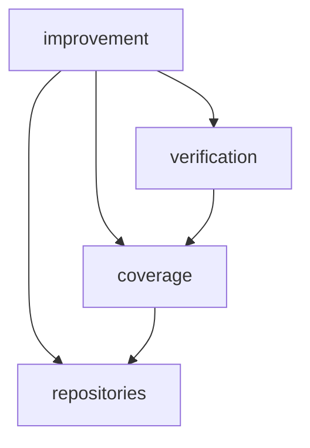
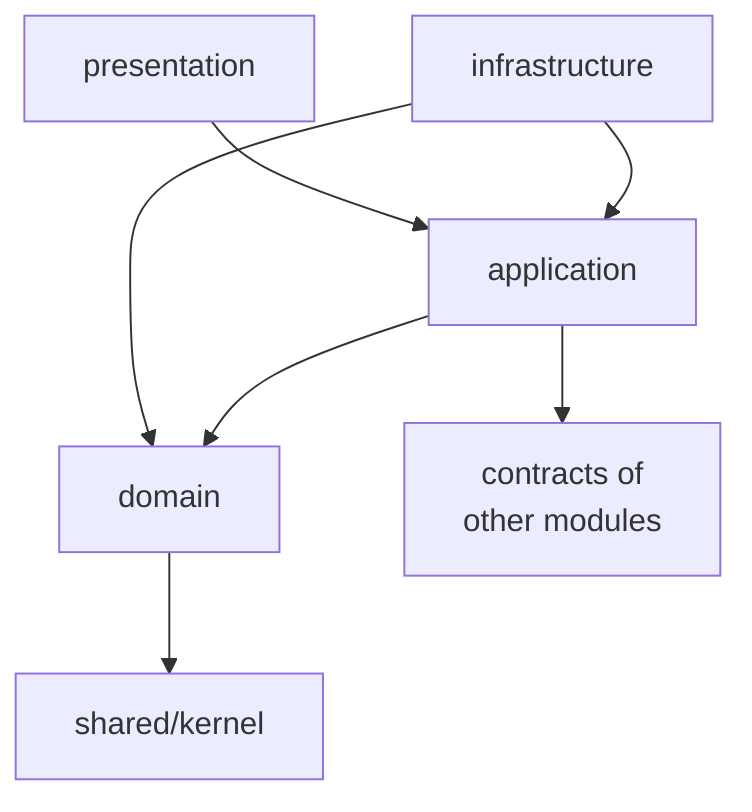

# Project structure

Author: Valentin Daitkhe

This document fixes where code lives and which parts may depend on which. It
follows from [Scope and requirements](scope-and-requirements.md). File names in
the examples are illustrative. The domain model itself is defined in the system
design document.

## Repository layout

```
coverage-autopilot/
├── backend/
│   ├── src/
│   │   ├── main.ts
│   │   ├── worker.ts
│   │   ├── app.module.ts
│   │   ├── modules/
│   │   │   ├── repositories/
│   │   │   ├── coverage/
│   │   │   ├── verification/
│   │   │   └── improvement/
│   │   └── shared/
│   │       ├── kernel/
│   │       └── infrastructure/
│   ├── migrations/
│   ├── tests/
│   ├── package.json
│   └── tsconfig.json
│
├── frontend/
│   ├── src/
│   │   ├── index.tsx
│   │   ├── app/
│   │   ├── screens/
│   │   │   ├── repositories/
│   │   │   ├── coverage/
│   │   │   └── jobs/
│   │   ├── commands/
│   │   ├── components/
│   │   ├── hooks/
│   │   └── api/
│   ├── package.json
│   └── tsconfig.json
│
├── docs/
│   └── plan/
├── package.json
└── README.md
```

- `backend/` is the NestJS service. `main.ts` starts the HTTP API and
  `worker.ts` starts the job worker. Both load the same modules. Running them
  as one process or two is a deployment choice, because jobs are claimed
  through the database.
- `frontend/` is the terminal client. `screens/` holds the interactive views and
  `commands/` holds the non-interactive commands. It talks to the backend only
  through `api/`.
- The root `package.json` declares both folders as workspaces.

## Backend modules

Each module is a bounded context with its own rules and its own lifecycle.

| Module | Owns |
| --- | --- |
| `repositories` | Connected repositories, access checks, working copies |
| `coverage` | Project detection, test runs with coverage, report parsing, snapshots, thresholds |
| `verification` | Quality gate, repeated runs, mutation testing |
| `improvement` | Improvement job, its state machine, queue, budget, test generation, publishing |

Dependencies point one way and have no cycles:



- `coverage` asks `repositories` for a working copy.
- `verification` asks `coverage` to run tests and measure them.
- `improvement` drives the whole job and uses the other three.

A module calls another module only through that module's `contracts/` folder.

## Inside a module

Every module has the same layers. This is the `coverage` module as an example:

```
backend/src/modules/coverage/
├── domain/
│   ├── entities/
│   │   └── coverage-snapshot.entity.ts
│   ├── value-objects/
│   │   ├── coverage-percentage.vo.ts
│   │   ├── coverage-percentage.vo.test.ts
│   │   └── coverage-threshold.vo.ts
│   ├── services/
│   ├── events/
│   └── repositories/
│       └── coverage-snapshot.repository.ts
│
├── application/
│   ├── commands/
│   │   └── scan-repository/
│   ├── queries/
│   │   └── list-low-coverage-files/
│   ├── ports/
│   │   ├── project-detector.port.ts
│   │   ├── test-runner.port.ts
│   │   └── coverage-report-parser.port.ts
│   └── dto/
│
├── infrastructure/
│   ├── persistence/
│   │   └── sqlite-coverage-snapshot.repository.ts
│   ├── runners/
│   │   ├── jest-runner.adapter.ts
│   │   └── vitest-runner.adapter.ts
│   └── reports/
│       └── istanbul-report-parser.adapter.ts
│
├── presentation/
│   └── http/
│       └── coverage.controller.ts
│
├── contracts/
│   ├── coverage-public-api.ts
│   └── coverage-events.ts
│
└── coverage.module.ts
```

| Layer | Contains | May use the framework |
| --- | --- | --- |
| `domain` | Entities, value objects, domain services, events, repository interfaces | No |
| `application` | Use cases as commands and queries, ports for everything outside | No |
| `infrastructure` | Implementations of repositories and ports: SQLite, test runners, CLIs | Yes |
| `presentation` | HTTP controllers | Yes |
| `contracts` | The only surface other modules may import | No |



Repository interfaces live in `domain/repositories/`. Every other outbound
dependency is a port in `application/ports/`. A folder is created only when it
has a file to hold: a module with no events has no `events/` folder.

## Shared code

```
backend/src/shared/
├── kernel/
│   ├── primitives/
│   └── errors/
└── infrastructure/
    ├── database/
    ├── config/
    ├── logging/
    └── sandbox/
```

- `kernel/` is plain TypeScript: base classes for entities and value objects,
  the result type, base errors. The domain may import it.
- `infrastructure/` is technical code used by more than one module: the SQLite
  connection, configuration, logging and the sandbox that runs untrusted
  commands. The domain may not import it.

There is no `utils/` folder. A helper belongs to the module that needs it.

## Dependency rules

These rules are checked by a tool, not by review:

1. `domain` imports only its own module's `domain` and `shared/kernel`.
2. `application` imports its own `domain`, `shared/kernel`, and the `contracts`
   of other modules.
3. Only `infrastructure` and `presentation` import NestJS, the database driver
   or any other library that does I/O.
4. A module never imports from another module outside its `contracts/`.
5. `shared/kernel` imports nothing from the project and no framework.
6. `frontend` imports nothing from `backend`.

## Naming

Files are kebab-case with the role as a suffix.

| Suffix | Role |
| --- | --- |
| `.entity.ts` | Entity or aggregate root |
| `.vo.ts` | Value object |
| `.service.ts` | Domain service |
| `.event.ts` | Domain event |
| `.repository.ts` | Repository interface in `domain`, implementation in `infrastructure` |
| `.port.ts` | Outbound port |
| `.adapter.ts` | Implementation of a port |
| `.command.ts`, `.query.ts` | Use case input |
| `.handler.ts` | Use case |
| `.controller.ts` | HTTP controller |
| `.module.ts` | NestJS module |
| `.test.ts` | Unit test |

An implementation carries its technology as a prefix:
`sqlite-coverage-snapshot.repository.ts`, `jest-runner.adapter.ts`.

## Tests

- Unit tests sit next to the code they test, as `*.test.ts`.
- `backend/tests/` holds integration and end-to-end tests that need a database
  or a running service.
