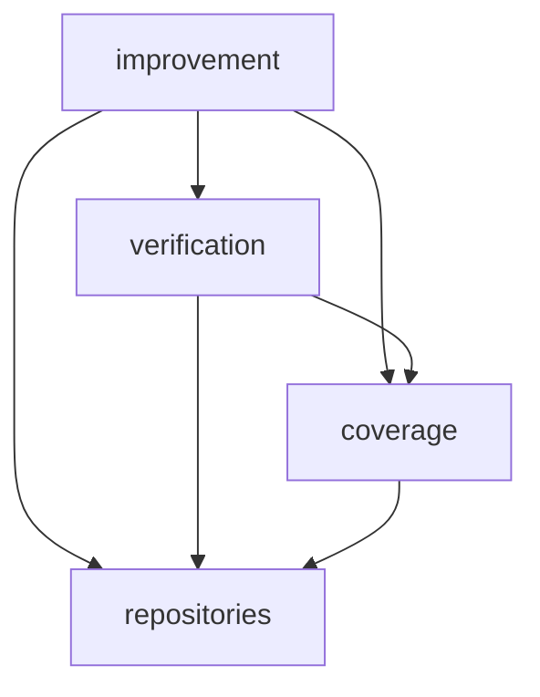
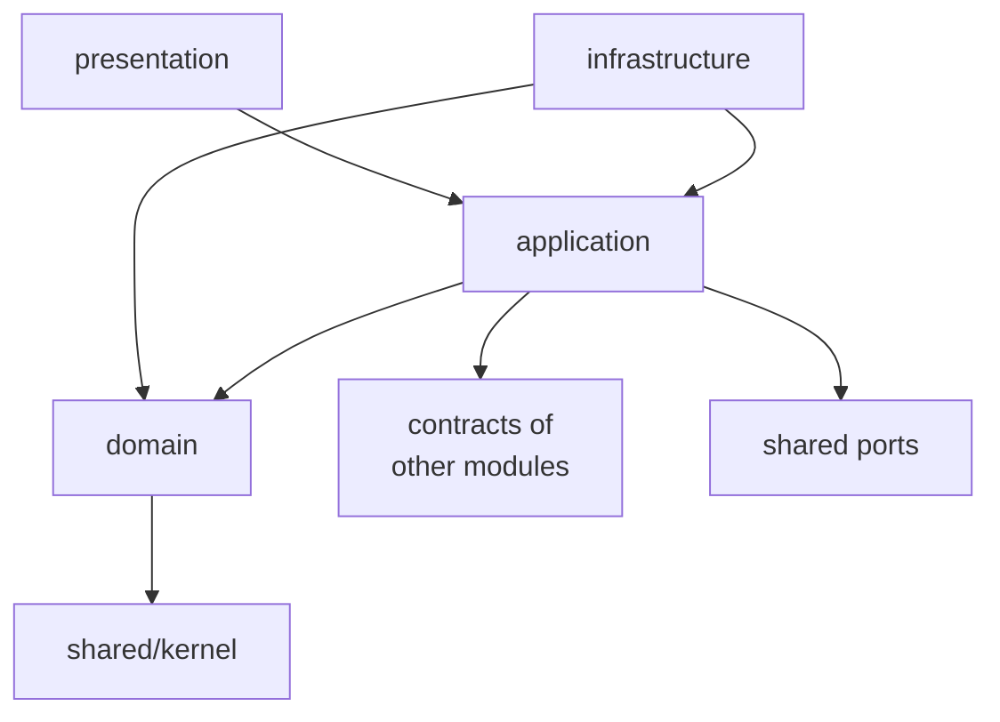

# Project structure

Author: Valentin Daitkhe

This document fixes where code lives and which parts may depend on which. It
follows from [Scope and requirements](scope-and-requirements.md). File names in
the examples are illustrative. The domain model itself is defined in
[System design](system-design.md).

## Repository layout

```text
coverage-autopilot/
├── backend/
│   ├── src/
│   │   ├── main.ts
│   │   ├── worker.ts
│   │   ├── app.module.ts
│   │   ├── modules/
│   │   │   ├── repositories/
│   │   │   ├── coverage/
│   │   │   ├── verification/
│   │   │   └── improvement/
│   │   └── shared/
│   │       ├── kernel/
│   │       ├── application/
│   │       └── infrastructure/
│   ├── migrations/
│   ├── tests/
│   │   ├── unit/
│   │   ├── integration/
│   │   ├── e2e/
│   │   ├── stress/
│   │   └── support/
│   ├── package.json
│   └── tsconfig.json
│
├── frontend/
│   ├── src/
│   │   ├── main.tsx
│   │   ├── app/
│   │   ├── screens/
│   │   │   ├── repositories/
│   │   │   ├── files/
│   │   │   └── improvements/
│   │   ├── commands/
│   │   ├── components/
│   │   ├── theme/
│   │   ├── hooks/
│   │   └── api/
│   ├── tests/
│   │   ├── unit/
│   │   ├── integration/
│   │   ├── e2e/
│   │   └── support/
│   ├── package.json
│   └── tsconfig.json
│
├── api-contracts/
│   ├── src/
│   ├── tests/
│   │   └── unit/
│   ├── package.json
│   └── tsconfig.json
│
├── harness/
│   ├── bin/
│   ├── policy/
│   ├── architecture/
│   ├── eslint/
│   ├── configs/
│   ├── agents/
│   ├── fixtures/
│   └── tests/
│
├── docs/
│   └── plan/
├── package.json
└── README.md
```

- `backend/` is the NestJS service. `main.ts` starts the HTTP API on a local
  socket and `worker.ts` starts the job worker. Both load the same modules.
  Running them as one process or two is a deployment choice, because jobs are
  claimed through the database. `migrations/` holds plain SQL files. The
  service applies the missing ones in order every time it starts.
- `frontend/` is the terminal client. `screens/` holds the interactive views and
  `commands/` holds the non-interactive commands. It talks to the backend only
  through `api/`. `theme/` is the only place that names a colour or a symbol:
  it holds the colour roles, the symbols with their ASCII replacements, the
  words for every status and the three widths of the layout. The screens and
  the commands are described in [Terminal UI](terminal-ui.md).
- `api-contracts/` holds the Zod schemas of the HTTP API. The backend validates
  requests with them and the frontend validates responses with them, so each
  DTO is described once and its type is inferred from the schema.
- `harness/` holds the checks that decide whether a change may land: the
  tools, their configuration, the policy as data and the settings of the AI
  agent. It is not a workspace. It belongs to the root package and no
  product code imports it. It is described in [Harness](harness.md).
- The root `package.json` declares `backend`, `frontend` and
  `api-contracts` as workspaces.

## Backend modules

Each module is a bounded context with its own rules and its own lifecycle.

| Module | Owns |
| --- | --- |
| `repositories` | Connected repositories, access checks, working copies, branches and pull requests. Everything that uses `git` and `gh` |
| `coverage` | Project detection, test runs with coverage, report parsing, snapshots, thresholds |
| `verification` | Quality gate, repeated runs, mutation testing. Stores nothing |
| `improvement` | Improvement, its attempts and statuses, budget, test generation, the decision to publish |

The job queue is not a module. It is technical code in
`shared/infrastructure/queue`, and both `coverage` and `improvement` put jobs
into it.

Dependencies point one way and have no cycles:



- `coverage` asks `repositories` for a working copy.
- `verification` asks `repositories` for a clean working copy, applies the
  patch to it, and asks `coverage` to run tests and measure them.
- `improvement` drives the whole job and uses the other three.

A module calls another module only through that module's `contracts/` folder.
Only values cross a module boundary. A working copy belongs to the module that
asked for it. The contracts are listed in
[System design](system-design.md#contracts-between-modules).

## Inside a module

Every module has the same layers. This is the `coverage` module as an example:

```text
backend/src/modules/coverage/
├── domain/
│   ├── entities/
│   │   └── coverage-snapshot.entity.ts
│   ├── value-objects/
│   │   ├── coverage-percentage.vo.ts
│   │   └── coverage-threshold.vo.ts
│   ├── services/
│   ├── errors/
│   │   └── invalid-coverage-percentage.error.ts
│   └── repositories/
│       └── coverage-snapshot.repository.ts
│
├── application/
│   ├── commands/
│   │   └── scan-repository/
│   ├── queries/
│   │   └── list-low-coverage-files/
│   ├── ports/
│   │   ├── project-detector.port.ts
│   │   ├── test-runner.port.ts
│   │   └── coverage-report-parser.port.ts
│   └── dto/
│
├── infrastructure/
│   ├── persistence/
│   │   └── sqlite-coverage-snapshot.repository.ts
│   ├── runners/
│   │   ├── jest-runner.adapter.ts
│   │   └── vitest-runner.adapter.ts
│   └── reports/
│       └── istanbul-report-parser.adapter.ts
│
├── presentation/
│   └── http/
│       └── coverage.controller.ts
│
├── contracts/
│   └── coverage-public-api.ts
│
└── coverage.module.ts
```

| Layer | Contains | May use the framework |
| --- | --- | --- |
| `domain` | Entities, value objects, domain services, errors, repository interfaces | No |
| `application` | Use cases as commands and queries, ports for everything outside | Only `@Injectable()` and `@Inject()` |
| `infrastructure` | Implementations of repositories and ports: SQLite, test runners, CLIs | Yes |
| `presentation` | HTTP controllers | Yes |
| `contracts` | The only surface other modules may import | No |



Repository interfaces live in `domain/repositories/`. Every other outbound
dependency is a port in `application/ports/`. A folder is created only when it
has a file to hold: a module with no domain services has no `services/` folder.

Modules call each other synchronously. There is no event bus and no `events/`
folder in the first version.

## Shared code

```text
backend/src/shared/
├── kernel/
│   ├── primitives/
│   ├── errors/
│   ├── time/
│   └── id/
├── application/
│   └── ports/
└── infrastructure/
    ├── database/
    ├── queue/
    ├── artifacts/
    ├── config/
    ├── logging/
    ├── time/
    ├── id/
    └── sandbox/
```

- `kernel/` is plain TypeScript: base classes for entities and value objects,
  the small types every module uses (`RepositoryId`, `CommitSha`, `FilePath`),
  the three base errors (`DomainError`, `ApplicationError`,
  `InfrastructureError`), the `Clock` and `IdGenerator` interfaces, and an
  opaque `Transaction` handle. The domain may import it.
- `application/ports/` holds the technical interfaces that only the
  application layer needs: `TransactionManager`, `JobQueue` and `JobHandler`.
  The domain may not import it, so a domain object cannot reach the queue.
- `infrastructure/` is technical code used by more than one module: the SQLite
  connection, the job queue, storage for raw tool output, configuration,
  logging, the system clock, the id generator and the sandbox that runs
  untrusted commands. The domain may not import it.

Errors are exceptions. Every error is its own class that extends one of the
three base errors, and one boundary per entry point turns them into an HTTP
response or a job failure reason. An expected outcome, such as a rejected
candidate, is a typed value and not an exception.

The domain and the application never call `new Date()` or `randomUUID()`. They
receive a `Clock` and an `IdGenerator`, which keeps leases, timeouts and ids
deterministic in tests.

There is no `utils/` folder. A helper belongs to the module that needs it.

## Frontend folders

The client has no layers of a domain. Its folders still import one way.

| Folder | May import |
| --- | --- |
| `main.tsx` | `app/`, `commands/` |
| `app/` | `screens/`, `components/`, `hooks/`, `theme/`, `api/` |
| `screens/<name>/` | Its own folder, `components/`, `hooks/`, `theme/`, `api/` |
| `commands/` | `api/`, `theme/` |
| `components/` | `components/`, `hooks/`, `theme/` |
| `hooks/` | `hooks/`, `theme/` |
| `api/` | `api/` |
| `theme/` | `theme/` |

- The table lists what is allowed. Anything it does not list is refused,
  whether or not it makes a cycle.
- A screen never imports another screen. Moving between screens is the job
  of `app/`.
- `commands/` imports no screen, no component and no hook. Ink and React
  are imported in `app/`, `screens/`, `components/` and `hooks/` only, so a
  command, the client in `api/` and `theme/` work without the interactive
  view.
- `hooks/` holds hooks of the interface only: the keys, the focus, the
  selection, the size of the terminal, a timer. None of them imports
  `api/`. The hook that repeats a request takes the request as an
  argument, and the screen passes it in. A hook that knows one request of
  the service lives in the folder of its screen.
- A component gets what it draws as props. No chain of imports leads from
  `components/` or `hooks/` to `api/`. A part of one screen that knows an
  improvement lives in the folder of that screen.
- Any folder may import a type from `api-contracts`. Only `api/` imports
  its schemas, and only `api/` opens the socket.

## Dependency rules

These rules are checked by a tool, not by review. The tool behind each one
is named in [Harness](harness.md).

1. `domain` imports only its own module's `domain` and `shared/kernel`.
2. `application` imports its own `domain`, `shared/kernel`,
   `shared/application` and the `contracts` of other modules.
3. Only `infrastructure` and `presentation` import NestJS, the database driver
   or any other library that does I/O. The one exception: `application` may
   import the `@Injectable()` and `@Inject()` decorators, and nothing else from
   NestJS.
4. A module never imports from another module outside its `contracts/`.
5. `shared/kernel` imports nothing from the project and no framework.
   `shared/application` imports only `shared/kernel`.
6. `frontend` imports nothing from `backend`, and `backend` imports nothing
   from `frontend`. Both may import `api-contracts`, which imports neither.
7. Zod is used where data enters the system: `api-contracts`, configuration and
   adapters that parse the output of external tools. The domain does not import
   it and checks its own invariants.
8. No file uses a relative import. Every import goes through an alias from the
   [Imports](#imports) section.
9. SQL is written only in `infrastructure/persistence` of a module, in
   `shared/infrastructure` and in `migrations/`. There is no ORM and no query
   builder.
10. A folder of `frontend` imports only what its row in
    [Frontend folders](#frontend-folders) allows.

## Imports

Relative imports are not allowed anywhere, including `./` inside one folder.
Every import starts with an alias, so a path reads the same from any file and
does not change when the importing file moves.

| Alias | Points to |
| --- | --- |
| `#repositories/*`, `#coverage/*`, `#verification/*`, `#improvement/*` | `backend/src/modules/<module>/*` |
| `#kernel/*` | `backend/src/shared/kernel/*` |
| `#ports/*` | `backend/src/shared/application/ports/*` |
| `#infrastructure/*` | `backend/src/shared/infrastructure/*` |
| `#tests/*` | `tests/*` of the workspace the file is in |
| `#app/*`, `#screens/*`, `#commands/*`, `#components/*`, `#theme/*`, `#hooks/*`, `#api/*` | `frontend/src/<folder>/*` |
| `#api-contracts/*` | `api-contracts/src/*`, for the files of that workspace itself |
| `#harness/*` | `harness/*` |
| `@coverage-autopilot/api-contracts` | The `api-contracts` workspace |

```ts
import { DomainError } from '#kernel/errors/domain.error';
import type { Clock } from '#kernel/time/clock';
import type { WorkingCopy } from '#repositories/contracts/working-copy.dto';
```

An alias is only a name for a path. The dependency rules above still apply to
the file it points to: `#coverage/contracts/...` may be imported from another
module and `#coverage/domain/...` may not.

## Naming

Files are kebab-case with the role as a suffix.

| Suffix | Role |
| --- | --- |
| `.entity.ts` | Entity or aggregate root |
| `.vo.ts` | Value object |
| `.service.ts` | Domain service |
| `.error.ts` | One error class |
| `.schema.ts` | Zod schema and the DTO type inferred from it |
| `.dto.ts` | DTO that needs no validation |
| `.repository.ts` | Repository interface in `domain`, implementation in `infrastructure` |
| `.port.ts` | Outbound port |
| `.adapter.ts` | Implementation of a port |
| `.command.ts`, `.query.ts` | Use case input |
| `.handler.ts` | Use case |
| `.controller.ts` | HTTP controller |
| `.module.ts` | NestJS module |
| `.test.ts` | Test of any kind. The folder tells which kind |

An implementation carries its technology as a prefix:
`sqlite-coverage-snapshot.repository.ts`, `jest-runner.adapter.ts`.

## Tests

Tests do not sit next to the code. Each workspace has a `tests/` folder with
one subfolder per kind of test:

| Folder | Tests | May touch |
| --- | --- | --- |
| `tests/unit/` | One class or function on its own | Memory only: no database, file system, network or child process |
| `tests/integration/` | An adapter against the real thing it wraps: SQLite, `git`, a test runner on a fixture project | Local resources, no network |
| `tests/e2e/` | The running service through its HTTP API and the client | Everything a real run uses, with external services faked |
| `tests/stress/` | A guarantee of the design under load: real processes that share one database and are stopped at random | The same as `tests/e2e/`. Only the backend has this folder |

- The path under `tests/unit/` repeats the path under `src/`:
  `src/modules/coverage/domain/value-objects/coverage-percentage.vo.ts` is
  tested by
  `tests/unit/modules/coverage/domain/value-objects/coverage-percentage.vo.test.ts`.
- `tests/support/` holds test doubles and builders, such as a fixed clock and a
  sequential id generator. It contains no tests.
- A screen of the client rendered to text in memory is a unit test. A test
  of `api/` against a socket is an integration test.
- A stress test passes when the guarantee holds, whatever the order of
  events was. It runs before a merge only. Which guarantees are tested this
  way is listed in [Harness](harness.md#invariant-tests).
- The outer `describe` names the class or function under test. A nested
  `describe` names a method or a context that starts with `when`. Every `it`
  starts with `should`.

```ts
describe('CoveragePercentage', () => {
  describe('create', () => {
    it('should keep a value between 0 and 100', () => {});

    describe('when the value is above 100', () => {
      it('should throw InvalidCoveragePercentageError', () => {});
    });
  });
});
```

The project's own code is held to 95% coverage on every counter: statements,
branches, functions and lines. The build fails below that.
