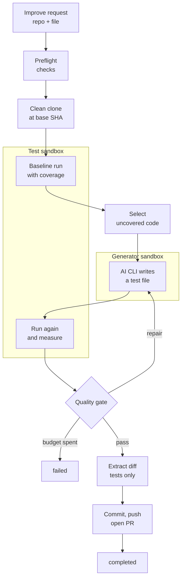

# Scope and requirements

Author: Valentin Daitkhe

I am Valentin Daitkhe, and this is the starting point of my plan for
`coverage-autopilot`. It fixes what the tool must do and what it will not do,
before any design or code. The domain model is in
[System design](system-design.md) and the folder layout is in
[Project structure](project-structure.md).

## 1. Task

Build a NestJS service on Node.js and SQLite that raises TypeScript test
coverage in GitHub repositories. The service finds files with low coverage,
generates `*.test.ts` files for them with an AI CLI, and proposes the result as
a pull request.

The task asks for:

- A scan that reports coverage per file and flags files below a threshold, for
  example 80%.
- A CLI or a small React dashboard that shows the coverage of each file, the
  progress of running improvements, and the link to the resulting pull request.
- An improvement that runs in the background from request to pull request, with
  no manual steps in between.
- Domain-Driven Design: separate domain, application and infrastructure layers,
  with business logic that does not depend on the framework.
- Isolated AI CLI runs, safe handling of tokens, and jobs serialized per
  repository.
- A `backend/` folder, a `README.md`, setup instructions, a short domain
  glossary or diagram, and at least one example pull request.

## 2. How I read it

- **A service and a client, not one CLI process.** The backend is a long-lived
  service that owns jobs and state. The CLI is its client. A job must survive
  the client exiting, so the two cannot be the same process. The client starts
  the service when it is not running, and they talk over a local socket, so
  the user sees one command-line tool and no network port is opened.
- **Unit tests only.** The unit of work is one source file and the output is one
  `*.test.ts` file next to it. Integration and end-to-end tests need
  infrastructure that a foreign repository does not give me.
- **Coverage is produced, not read.** Repositories do not commit coverage
  reports. The tool clones the repository, installs dependencies and runs the
  project's own test runner with coverage enabled.
- **"Serialize jobs per repository" means one at a time.** Jobs for the same
  repository run strictly one after another. Jobs for different repositories
  run in parallel. A scan is also a background job and uses the same queue.
- **The tool is local.** It runs on the user's machine or in a CI job and uses
  the `git` and `gh` setup that is already there. It stores no credentials.
- **The language model proposes, the pipeline decides.** Generation is
  probabilistic. Everything that decides whether a test is kept is
  deterministic and repeatable.

## 3. Algorithm

One improvement job follows this loop: measure, select a target, generate,
execute, measure again, then reject, repair or accept.

1. **Preflight.** Check that `git` and `gh` are present, `gh` is authenticated,
   the user can push to the repository, and the test runner is supported.
2. **Clean clone.** Clone the repository at the base commit.
3. **Baseline run.** In the test sandbox, install dependencies and run the
   existing tests with coverage. Then find the mutants of the target file that
   the existing tests do not detect. The sandbox holds no secrets and has no
   network after the install.
4. **Select.** Pick the uncovered branches of the target file.
5. **Generate.** In the generator sandbox, the AI CLI writes a test file. It
   holds only the language model credential and runs no commands.
6. **Run again and measure.** Back in the test sandbox: coverage, repeated runs
   and mutants.
7. **Quality gate.** A rejected test is repaired while budget is left, and the
   job fails when the budget is spent. A check that could not finish is run
   again without using up an attempt.
8. **Publish.** Only the diff leaves the sandbox. The host applies it to a clean
   clone, commits, pushes and opens the pull request, then stores the link.

Two properties hold for every job:

- Nothing is published unless the quality gate passes.
- The job ends within its budget, whatever the generator does.

The tool does not promise that every file gets a test. It promises that what it
publishes has been checked.

## 4. Metrics

Coverage comes from Istanbul-format reports, which give four counters per file:
statements, branches, functions and lines. For a test suite `T`:

$$
C_s(T) = \frac{\text{statements executed by } T}{\text{all statements}}
\qquad
C_b(T) = \frac{\text{branch edges traversed by } T}{\text{all branch edges}}
\qquad
C_f(T) = \frac{\text{functions invoked by } T}{\text{all functions}}
$$

Line coverage is an approximation of statement coverage: several statements can
share a line. I use each metric for a different purpose:

- **Line coverage** is the number shown to the user and compared with the
  threshold. It is what "80% coverage" normally means and it is defined for
  every file.
- **Branch coverage** drives target selection and the gate. It is stricter. For
  a file with no branches the gate falls back to line coverage.

Coverage only shows that code ran. It does not show that a test checks anything.
Mutation testing covers that gap. The tool makes small changes (mutants) to the
target file. A total mutation score is not enough, because it can be high
thanks to tests that already existed. The tool counts the gain instead: the
mutants that no test detected before and that the new tests kill.

$$
\Delta K = \lvert \lbrace m : m \text{ undetected before, killed after} \rbrace \rvert
$$

The exact rule is in [System design](system-design.md#mutation-gate).

Mutation testing is expensive, so I scope it: mutants are created only in the
target file, the starting point is measured once per job, and later runs test
only the mutants the new tests reach.

The quality gate accepts a candidate only if all of these hold:

1. The diff touches test files only.
2. The project still type-checks.
3. The new tests pass.
4. Tests that passed before still pass.
5. The new tests pass on several consecutive runs.
6. Coverage of the target file went up.
7. The new tests kill mutants that no test detected before: at least one, and
   at least the policy share of the mutants they reach. This check is required
   by default. If the policy turns it off, the pull request says so.

A job also carries a budget with three limits: attempts, tokens and wall-clock
time. The job fails when any of them runs out.

## 5. Problems the design has to solve

- **Coverage is a proxy.** A test can execute code and assert nothing. The
  percentage goes up and the quality does not.
- **Generated code is unreliable.** It may not compile, may be flaky, may assert
  the current bugs, or may edit production code to make itself pass.
- **The repository is untrusted.** Installing dependencies and running tests
  executes arbitrary code, on a machine that holds the user's credentials.
- **The process is long and can die halfway.** A crash between "pull request
  created" and "result saved" must not produce a second pull request.
- **Generation costs money.** A repair loop with no limit can spend the whole
  budget on one file.
- **Projects differ.** Test runners, coverage providers and layouts vary, and
  the tool has to normalize them.

## 6. Requirements

Each item is marked `task` if the task states it and `added` if I added it.

### Functional

- **FR-1.** Connect a GitHub repository by URL. `task`
- **FR-2.** Scan a repository: clone, detect the test runner, run tests with
  coverage, store a per-file snapshot tied to the commit SHA. `task`
- **FR-3.** Include source files that no test loads, reported as 0%. `added`
- **FR-4.** List files below the threshold with their coverage. The threshold
  and its metric are configurable, 80% of lines by default. `task`
- **FR-5.** Start an improvement for one file as a background job. `task`
- **FR-6.** Run the job through the loop in section 3 without manual steps.
  `task`
- **FR-7.** Show job state, attempt count, failure reason and the pull request
  link. `task`
- **FR-8.** Publish to a deterministic branch and open a pull request. Reuse an
  existing branch or pull request instead of creating a duplicate. `added`
- **FR-9.** Run a preflight check before spending any budget: `git` and `gh`
  present, `gh` authenticated, write access to the repository, a supported test
  runner, and a target file that has not changed on the default branch since
  the scan. `added`
- **FR-10.** Report expected failures as typed outcomes, not crashes: no test
  runner, dependency install failed, timeout, nothing to improve. `added`
- **FR-11.** Optional review mode: the job waits for approval after the gate,
  and the client shows the diff before publishing. Off by default. `added`
- **FR-12.** Cancel a queued or running job. `added`
- **FR-13.** Offer non-interactive commands next to the interactive client, with
  a `--wait` flag that blocks until the job ends and returns an exit code,
  and an `--isolated` flag that runs a private service for one command, for
  CI. `added`

### Non-functional

- **NFR-1. Isolation.** Repository code and the AI CLI run in sandboxes. Tests
  run with no secrets and no network. The AI CLI gets only the language model
  credential and may write files but not run commands. `task`, extended
- **NFR-2. Secrets.** The tool stores no tokens. It uses the existing `gh`
  login, or `GH_TOKEN` in CI. Tokens are never written to the database or logs.
  Sandboxed processes start with an explicit list of environment variables.
  A generated file that contains the language model credential is never
  stored or published.
  `task`, extended
- **NFR-3. Publishing boundary.** Only a diff leaves the sandbox. The host
  applies it to a clean clone and pushes from there, never from a directory
  that untrusted code has touched. `added`
- **NFR-4. Serialization.** One job per repository at a time, scans included.
  Different repositories run in parallel. `task`
- **NFR-5. Durable queue.** Jobs live in SQLite. A worker claims a job
  atomically and holds a lease with a heartbeat. An expired lease returns the
  job to the queue. Retries are limited. A retry repeats the same step and
  does not use up a generation attempt. `added`
- **NFR-6. Idempotency.** Execution is at-least-once. Each job has a key derived
  from repository, base SHA, target file, generator configuration and quality
  policy. The key is unique among active and successful jobs, so a failed job
  can be requested again. At most one open improvement exists per repository
  and file. `added`
- **NFR-7. Bounded cost.** Every job has a budget and stops when it is used up.
  `added`
- **NFR-8. Extensibility.** Project detection, test runner, coverage report
  format, test generator, mutation tool and pull request publisher are separate
  ports. Jest and Vitest are implemented. `added`
- **NFR-9. Layering.** Domain, application and infrastructure are separate, and
  the domain imports nothing from the framework. Modules talk to each other
  only through their public contracts. `task`, extended
- **NFR-10. Portability.** The same tool runs on a developer machine and in a CI
  job. `added`

## 7. Trade-offs

| Decision | What I give up | Why |
| --- | --- | --- |
| Jest and Vitest only | Mocha, `node:test`, monorepos | Two runners prove the adapter seam. Each extra runner also needs mutation and flake support. |
| Write access required, no fork flow | Repositories the user cannot push to | The main use is the user's own repository. A missing permission is reported in preflight. |
| `gh` CLI for pull requests | A tool with no external dependency | The tool handles no tokens and works locally and in CI with one adapter. |
| SQLite queue | Horizontal scaling across machines | The task fixes SQLite. The queue is behind a port and can move to a broker later. |
| No separate outbox table | A general mechanism for external actions | There is one external action and it is idempotent. The job row in the publishing state plays that role. |
| An AI CLI, not a model API | An exact token limit per call | The task asks for a CLI. It limits turns and estimated cost, so the token budget is approximate. |
| A Unix socket, not a network port | Windows, and a browser dashboard without extra work | Nothing on the network can reach the service, and no port has to be chosen. |
| Asking for status again, no event stream | Updates the moment they happen | An improvement has about a dozen events. Asking once a second is enough. |
| Containers, not microVMs | The strongest isolation | Containers with no network and no secrets cover the stated threat. |
| Mutation testing required by default, target file only | Speed, and projects the mutation tool cannot run | It is the check that stops a test without assertions. A project it cannot run on fails before any generation. |
| No path, sequence or MC/DC coverage | Stricter structural metrics | TypeScript coverage tools do not measure them. |
| No scoring function for candidates | Choosing the best of several tests | A job produces one test file. Targets are picked by uncovered branch count. |
| Line coverage as the displayed number | The stricter headline metric | It matches what users expect. Branch coverage still decides the gate. |
| Unit tests only | Integration and end-to-end coverage | They need infrastructure the tool cannot provide for a foreign repository. |
| Automatic publishing by default | A human check before every pull request | The task asks for an automatic flow. Review mode exists as an option. |
| Unsupported repositories are reported, not bootstrapped | Repositories with no test runner | Adding a runner changes the project and is not a coverage improvement. |
| At-least-once execution | Exactly-once semantics | With idempotent steps the visible result is the same and the design is simpler. |
| Base SHA is part of the job key | Reuse of work after the base branch moves | A test verified against one commit says nothing about another. |
