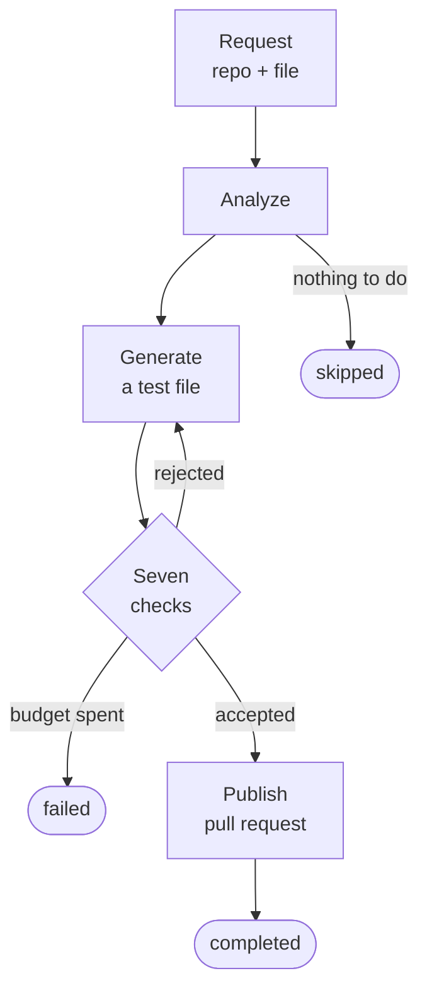

# Scope and requirements

Author: Valentin Daitkhe

What `coverage-autopilot` does, what it leaves out, and the requirements
it is built to. The design as built goes on in
[System design](system-design.md), [Project structure](project-structure.md),
[Terminal UI](terminal-ui.md) and [Harness](harness.md). Why a decision
changed after the first plan is in
[the decision log](../implementation/decisions.md).

## What it does

`coverage-autopilot` raises the unit test coverage of a TypeScript
repository on GitHub:

1. It measures the coverage of every source file of the repository.
2. It lists the files below a threshold, 80% of lines by default.
3. For one file a person picks, an AI CLI writes a new test file.
4. A gate of seven checks decides whether that test is kept.
5. A kept test is published as a pull request with one commit.

It is one npm package with one command. A NestJS service on Node.js and
SQLite owns the work, and a terminal client shows it and starts it.

## How the work is read

- **A service and a client.** An improvement takes minutes and survives
  a closed terminal. The client starts the service when none answers,
  and the two talk HTTP over a Unix socket, so no port is opened.
- **Unit tests only.** One source file goes in, one new test file comes
  out.
- **Coverage is produced, not read.** The service clones the repository,
  installs its packages and runs its own test runner with coverage.
- **One job per repository at a time.** Different repositories run side
  by side.
- **The model proposes, the pipeline decides.** Everything that decides
  whether a test is kept is deterministic.

## The loop

The AI CLI runs in its own sandbox and may only read and write files of
a fresh copy. The checks run in the sandbox of the commands, and a
rejection sends its reasons to the next attempt. Nothing is published
unless every required check passed, and an improvement ends within its
budget whatever the generator does.

## Requirements as built

| Id | Requirement |
| --- | --- |
| FR-1 | Connect a GitHub repository by its `https` address |
| FR-2 | Scan: clone the head of the default branch, detect the project, install, run the tests with coverage, store a snapshot of every file tied to the commit |
| FR-3 | List every eligible source file. A file no test loads is measured at 0%. A file that cannot be measured is listed apart with its reason and is never shown as 0% |
| FR-4 | List the files below the threshold: a whole percent of lines, 80 by default for the service, and a percent of its own for a repository |
| FR-5 | Start an improvement of one file as a background job |
| FR-6 | Run it from request to pull request with no manual step |
| FR-7 | Show its status, attempts, checks, budget use, failure reason and pull request |
| FR-8 | Publish to a branch that follows from the improvement, and find that branch and its pull request again instead of making a second |
| FR-9 | Publish to a fork in the account of `gh` when that account may not push to the repository |
| FR-10 | Check before spending: a credential for the generator, and the file unchanged since the snapshot. The client runs the access check of `git`, the `gh` login and the right to push first |
| FR-11 | Report expected failures as typed reasons, not crashes |
| FR-12 | Review mode: wait for a person to approve the exact patch, off by default |
| FR-13 | Cancel a queued or running scan or improvement |
| FR-14 | Commands for scripts beside the screens, with `--wait`, `--json` and `--isolated` |
| FR-15 | Install a repository with the package manager it names: npm, pnpm or yarn |
| FR-16 | Let a person trust one repository to run its install scripts |
| FR-17 | Improve a repository whose own tests fail in the sandbox, judging a patch only by the tests it breaks |

| Id | Property |
| --- | --- |
| NFR-1 | Isolation: repository code and the AI CLI run in containers with no credential of the host. Tests run with no network |
| NFR-2 | Secrets: the service keeps no token of its own. It uses the `gh` login of the machine and a credential of the generator from its environment, hides that credential in its log and prompts, and gives a sandboxed process an explicit list of variables |
| NFR-3 | Publishing boundary: only the patch text leaves a sandbox. The host pushes from a clean copy |
| NFR-4 | Serialization: one leased job per repository |
| NFR-5 | Durable queue in SQLite: atomic claim, lease with heartbeat, limited runs |
| NFR-6 | Idempotency: a request key gives the same answer, and a fingerprint keeps the same work from running twice |
| NFR-7 | Bounded cost: attempts, minutes and, with an API key, tokens |
| NFR-8 | Extensibility: runner, generator, sandbox, code host and mutation tool are ports |
| NFR-9 | Layering: the domain imports no framework, and modules meet only through their contracts |
| NFR-10 | The same tool runs on a desk and in a CI job |

## What it supports

| Area | Supported | Refused, with the reason in words |
| --- | --- | --- |
| Project | One package with a `package.json` and one lockfile | Workspaces and other monorepos, no lockfile, two lockfiles and no `packageManager` field |
| Package manager | npm, pnpm 7 to 12, yarn 1, 3 and 4, at the exact version the repository names, through Corepack | bun, yarn Plug'n'Play, `nodeLinker: pnpm` |
| Test runner | Jest and Vitest | Any other, or a project that names both and leaves it open |
| Coverage | The JSON report in Istanbul format that both runners write | Vitest with no coverage provider declared |
| Generator | Claude Code, under a subscription or an API key | Any other CLI: the port is there, one adapter is built |
| Host | GitHub through `gh` | Any other host |
| Desk | A Unix system with Node 26 and a container engine, Docker by default | Windows |

A sandboxed install runs no code of the repository. A project whose
install would run code anyway, such as a package from git, is refused
with `install_runs_code` and the command that trusts it.

## Left out

- Integration and end-to-end tests of the target repository, and adding
  a test runner to a repository that has none.
- A browser dashboard and a live stream of events: the client asks again
  about once a second.
- Network and tokens of a private registry for the tests of a
  repository. Tests that need the network fail in the sandbox, and
  `AUTOPILOT_BASELINE_TESTS` decides whether that stops the work.
- Path, sequence and MC/DC coverage, and a choice between several
  candidate tests: an attempt writes one.

## Trade-offs

| Decision | What is given up | Why |
| --- | --- | --- |
| Jest and Vitest only | Mocha, `node:test`, monorepos | Each runner also needs mutation and failure support |
| `gh` for the host | A tool with no outside program | The service handles no token |
| A fork when the account may not push | A pull request in the repository itself | The account never pushes where it has no right |
| SQLite and plain SQL | Scaling across machines, an ORM | Partial indexes and a claim in one statement, on six tables |
| An AI CLI, not a model API | An exact token limit per call | The CLI limits turns and cost, so tokens are counted after a call |
| A Unix socket | Windows, a browser client | Nothing on the network reaches the service |
| Containers, not microVMs | The strongest isolation | No network, no credential and a read-only root cover the threat |
| Mutation check required by default | Speed | It is the check that stops a test that asserts nothing |
| Line coverage as the threshold | A stricter headline metric | It is what "80% coverage" means to people |
| Automatic publishing by default | A person before every pull request | Review mode is one flag away |
| At-least-once execution | Exactly-once | Idempotent steps give the same visible result |
| Base commit in the fingerprint | Reuse after the branch moves | A test verified on one commit says nothing of another |
