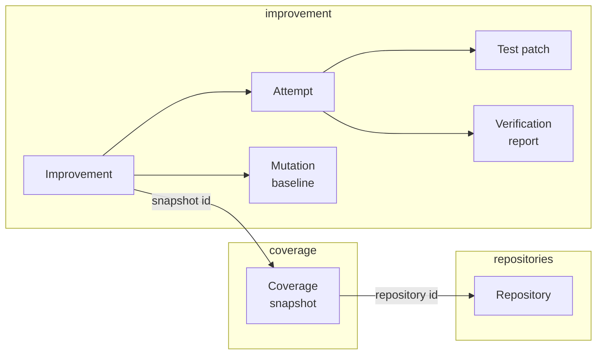
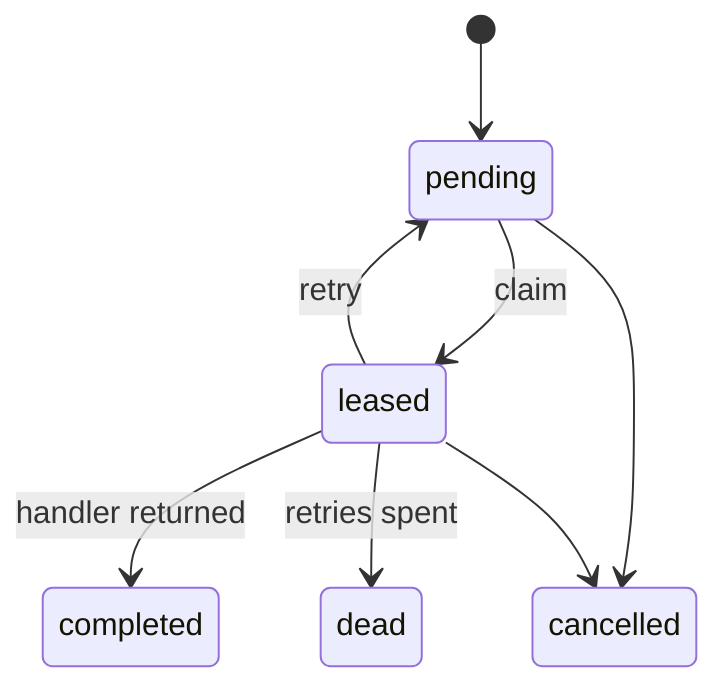
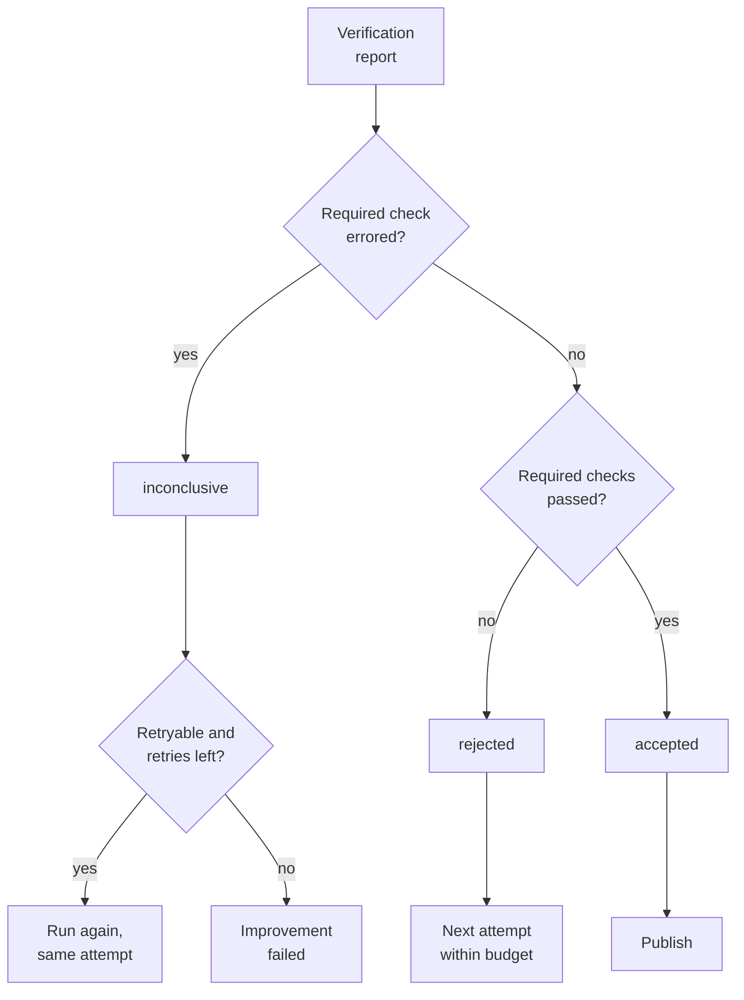

# System design

Author: Valentin Daitkhe

This document defines the domain model: the objects the system works with,
their states and the rules of the quality gate. It builds on
[Scope and requirements](scope-and-requirements.md) and
[Project structure](project-structure.md). The contracts between modules are
the next part and are not written yet.

## Glossary

| Term | Meaning |
| --- | --- |
| Repository | A GitHub repository connected to the service |
| Working copy | A clean clone of a repository at one commit. It is temporary and can always be made again |
| Scan | A background run that measures the coverage of a repository |
| Coverage snapshot | The stored result of one scan: coverage of every file at one commit |
| Threshold | A coverage metric and a percentage. A file below it needs improvement |
| Improvement | The process of raising the coverage of one file, from the request to the pull request |
| Target | The file to improve, with its uncovered branches and undetected mutants |
| Attempt | One try at generating a test inside an improvement |
| Test patch | The diff an attempt produced. It touches test files only |
| Budget | The limits of an improvement: attempts, tokens and wall-clock time |
| Quality policy | The settings of the quality gate, fixed when the improvement is created |
| Check | One condition of the quality gate |
| Verification report | The results of all checks for one test patch, with the verdict |
| Verdict | The decision on a test patch: accepted, rejected or inconclusive |
| Mutant | A copy of the target file with one small change, used to see whether tests notice it |
| Mutation baseline | The mutants of the target file that the existing tests do not detect |
| Job | One unit of background work in the queue: a scan or an improvement |

## Domain model

Three aggregates are stored: `Repository`, `CoverageSnapshot` and
`Improvement`. Aggregates refer to each other by id only.

### repositories

| Object | Kind | Holds |
| --- | --- | --- |
| `Repository` | Aggregate | Owner and name, URL, default branch, time of connection |
| `WorkingCopy` | Value object | Path and commit of a clean clone. Not stored |
| `AccessCheck` | Value object | Preflight result: `git` present, `gh` authenticated, push allowed |

### coverage

| Object | Kind | Holds |
| --- | --- | --- |
| `CoverageSnapshot` | Aggregate | Repository, commit, detected project, scan parameters, coverage of every file. Never changes after it is created |
| `FileCoverage` | Value object | File path, the four counters, uncovered lines and branches |
| `DetectedProject` | Value object | Test runner and its version, package manager, configuration file |
| `CoverageThreshold` | Value object | Metric and percentage. Answers whether a file is below it |
| `TestRun` | Value object | Which tests passed and failed, and how long the run took |

`FileCoverage` has no identity of its own: it is fully described by its
snapshot and its path. It is still stored as one row per file, because the
storage layout does not have to repeat the model.

A snapshot has its own id. Repository and commit do not identify it, because
the same commit can give different numbers under a different runner version or
configuration. The snapshot records the parameters it was measured with.

### verification

| Object | Kind | Holds |
| --- | --- | --- |
| `QualityPolicy` | Value object | Which checks are required, the number of repeated runs, the mutation threshold |
| `VerificationReport` | Value object | The result of every check, the mutant counts before and after, the verdict and its reasons, links to raw output |
| `CheckResult` | Value object | One check: its status and the evidence |
| `MutationBaseline` | Value object | The undetected mutants of the target file under the existing tests |
| `Verdict` | Value object | Accepted, rejected or inconclusive |

The module stores nothing. It runs commands through its adapters and returns
values. The caller keeps them: the mutation baseline belongs to the
improvement and the verification report belongs to the attempt.

### improvement

| Object | Kind | Holds |
| --- | --- | --- |
| `Improvement` | Aggregate | Repository, baseline snapshot, base commit, target file, status, quality policy, generator configuration, budget and usage, attempts, mutation baseline, idempotency key, branch, pull request, failure reason |
| `Attempt` | Entity inside `Improvement` | Number, test patch, token usage, verification report |
| `Budget`, `BudgetUsage` | Value objects | The three limits and what has been spent |
| `ImprovementTarget` | Value object | The file, its uncovered branches and its undetected mutants |
| `TestPatch` | Value object | The full text of the diff and its hash |
| `GeneratorConfig` | Value object | The AI CLI, the model and the prompt version |
| `PullRequestRef` | Value object | Number and URL of the pull request |

`Improvement` is the largest aggregate, so its job is kept narrow. It holds
transitions and invariants and nothing else:

- The status changes only along the transition table below.
- An attempt opens only while budget is left, and only one attempt is open at
  a time.
- An attempt is identified by the improvement and its number. Running a step
  again after a crash finds the open attempt and does not create a new one.
- The test patch is saved in full before the status moves to `verifying`.
- A pull request is recorded only after an accepted verdict.
- The quality policy and the generator configuration never change after
  creation. Both are part of the idempotency key.

Budget arithmetic lives in `Budget`. Running the AI CLI, the tests and `gh`
belongs to the application layer, with one step class per status.

### Shared kernel

`RepositoryId`, `CommitSha` and `FilePath` live in `shared/kernel`, because
all four modules use them. The kernel holds only small stable types like
these and no aggregates.

## Two state machines

An improvement and the job that executes it have separate states, because
they answer different questions. The improvement says how far the work has
come. The job says whether a worker is on it right now.

- `analyzing` makes the working copy, measures baseline coverage and the
  mutation baseline, and selects the target.
- `skipped` means there is nothing to improve or nothing that can be verified.
- `awaiting_approval` exists only in review mode.
- `failed` and `cancelled` can be reached from every status that is not final.
  `failed` carries a typed reason.

The queue is technical code in `shared/infrastructure`. A job knows its kind,
the repository it serializes on, its idempotency key and the id of the object
it works on. The queue knows nothing about improvements. A scan has no
aggregate of its own: it is a job of kind `scan` and its result is a coverage
snapshot.

A job is `completed` when its handler returned, whatever the outcome was. The
outcome is stored with the job. `dead` means the handler could not finish
within the retry limit.

There are two kinds of repetition and they are counted separately:

| | Technical retry | Attempt |
| --- | --- | --- |
| Cause | The worker died, the lease expired, a check could not finish | The quality gate rejected the test patch |
| Counted by | The queue | The improvement, against its budget |
| What repeats | The same step of the same attempt | Generation, as a new attempt |
| Spends tokens | No | Yes |

One job covers a whole improvement. Each step saves the new status in its own
transaction, and the job is completed in the same transaction as the final
status. The repository stays reserved for the whole improvement. The one
exception is `awaiting_approval`: the job ends there, so that waiting for a
person does not block the repository, and the approval adds a new job that
publishes.

## Recovery after a crash

A working copy is a temporary resource that can be made again. It is never
the source of truth. A new run always starts from a clean clone and looks at
the stored status:

| Status at the crash | What the new run does |
| --- | --- |
| `analyzing` | Measures the baselines again |
| `generating` | Finds the open attempt, which has no patch, and generates again as the same attempt |
| `verifying` | Applies the stored patch of the open attempt and verifies again |
| `publishing` | Applies the patch, looks for the branch and the pull request, and creates only what is missing |

The pull request cannot be part of a database transaction. Publishing is safe
to repeat because the branch name is derived from the improvement and the run
checks for an existing branch and pull request first.

One thing is not guaranteed. If the process dies during generation, the
tokens that call spent are unknown. The token limit still holds as an upper
bound, because one generator call has its own cap and technical retries are
limited.

## Verification

The quality gate has seven checks:

1. The diff touches test files only.
2. The project type-checks.
3. The new tests pass.
4. Tests that passed before still pass.
5. The new tests pass on several consecutive runs.
6. Coverage of the target file went up.
7. The new tests kill mutants that no test detected before.

Each check ends in one of five statuses:

| Status | Meaning |
| --- | --- |
| `passed` | The condition holds |
| `failed` | The condition does not hold. The test patch is at fault |
| `skipped` | The policy turned the check off |
| `not_applicable` | The check has nothing to examine |
| `error` | The check could not finish. Carries a flag that says whether running it again can help |

The verdict follows from the statuses of the required checks:

- `accepted`: every required check passed. The patch is published.
- `rejected`: a required check failed. The reasons go back to the generator
  and the next attempt starts, if the budget allows.
- `inconclusive`: a required check ended in `error`, so no reliable decision
  exists. Generating again would not help and would only spend tokens. A
  retryable error runs the same attempt again. Any other error fails the
  improvement.

A report that is not complete never produces `accepted` or `rejected`.

All seven checks are required by default, mutation testing included. A policy
can turn the mutation check off. The check is then `skipped` and the pull
request says so.

## Mutation gate

Coverage shows that code ran. It does not show that a test checks anything: a
test that only calls a function passes the first six checks. The seventh
check closes that gap with StrykerJS.

A total mutation score is the wrong measure for two reasons. It can be high
because of tests that already existed, and Stryker counts a mutant that timed
out as detected. The gate measures what the new tests add instead.

Let $s_0(m)$ be the status of mutant $m$ under the existing tests and
$s_1(m)$ its status after the new tests are added. The mutation baseline is
the set of mutants that nothing detected:

$$
U = \lbrace m : s_0(m) \in \lbrace \text{Survived}, \text{NoCoverage} \rbrace \rbrace
$$

The gain is the number of them that the new tests kill:

$$
\Delta K = \lvert \lbrace m \in U : s_1(m) = \text{Killed} \rbrace \rvert
$$

The kill rate compares the gain with the mutants the new tests reach:

$$
R = \frac{\Delta K}{\lvert \lbrace m \in U : m \text{ is run by a new test},\ s_1(m) \ne \text{Timeout} \rbrace \rvert}
$$

The check passes when $\Delta K \ge 1$ and $R$ is at or above the policy
threshold. A mutant that timed out counts neither as killed nor as reached.

### How it is measured

- The baseline is measured once per improvement, in `analyzing`, and every
  attempt reuses it. It does not depend on the test patch.
- An attempt runs Stryker in incremental mode on a copy of the baseline
  cache. Results for mutants the new tests do not reach are reused. Starting
  from the baseline copy, and not from the previous attempt, keeps attempts
  independent.
- Both runs use the same commit, the same sandbox and the same mutation
  settings. Only the test files differ.
- The gate computes $U$, $\Delta K$ and $R$ itself from the two reports. It
  does not use the score Stryker prints.

Measuring the baseline before generation also finds two cases before any
tokens are spent:

| Found in `analyzing` | Result |
| --- | --- |
| Stryker cannot run on the project | The improvement fails with a configuration reason |
| $U$ is empty | The improvement is `skipped`: no uncovered logic can be verified |

### Requirements for the adapter

1. Two operations: measure the baseline, and verify a patch against it.
2. The adapter returns the project's own types. A mutant is identified by
   file, mutator, position and replacement. The Stryker id is kept for
   diagnostics only.
3. Test ids are local to one report. The tests that ran or killed a mutant are
   resolved through the test list of the same report, and passed on as a
   relative file path and a full test name.
4. The mutants of the attempt report must be the same set as in the baseline.
   A difference is an incomplete report, not a rejection.
5. A run that goes past its deadline is stopped from outside, because Stryker
   has no limit for a whole run. The result is `error`, retryable.
6. The incremental cache is saved before the temporary directory is removed.
   The cache only saves time. A run that lost it starts from the baseline
   again and gives the same result.
7. Stored reports contain no absolute paths, no terminal colour codes and no
   unbounded stack traces.

Three artifacts have different conditions for being trusted:

| Artifact | Trusted when |
| --- | --- |
| Incremental cache | After any run, complete or not. Used only to resume |
| Mutation baseline | Only after a full baseline run finished |
| Verification report | Only after every required check finished and the verdict was computed |

### Feedback for the generator

A rejection names the mutants that are still undetected: the position, the
change, and whether a test runs that code at all. The next attempt gets a
concrete target, for example "line 42: replacing `>` with `>=` is not
noticed by any test". The list is limited in size so that it does not use up
the token budget. Stryker reports what was not detected, not why.

### What was measured

I ran both runners on a small project with one source file and 42 mutants.
Versions: StrykerJS 10.1.1, Jest 29 with ts-jest, Vitest 4.1. Both runners
gave the same numbers.

| New test | Stryker score | $\Delta K$ | $R$ |
| --- | --- | --- | --- |
| Calls the functions, asserts nothing | 23.81% to 26.19% | 0 | 0 of 20 |
| Asserts the returned values | 23.81% to 73.81% | 20 | 20 of 20 |

- The score went up for the test without assertions because one loop mutant
  timed out.
- With a new test file added, 21 of 42 results were reused.
- Mutant ids stayed the same between runs on unchanged source. Test ids did
  not: Jest renumbered them when a file was added.
- After `SIGINT` and after `SIGTERM` Stryker saved a partial cache, and the
  next run reused 20 of 42 results. The final report is not written in that
  case and the temporary directory is left behind.

Not measured and not claimed: the Stryker TypeScript checker, large projects,
monorepos, Jest in ESM mode, and what survives `SIGKILL` or an out-of-memory
kill. The threshold for $R$ is not calibrated yet. The two tests above sit at
0% and 100% and say nothing about a value in between.

## Communication between modules

Modules call each other synchronously through their contracts. The first
version has no event bus, because no part of the system would consume the
events: the client asks for the status of a job. The contracts themselves are
the next part of this document.
