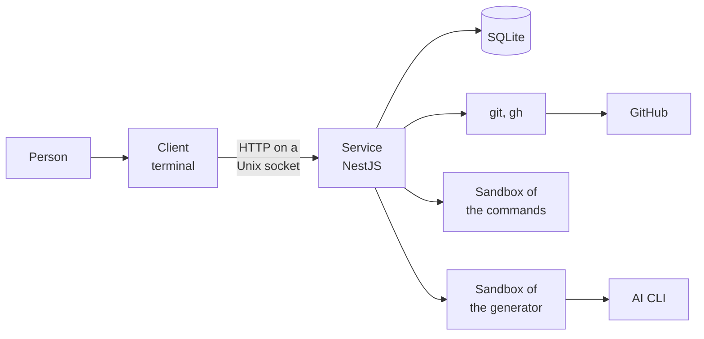
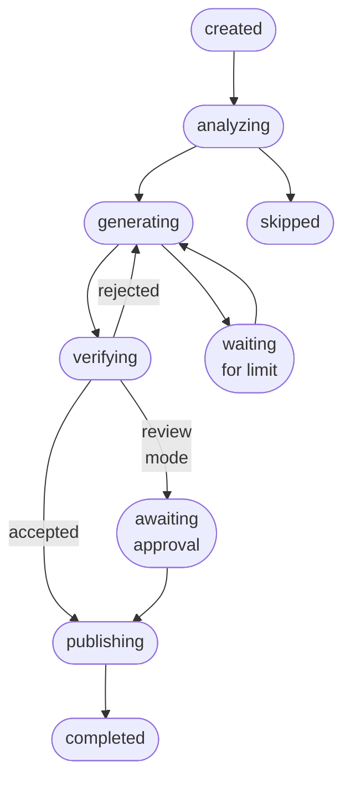
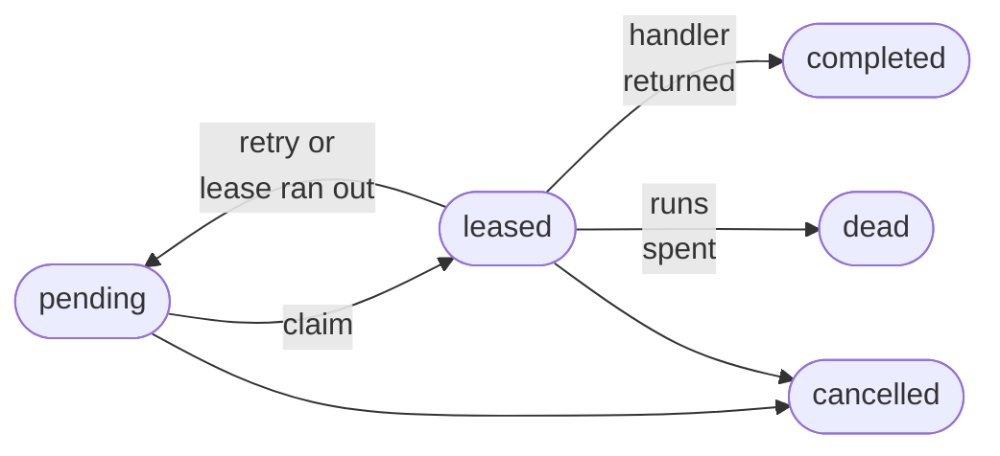
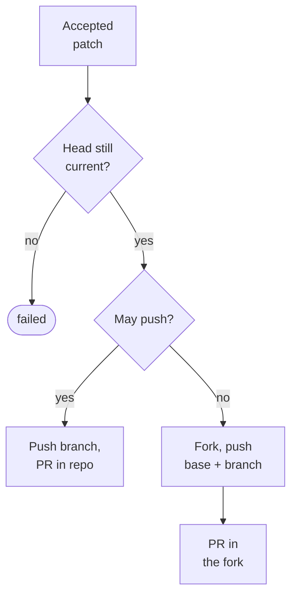

# System design

Author: Valentin Daitkhe

How the service works as it is built: its context, its modules, a scan, an
improvement, the gate, the queue, the sandbox and publication. What it is
for is in [Scope and requirements](scope-and-requirements.md), and where
the code lives is in [Project structure](project-structure.md).

## Context

- The client starts the service when nothing answers. The service keeps
  its database, lock, socket, tool output and working copies in one
  folder, `~/.coverage-autopilot` by default, readable by its owner only.
- Commands of a repository and the AI CLI run in containers of the
  engine, Docker by default. `git` and `gh` run on the host, never in a
  tree that code of the repository has touched.

## Modules

| Module | Owns |
| --- | --- |
| `repositories` | Repositories with their threshold and install mode, the access check, the head of the default branch, mirrors, working copies, patches and publication. All of `git` and `gh` |
| `coverage` | Project detection, installs, test runs with coverage, reports, snapshots and scans |
| `verification` | The gate: the baseline of a commit and the seven checks. It stores nothing |
| `improvement` | Improvements, attempts, the budget, the generator and the decision to publish |

- Each module uses only the modules below it in the table, through their
  contracts in `application/contracts/`. Only values cross: ids, commits,
  paths, patch text and DTOs. A module below that needs a fact of a
  module above declares a port, and the module above implements it.
- Each module has three layers, `domain`, `application` and
  `infrastructure`. Routes are adapters in `infrastructure/http/`.

## Life of a scan

- A scan is a job of kind `scan` with the id of its job: `queued`,
  `running`, `completed`, `failed` or `cancelled`. It reads the head of
  the default branch, then runs `clone`, `install`, `test_run` and
  `read_report`. Only the install has the network. Failing tests still
  give coverage, and the snapshot counts them.
- It fails with `unsupported_project` and the reason in words,
  `install_failed`, `test_run_timed_out`, `coverage_report_missing` or
  `retries_exhausted`.
- Eligible files are the `.ts`, `.tsx`, `.mts` and `.cts` files that are
  no declaration, test or tool configuration, outside hidden folders,
  `node_modules`, `dist`, `build`, `out`, `coverage`, test folders and
  folders of examples, demos, samples, benchmarks and fixtures. The runner
  gets this list, so a file no test imports is measured at 0%.

| The parser says | The report has | State |
| --- | --- | --- |
| The file does not parse | Anything | `unmeasured`, `parse_failed` |
| Type declarations only | Anything | `no_executable_code` |
| Code that runs | Nothing for the file | `unmeasured`, `missing_from_report` |
| Code that runs | Counters of zero total | `unmeasured`, `no_counters` |
| Code that runs | Counters above zero | `measured` |

An unmeasured file has no percentage and is never a target. The totals of
a snapshot count measured files only.

## The metric

A threshold is a metric, lines, and a whole percent $T$:
`AUTOPILOT_COVERAGE_THRESHOLD`, 80 by default, or the percent a repository
keeps of its own. With $c$ lines covered of $n$, a measured file is below
the threshold, and can be a target, when $100 \cdot c < T \cdot n$. There
is no division and no rounding, and a file with $n = 0$ is never below.

**Coverage went up** compares the target in the snapshot the analysis took
with the run of every test after the patch, under the same runner,
provider and file rule. It holds when more lines are covered and no
counter of statements, branches, functions or lines covers less.

**Mutants detected.** StrykerJS mutates the target file only. With $s_0(m)$
the status of mutant $m$ before the patch and $s_1(m)$ after it:

$$
U = \lbrace m : s_0(m) \in \lbrace \text{Survived}, \text{NoCoverage}
\rbrace \rbrace
\qquad
\Delta K = \lvert \lbrace m \in U : s_1(m) = \text{Killed} \rbrace \rvert
$$

$$
R = \lvert \lbrace m \in U : m \text{ is run by a new test},\
s_1(m) \ne \text{Timeout} \rbrace \rvert
$$

The check passes when $\Delta K \ge 1$ and $100 \cdot \Delta K \ge \theta R$,
with the kill rate $\theta = 50$ until a real run calibrates it. A
timeout is never a kill, and the score the tool prints is not used. Two
runs that do not hold the same set of mutants give an error, never a
rejection.

## Life of an improvement

- `failed` and `cancelled` can follow every status that is not final.
- **analyzing** checks that the file did not change since the snapshot,
  takes a fresh snapshot of the commit, and asks the gate for its
  baseline: the type check, the tests that fail, and the mutation
  baseline. It skips with `threshold_met` or `no_undetected_mutants`.
- **generating** opens an attempt while the budget allows and calls the
  generator in a fresh copy. The patch and its hash are saved before
  `verifying`. A call that changed nothing or hit its own limit closes
  the attempt, which still counts. A spent five-hour window waits with
  the same attempt, at most twice, and a spent quota fails. A written
  file that holds the credential, or a written `.git`, fails with
  `credential_exposed` and nothing of the run is kept.
- **verifying** runs the seven checks on the stored patch. A rejection
  closes the attempt, and the next one hears the reasons, at most ten
  surviving mutants and the first lines of a failed test run.
- **awaiting_approval** ends the job. An approval names the hash of the
  patch and queues a job that publishes.
- Other failures: `budget_exhausted`, `stale_snapshot`,
  `mutation_unsupported`, `existing_tests_fail`, `verification_error`,
  `generator_unavailable`, `publish_failed` and `retries_exhausted`.
- The budget is 3 attempts and 30 minutes by default, 10 and 120 at most,
  and tokens with an API key. The minutes become one deadline when work
  starts, and a wait moves it later by its length.

## The seven checks

| Order | Check | Passes when |
| --- | --- | --- |
| 1 | `test_files_only` | The patch only adds new plain files ending in `.test.ts` or `.test.tsx`, read strictly as git writes them, and git applied exactly those |
| 2 | `type_check` | The project still type-checks |
| 3 | `new_tests_pass` | The test files of the patch pass |
| 4 | `existing_tests_pass` | No test fails that did not fail before the patch |
| 5 | `repeated_runs` | The new tests pass three runs in a row |
| 6 | `coverage_increase` | Coverage went up, as defined above |
| 7 | `mutation_gain` | Mutants are detected, as defined above |

- A check ends `passed`, `failed`, `skipped`, `not_applicable` or `error`,
  and a failure does not stop the checks after it. `not_applicable`
  rejects nothing, such as a type check of a commit that did not
  type-check before.
- **accepted**: no required check failed or errored. **rejected**: one
  failed and none errored. **inconclusive**: one errored or is missing.
  It runs the attempt again when every error is retryable, and fails with
  `verification_error` otherwise.
- `AUTOPILOT_BASELINE_TESTS=must_pass` fails a commit with a failing test
  as `existing_tests_fail`. The default, `may_fail`, leaves the tests that
  failed before out of checks 4 and 7.

## The queue

- One `UPDATE ... RETURNING` claims a job: first a leased one whose lease
  ran out, then the oldest pending one whose repository has no leased job
  and whose moment has come. A unique index allows one leased job per
  repository.
- A lease lasts 60 seconds, a heartbeat extends it every 20, a job has 3
  runs, and two jobs run at once. All four are settings.
- Every claim gives a new lease token. A save checks it, and the version
  of the improvement, in its transaction, so a worker that lost its lease
  saves nothing.
- A technical retry repeats the same step and spends no attempt. Each
  step saves its status, so a run after a crash goes on from there with
  the stored patch, and publication finds what it made before.
- A request key repeated with the same request answers 200 with the
  earlier improvement, and with another request 409. The fingerprint, a
  SHA-256 of the repository, base commit, file, quality policy and
  generator, answers 409 while earlier work is active, completed or
  skipped, and lets a new request in after it failed or was cancelled.

## The sandbox and the secrets

- A command container has `--network none` unless it installs,
  `--cap-drop ALL`, `no-new-privileges`, a read-only root, a user that is
  never root, a `/tmp` in memory, limits of memory, processors, processes
  and output, and exactly the variables `PATH`, `HOME=/tmp` and `CI`.
- A working copy is mounted at its path on the host. Its git directory is
  kept outside it, git reads no setting, hook or driver of the tree, and a
  tree with an entry named `.git` is refused.
- The service builds its default images from files it ships: Node 26 with
  `ps`, `git` and Corepack for the commands, and Node with the AI CLI.
- Claude Code runs with `--restricted`, the tools `Read`, `Write`, `Edit`,
  `Glob` and `Grep` and no shell, no tool server, hooks and the
  `CLAUDE.md` files of the repository off, and a limit of turns. Its
  variables are its credential, `PATH` and a home in `/tmp`. A start
  report that names other tools throws the run away.
- A sandboxed install runs no script or hook of the repository. A trusted
  repository installs as its developers do, scripts included. Nothing
  after the install has the network in either mode.

## Publication

- The host applies the stored patch to a clean copy of the base commit
  and commits it as `test: cover <file>`, also the title. The body shows
  what the gate measured and names the tool, not a model. The branch is
  `coverage-autopilot/<improvement id>`. In a fork the base commit goes to
  `coverage-autopilot/base-<hash>` in the same atomic push.

## Storage and the socket

- SQLite through `node:sqlite`: six `STRICT` tables, `repositories`,
  `coverage_snapshots`, `file_coverages`, `improvements`, `attempts` and
  `jobs`, changed by numbered SQL migrations as the service starts.
  Stored JSON documents carry a version and are read with Zod. Raw tool
  output is kept in files named by their hash.
- A start takes the instance lock, migrates and checks the database,
  removes a stale socket and what a killed service left, then listens.
- Twenty routes serve repositories, scans, snapshots, improvements,
  budget settings, health and a stop. Every body is read with a Zod schema
  of `api-contracts`, contract version 6. A request that starts work
  carries an `Idempotency-Key`. A refusal is `{ "error", "message" }` with
  status 400, 404 or 409, and a fault is 500.
