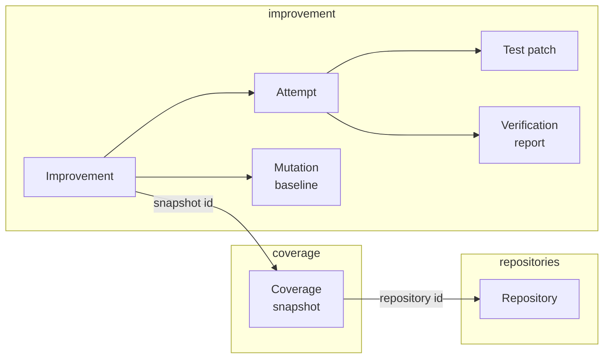
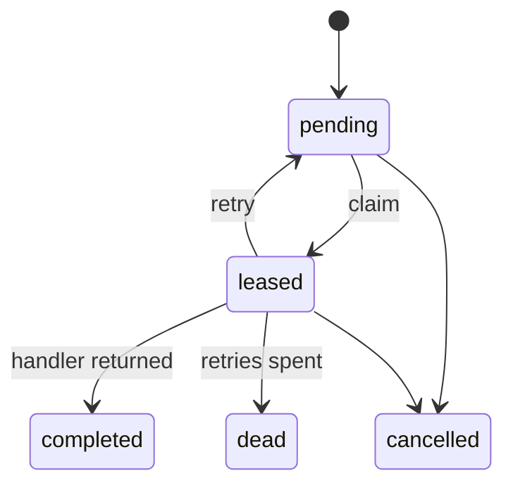
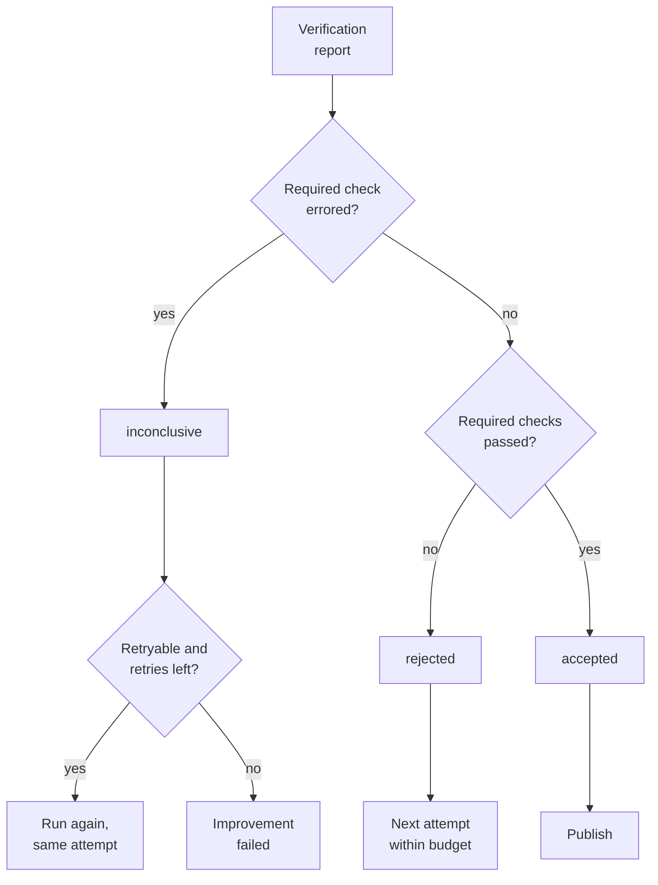
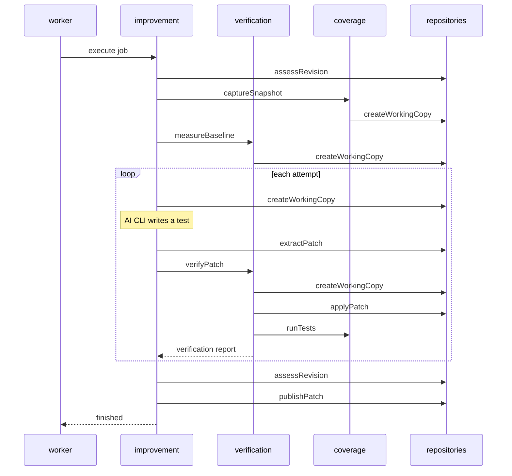
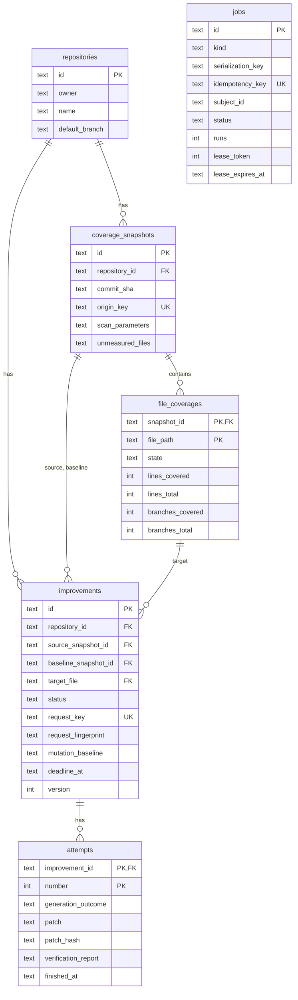
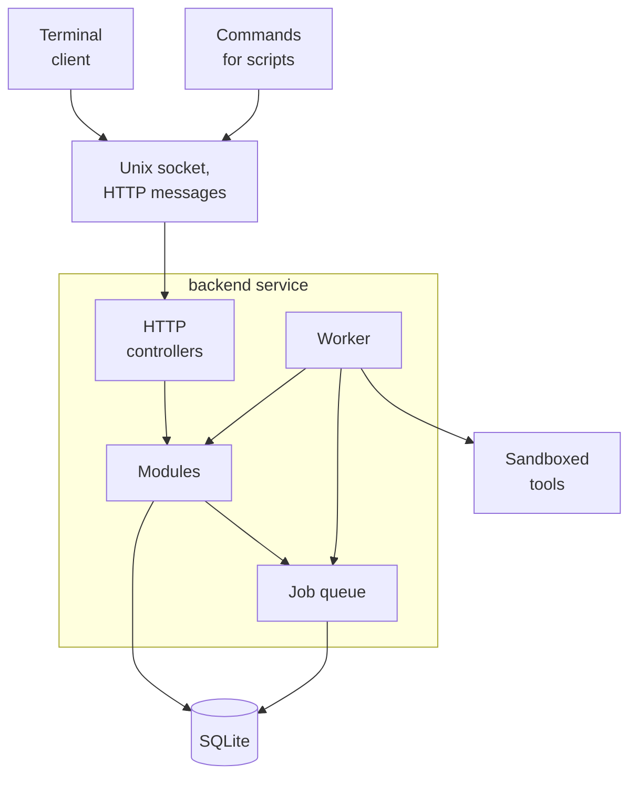

# System design

Author: Valentin Daitkhe

This document defines the domain model and the contracts of the system: the
objects it works with, their states, the rules of the quality gate, the way
the test generator is started, the way modules call each other, the database
schema, and the way the client talks to the service. It builds on
[Scope and requirements](scope-and-requirements.md) and
[Project structure](project-structure.md).

## Glossary

| Term | Meaning |
| --- | --- |
| Repository | A GitHub repository connected to the service |
| Working copy | A clean clone of a repository at one commit. It is temporary and can always be made again |
| Scan | A background run that measures the coverage of a repository |
| Coverage snapshot | The stored result of one scan: coverage of every file at one commit |
| Threshold | A coverage metric and a percentage. A file below it needs improvement |
| Improvement | The process of raising the coverage of one file, from the request to the pull request |
| Target | The file to improve, with its uncovered branches and undetected mutants |
| Attempt | One try at generating a test inside an improvement |
| Generator | The AI CLI that writes the test |
| Test patch | The diff an attempt produced. It touches test files only |
| Budget | The limits of an improvement: attempts, tokens and wall-clock time |
| Quality policy | The settings of the quality gate, fixed when the improvement is created |
| Check | One condition of the quality gate |
| Verification report | The results of all checks for one test patch, with the verdict |
| Verdict | The decision on a test patch: accepted, rejected or inconclusive |
| Mutant | A copy of the target file with one small change, used to see whether tests notice it |
| Mutation baseline | The mutants of the target file that the existing tests do not detect |
| Request key | A value the client makes for one command. The same key always returns the same result |
| Request fingerprint | A hash of what an improvement was asked to do. Two requests with the same fingerprint ask for the same work |
| Job | One unit of background work in the queue: a scan or an improvement |

## Domain model



Three aggregates are stored: `Repository`, `CoverageSnapshot` and
`Improvement`. Aggregates refer to each other by id only.

### repositories

| Object | Kind | Holds |
| --- | --- | --- |
| `Repository` | Aggregate | Owner and name, URL, default branch, time of connection |
| `WorkingCopy` | Value object | Path and commit of a clean clone. Not stored, and owned by the module that asked for it |
| `AccessCheck` | Value object | Preflight result: `git` present, `gh` authenticated, push allowed |

### coverage

| Object | Kind | Holds |
| --- | --- | --- |
| `CoverageSnapshot` | Aggregate | Repository, commit, detected project, scan parameters, origin key, coverage of every measured file, the files that could not be measured. Never changes after it is created |
| `FileCoverage` | Value object | File path, state, the four counters, uncovered lines and branches |
| `UnmeasuredFile` | Value object | File path and the reason it has no numbers |
| `DetectedProject` | Value object | Test runner and its version, package manager, configuration file |
| `CoverageThreshold` | Value object | Metric and percentage. Answers whether a file is below it |
| `TestRun` | Value object | Which tests passed and failed, and how long the run took |

`FileCoverage` has no identity of its own: it is fully described by its
snapshot and its path. It is still stored as one row per file, because the
storage layout does not have to repeat the model.

A snapshot has its own id. Repository and commit do not identify it, because
the same commit can give different numbers under a different runner version or
configuration. The snapshot records the parameters it was measured with.

A snapshot is not a copy of the runner's report. The report is outside data
that the adapter checks and sorts, as described in
[What a snapshot contains](#what-a-snapshot-contains).

### verification

| Object | Kind | Holds |
| --- | --- | --- |
| `QualityPolicy` | Value object | Which checks are required, the number of repeated runs, the mutation threshold |
| `VerificationReport` | Value object | The result of every check, the mutant counts before and after, the verdict and its reasons, links to raw output |
| `CheckResult` | Value object | One check: its status and the evidence |
| `MutationBaseline` | Value object | The undetected mutants of the target file under the existing tests |
| `Verdict` | Value object | Accepted, rejected or inconclusive |

The module stores nothing. It runs commands through its adapters and returns
values. The caller keeps them: the mutation baseline belongs to the
improvement and the verification report belongs to the attempt.

### improvement

| Object | Kind | Holds |
| --- | --- | --- |
| `Improvement` | Aggregate | Repository, source snapshot, baseline snapshot, base commit, target file, status, quality policy, generator configuration, budget and usage, attempts, mutation baseline, request key, request fingerprint, branch, pull request, failure reason |
| `Attempt` | Entity inside `Improvement` | Number, generation outcome, test patch, token usage, verification report |
| `Budget`, `BudgetUsage` | Value objects | The three limits and what has been spent. The time limit becomes an absolute deadline when work starts |
| `ImprovementTarget` | Value object | The file, its uncovered branches and its undetected mutants |
| `TestPatch` | Value object | The full text of the diff and its hash |
| `GeneratorConfig` | Value object | The AI CLI, the model and the prompt version |
| `PullRequestRef` | Value object | Number and URL of the pull request |

`Improvement` is the largest aggregate, so its job is kept narrow. It holds
transitions and invariants and nothing else:

- The status changes only along the transition table below.
- An attempt opens only while budget is left, and only one attempt is open at
  a time.
- An attempt is identified by the improvement and its number. Running a step
  again after a crash finds the open attempt and does not create a new one.
- The test patch is saved in full before the status moves to `verifying`,
  and never changes afterwards.
- A pull request is recorded only after an accepted verdict.
- The quality policy and the generator configuration never change after
  creation. Both are part of the request fingerprint.
- The source snapshot, the baseline snapshot and the base commit name the
  same commit.
- The target is a measured file of the source snapshot.

Budget arithmetic lives in `Budget`. Running the AI CLI, the tests and `gh`
belongs to the application layer, with one step class per status.

### Shared kernel

`RepositoryId`, `CommitSha` and `FilePath` live in `shared/kernel`, because
all four modules use them. The kernel holds only small stable types like
these and no aggregates.

## Two state machines

An improvement and the job that executes it have separate states, because
they answer different questions. The improvement says how far the work has
come. The job says whether a worker is on it right now.


- `analyzing` checks that the source snapshot is still current, captures a
  fresh snapshot at the same commit, measures the mutation baseline and
  selects the target.
- `skipped` means there is nothing to improve, because the fresh coverage
  already meets the threshold, or nothing that can be verified.
- `awaiting_approval` exists only in review mode.
- `failed` and `cancelled` can be reached from every status that is not final.
  `failed` carries a typed reason, such as `budget_exhausted`,
  `stale_snapshot`, `verification_error` or `retries_exhausted`.

An improvement is requested from an existing snapshot. That snapshot states
what the user wants: the repository, the commit and the file. The fresh
snapshot taken in `analyzing` is the actual baseline, measured in the same
sandbox the checks run in later.



The queue is technical code in `shared/infrastructure`. A job knows its kind,
the repository it serializes on, its idempotency key and the id of the object
it works on. The queue knows nothing about improvements. A scan has no
aggregate of its own: it is a job of kind `scan` and its result is a coverage
snapshot.

A job is `completed` when its handler returned, whatever the outcome was. The
outcome is stored with the job. `dead` means the handler could not finish
within the retry limit.

There are two kinds of repetition and they are counted separately:

| | Technical retry | Attempt |
| --- | --- | --- |
| Cause | The worker died, the lease expired, a check could not finish | The quality gate rejected the test patch |
| Counted by | The queue | The improvement, against its budget |
| What repeats | The same step of the same attempt | Generation, as a new attempt |
| Spends tokens | No | Yes |

One job covers a whole improvement, and each step saves the new status in its
own transaction. The repository stays reserved for the whole improvement. The
one exception is `awaiting_approval`: the job ends there, so that waiting for
a person does not block the repository, and the approval adds a new job that
publishes. How a job is completed is described under
[Queue and transactions](#queue-and-transactions).

## Recovery after a crash

A working copy is a temporary resource that can be made again. It is never
the source of truth. A new run always starts from a clean clone and looks at
the stored status:

| Status at the crash | What the new run does |
| --- | --- |
| `analyzing` | Measures the baselines again |
| `generating` | Finds the open attempt, which has no patch, and generates again as the same attempt |
| `verifying` | Applies the stored patch of the open attempt and verifies again |
| `publishing` | Applies the patch, looks for the branch and the pull request, and creates only what is missing |

The pull request cannot be part of a database transaction. Publishing is safe
to repeat because the branch name is derived from the improvement and the run
checks for an existing branch and pull request first.

One thing is not guaranteed. If the process dies during generation, the
tokens that call spent are unknown. The loss is bounded, because one generator
call is limited in turns and cost and technical retries are limited, but the
token budget is not exact. The details are under
[Test generator](#test-generator).

## Verification

The quality gate has seven checks:

1. The diff touches test files only. This is checked twice: on the text of
   the patch before it is applied, and on the list of changed files after.
   Renames, mode changes, symbolic links and binary files are refused.
2. The project type-checks.
3. The new tests pass.
4. Tests that passed before still pass.
5. The new tests pass on several consecutive runs.
6. Coverage of the target file went up.
7. The new tests kill mutants that no test detected before.

Each check ends in one of five statuses:

| Status | Meaning |
| --- | --- |
| `passed` | The condition holds |
| `failed` | The condition does not hold. The test patch is at fault |
| `skipped` | The policy turned the check off |
| `not_applicable` | The check has nothing to examine |
| `error` | The check could not finish. Carries a flag that says whether running it again can help |

The verdict follows from the statuses of the required checks:



- `accepted`: every required check passed. The patch is published.
- `rejected`: a required check failed. The reasons go back to the generator
  and the next attempt starts, if the budget allows.
- `inconclusive`: a required check ended in `error`, so no reliable decision
  exists. Generating again would not help and would only spend tokens. A
  retryable error runs the same attempt again. Any other error fails the
  improvement.

A report that is not complete never produces `accepted` or `rejected`.

All seven checks are required by default, mutation testing included. A policy
can turn the mutation check off. The check is then `skipped` and the pull
request says so.

## Mutation gate

Coverage shows that code ran. It does not show that a test checks anything: a
test that only calls a function passes the first six checks. The seventh
check closes that gap with StrykerJS.

A total mutation score is the wrong measure for two reasons. It can be high
because of tests that already existed, and Stryker counts a mutant that timed
out as detected. The gate measures what the new tests add instead.

Let $s_0(m)$ be the status of mutant $m$ under the existing tests and
$s_1(m)$ its status after the new tests are added. The mutation baseline is
the set of mutants that nothing detected:

$$
U = \lbrace m : s_0(m) \in \lbrace \text{Survived}, \text{NoCoverage} \rbrace \rbrace
$$

The gain is the number of them that the new tests kill:

$$
\Delta K = \lvert \lbrace m \in U : s_1(m) = \text{Killed} \rbrace \rvert
$$

The kill rate compares the gain with the mutants the new tests reach:

$$
R = \frac{\Delta K}{\lvert \lbrace m \in U : m \text{ is run by a new test},\ s_1(m) \ne \text{Timeout} \rbrace \rvert}
$$

The check passes when $\Delta K \ge 1$ and $R$ is at or above the policy
threshold. A mutant that timed out counts neither as killed nor as reached.

### How it is measured

- The baseline is measured once per improvement, in `analyzing`, and every
  attempt reuses it. It does not depend on the test patch.
- An attempt runs Stryker in incremental mode on a copy of the baseline
  cache. Results for mutants the new tests do not reach are reused. Starting
  from the baseline copy, and not from the previous attempt, keeps attempts
  independent.
- Both runs use the same commit, the same sandbox and the same mutation
  settings. Only the test files differ.
- The gate computes $U$, $\Delta K$ and $R$ itself from the two reports. It
  does not use the score Stryker prints.

Measuring the baseline before generation also finds two cases before any
tokens are spent:

| Found in `analyzing` | Result |
| --- | --- |
| Stryker cannot run on the project | The improvement fails with a configuration reason |
| $U$ is empty | The improvement is `skipped`: no uncovered logic can be verified |

### Requirements for the adapter

1. Two operations: measure the baseline, and verify a patch against it.
2. The adapter returns the project's own types. A mutant is identified by
   file, mutator, position and replacement. The Stryker id is kept for
   diagnostics only.
3. Test ids are local to one report. The tests that ran or killed a mutant are
   resolved through the test list of the same report, and passed on as a
   relative file path and a full test name.
4. The mutants of the attempt report must be the same set as in the baseline.
   A difference is an incomplete report, not a rejection.
5. A run that goes past its deadline is stopped from outside, because Stryker
   has no limit for a whole run. The result is `error`, retryable.
6. The incremental cache is saved before the temporary directory is removed.
   The cache only saves time. A run that lost it starts from the baseline
   again and gives the same result.
7. Stored reports contain no absolute paths, no terminal colour codes and no
   unbounded stack traces.

Three artifacts have different conditions for being trusted:

| Artifact | Trusted when |
| --- | --- |
| Incremental cache | After any run, complete or not. Used only to resume |
| Mutation baseline | Only after a full baseline run finished |
| Verification report | Only after every required check finished and the verdict was computed |

### Feedback for the generator

A rejection names the mutants that are still undetected: the position, the
change, and whether a test runs that code at all. The next attempt gets a
concrete target, for example "line 42: replacing `>` with `>=` is not
noticed by any test". The list is limited in size so that it does not use up
the token budget. Stryker reports what was not detected, not why.

### What was measured

I ran both runners on a small project with one source file and 42 mutants.
Versions: StrykerJS 10.1.1, Jest 29 with ts-jest, Vitest 4.1. Both runners
gave the same numbers.

| New test | Stryker score | $\Delta K$ | $R$ |
| --- | --- | --- | --- |
| Calls the functions, asserts nothing | 23.81% to 26.19% | 0 | 0 of 20 |
| Asserts the returned values | 23.81% to 73.81% | 20 | 20 of 20 |

- The score went up for the test without assertions because one loop mutant
  timed out.
- With a new test file added, 21 of 42 results were reused.
- Mutant ids stayed the same between runs on unchanged source. Test ids did
  not: Jest renumbered them when a file was added.
- After `SIGINT` and after `SIGTERM` Stryker saved a partial cache, and the
  next run reused 20 of 42 results. The final report is not written in that
  case and the temporary directory is left behind.

Not measured and not claimed: the Stryker TypeScript checker, large projects,
monorepos, Jest in ESM mode, and what survives `SIGKILL` or an out-of-memory
kill. The threshold for $R$ is not calibrated yet. The two tests above sit at
0% and 100% and say nothing about a value in between.

## Test generator

The generator is the AI CLI that writes the test. It is reached through one
port, `TestGenerator`, in `improvement/application/ports`. The adapter for a
concrete CLI lives in `improvement/infrastructure`. The first adapter runs
Claude Code in its non-interactive mode. Another CLI is a second adapter, and
`GeneratorConfig` says which one to use.

```ts
interface TestGenerator {
  generate(
    request: GenerationRequest,
    signal: AbortSignal,
  ): Promise<GenerationResult>;
}
```

A request carries the working copy, the target with its uncovered branches
and undetected mutants, the reasons the previous attempt was rejected, the
generator configuration and the limits of this call. The result is one of:

| Outcome | Meaning | What the improvement does |
| --- | --- | --- |
| `generated` | The CLI finished and changed files | Extracts the patch and verifies it |
| `no_changes` | The CLI finished and changed nothing | Closes the attempt without verification |
| `limit_reached` | The call hit its turn or cost limit | Closes the attempt without verification |
| `quota_exhausted` | The account has no usage left for now | Fails with a generator reason. A quick retry would not help |
| `credential_exposed` | A changed file contains the credential | Fails with a security reason. No patch is stored |

Every outcome reports the tokens it used. An attempt that produced no patch
still counts against the budget. A missing CLI or a failed login is a fault
and is raised as a typed exception.

### How the generator is started

The repository is untrusted, and an AI CLI reads configuration from the
directory it runs in. These rules hold for every adapter:

1. The CLI runs inside the generator sandbox, never directly on the host.
2. Its environment is an explicit list: the credential of the language model
   and nothing else from the service.
3. Configuration that comes with the repository is switched off: hooks, tool
   servers and project settings.
4. The CLI can read and write files in the working copy. It has no shell, no
   network tools, and no access to files outside the working copy, also not
   through a symbolic link.
5. Before the first model call the adapter reads the CLI's own start report
   and stops the run unless it lists exactly the allowed tools and no tool
   servers.
6. A call is limited three ways: a number of turns, an estimated cost, and a
   deadline enforced from outside, because the CLI has no time limit of its
   own.
7. After any outcome other than `generated` the working copy is thrown away.
   A run that stopped at a limit may already have written a file.
8. Tool calls the CLI refused are recorded. They are a sign that something in
   the repository tried to steer the model.
9. The adapter knows the credential, so it searches the changed files for its
   exact value before it returns.

The token budget is not exact with a CLI. It limits turns and estimated cost,
not tokens, the cost limit can be passed by one response, and a run that was
killed reports nothing. The real token count comes only with the final
result.

### What the generator run showed

I ran Claude Code 2.1.329 in a scratch repository that carried harmless
traps: four hooks, a tool server, an environment value, a symbolic link to a
file outside, and an instruction in a source comment. The child process got a
cleaned environment.

Without protection, a prompt that only asked for the word OK was enough: the
hooks of the repository ran, its tool server started and its environment
value reached the hooks. There was no trust prompt.

```bash
claude --restricted \
  --tools "Read,Write,Edit,Glob,Grep" \
  --permission-mode acceptEdits --permission-prompts none \
  --strict-mcp-config \
  --settings '{"disableAllHooks":true,"permissions":{"blockReadsOutsideWorkingDirectories":true}}' \
  --output-format json --no-session-persistence \
  -p "<prompt>" < /dev/null
```

| Tried under protection | Result |
| --- | --- |
| Hooks and tool server from the repository | Did not run |
| Read through the symbolic link | Refused |
| Read an absolute path outside, and `/etc/hosts` | Refused |
| Write a file outside the working copy | Refused |
| Run a shell command | No shell among the tools |
| Write the requested test file | Written, nothing else changed |

- Refused calls are listed in the result and the exit code stays 0, so the
  adapter has to read the list.
- The turn limit and the cost limit both end with exit code 1 and a typed
  subtype. With a cost limit of 0.0005 the run reported 0.00089, and the test
  file was already on disk.
- `SIGTERM` gives exit code 143 and no output.
- The streaming output starts with a report of the tools and tool servers in
  effect, and carries the state of the account's usage limits. Output token
  counts in it are placeholders until the final result.

Not measured and not claimed: whether a `CLAUDE.md` from the repository
reaches the model, since two probes gave the same answer with and without
protection; login with a long-lived token or an API key; running inside a
container or on Linux; and what a blocked usage limit looks like.

## Contracts between modules

Modules call each other synchronously through their contracts. The first
version has no event bus, because no part of the system would consume the
events: the client asks for the status of a job.

### Rules

- A module exposes one interface in `contracts/`, with the DTO types it uses.
  The interface can be split by responsibility when it grows. Other modules
  still import from `contracts/` only.
- Only values cross a boundary: ids, commit hashes, file paths, patch text and
  DTOs. Aggregates never do.
- A working copy is a technical resource with one owner, the module that
  asked `repositories` for it. A request that starts work in another module
  carries the repository, the commit and the patch text, and that module
  makes its own clean copy.
- The owner may lend a working copy to a module below it, as `verification`
  does when it asks `coverage` to run tests. Lending has four limits:
  - Only the owner disposes of the copy.
  - The borrower keeps no reference to it and does not hand it to background
    work.
  - The loan ends when the call returns.
  - Copies of different attempts and different jobs are separate directories.

  The borrower may write into the copy, for example reports and caches. It
  uses the copy and does not control its life.
- An operation answers in one of three ways. `null` means not found. A value
  with an `outcome` field is an expected result. A typed exception with a
  `code` and a `retryable` flag is a fault.
- An operation takes one request object and, when it can be stopped, an
  `AbortSignal`.
- Modules do not validate each other's data with Zod, because they share one
  process and its types. Zod parses what comes from outside: HTTP requests,
  configuration, tool output, and everything read back from JSON columns in
  SQLite or from artifact files.

### One improvement across modules



### The repositories contract

Everything that uses `git` and `gh` is here.

| Operation | Called by | Result |
| --- | --- | --- |
| `getRepository` | coverage, improvement | The repository or `null` |
| `checkAccess` | improvement | The preflight result |
| `assessRevision` | improvement | Whether the snapshot commit is still current for a file |
| `createWorkingCopy`, `disposeWorkingCopy` | coverage, verification, improvement | A clean clone at a commit, private to the caller |
| `extractPatch` | improvement | The diff of a working copy as text |
| `applyPatch` | verification | Applied, or refused with a reason |
| `publishPatch` | improvement | The branch and the pull request |

`improvement` decides whether to publish and supplies the branch name, the
title and the text. `repositories` does the work: it makes a clean clone at
the base commit, applies the stored patch, commits, pushes and opens the pull
request. It never takes a diff from a directory left by the generator. Called
again, it finds the branch and the pull request it made before and returns
them.

### The coverage contract

| Operation | Called by | Result |
| --- | --- | --- |
| `captureSnapshot` | improvement | A stored snapshot, or the reason the project cannot be measured |
| `prepareProject` | verification, improvement | Ready, unsupported, or install failed |
| `runTests` | verification | A test run, with coverage on request. Not stored |
| `getSnapshot`, `getFileCoverage` | verification, improvement | The snapshot, the file coverage, or `null` |

`captureSnapshot` takes a repository, a commit and an origin key: the id of
the scan job or of the improvement that asked. Called again with the same
key, it returns the snapshot it already stored. `prepareProject` and
`runTests` work in a working copy lent by the caller.

#### What a snapshot contains

The report of a test runner is not trusted as it is. Without a file list it
leaves out every file that no test imports. With a list it can still drop a
file, or invent numbers for a file it never loaded. So the adapter decides
which files belong to a snapshot and puts each of them in exactly one state.

1. The adapter builds the list of eligible files: the source files that the
   project's own coverage settings include, or a default list when the
   project has none.
2. It reads every file with the TypeScript parser. Nothing is type-checked
   and nothing is run.
3. It gives the runner the files that parse and hold code that runs.
4. It compares the report with its own list.

$$F_{\text{eligible}} = F_{\text{measured}} \sqcup F_{\text{no code}} \sqcup F_{\text{unmeasured}}$$

The three sets do not overlap, and every eligible file is in one of them.

| State | Means | Stored as | Can be a target |
| --- | --- | --- | --- |
| `measured` | The file parses, holds code that runs, and the report counts it | A row with counters | Yes, when below the threshold |
| `no_executable_code` | The file parses and holds type declarations only | A row with every counter at zero | No |
| `unmeasured` | There are no numbers that can be trusted | An entry in the snapshot with a reason | No |

The state follows from two inputs:

| The parser says | The report has | State |
| --- | --- | --- |
| The file does not parse | Anything | `unmeasured`, reason `parse_failed` |
| Type declarations only | Anything | `no_executable_code` |
| Code that runs | Counters with a total above zero | `measured` |
| Code that runs | Nothing for this file | `unmeasured`, reason `missing_from_report` |
| Code that runs | Counters that are all zero of zero | `unmeasured`, reason `no_counters` |

- The state comes from the adapter's own reading of the source, never from
  the counters alone. A row of zeros from the runner proves nothing.
- "Type declarations only" means that every top-level statement is an
  interface, a type alias, a type-only import or export, or a `declare`
  statement.
- An unmeasured file has no percentage. It is not 0%.
- The reasons are the three the adapter can tell apart from its two inputs.
  Why a runner dropped a file is in its raw output, which is kept as a file.
- The totals of a snapshot are computed over measured files only.
- A file with no executable code is stored as a row but is never a target.
  The application layer checks this before it creates an improvement.

Coverage numbers describe a file under one set of tools, not the file on its
own. The scan parameters of a snapshot record the runner and its version, the
coverage provider and the rule that built the file list. Numbers are compared
only between measurements with the same parameters. The gate compares the
baseline snapshot with the run after the patch, and one improvement makes
both with the same parameters. If they differ, the coverage check ends as
`error`.

#### What the coverage run showed

I ran Jest 29.7 with ts-jest and Vitest 4.1 on a project with four source
files: one that a test imports, one that nothing imports, one with types
only, and one with a syntax error.

| Run | Never imported | Types only | Syntax error |
| --- | --- | --- | --- |
| Either runner, no file list | Absent | Absent | Absent |
| Jest, Babel provider, file list | 0 of 5 | Absent | Absent, one line in the log |
| Jest, V8 provider, file list | 0 of 8 | 0 of 6 | 0 of 6, nothing in the log |
| Vitest, V8 provider, file list | 0 of 4 | 0 of 0 | Absent, one line in the log |
| Vitest, Istanbul provider, file list | 0 of 4 | Absent | The whole run fails |

- A file that nothing imports appears only when the file list is passed:
  `--collectCoverageFrom` for Jest and `--coverage.include` for Vitest.
- The V8 provider of Jest makes a row from the line count of a file it never
  loaded. A file with types only and a file that does not parse both look
  like files with 0% coverage.
- No report says that a file could not be measured. The file is dropped,
  faked, or stops the run.
- The imported file had 4 of 8 statements covered under Jest with Babel, 5 of
  13 under Jest with V8 and 2 of 6 under Vitest. The numbers depend on the
  tools.

Not measured and not claimed: the sorting of files into three states is a
design that follows from this run and has not been run itself. Also not
measured: a project that sets its own file list, `.tsx` files, monorepos, and
a file that fails when it is imported and not when it is parsed.

### The verification contract

| Operation | Called by | Result |
| --- | --- | --- |
| `measureBaseline` | improvement | The mutation baseline, or the reason it cannot be measured |
| `verifyPatch` | improvement | A verification report |

A `verifyPatch` request carries the repository, the base commit, the patch
with its hash, the target file, the allowed paths, the id of the baseline
snapshot, the mutation baseline, the quality policy, a deadline and an id for
log correlation. The report repeats the patch hash, so it is clear which text
was verified. `verification` never retries on its own.

`improvement` is at the top of the dependency graph. It exposes nothing to
other modules and is reached only through HTTP.

### Queue and transactions

The domain may refer to `Clock`, `IdGenerator` and an opaque `Transaction`
handle, so they live in `shared/kernel`. The ports only the application layer
needs live in `shared/application/ports`:

```ts
interface JobQueue {
  enqueue(
    request: EnqueueJobRequest,
    tx: Transaction,
  ): Promise<EnqueueJobResult>;
  cancel(jobId: JobId, tx: Transaction): Promise<void>;
  getJob(jobId: JobId): Promise<JobDto | null>;
}

interface JobHandler {
  readonly kind: JobKind;
  execute(context: JobContext): Promise<JobResult>;
  onRetriesExhausted(context: DeadJobContext): Promise<void>;
}

interface JobContext {
  readonly jobId: JobId;
  readonly subjectId: string;
  readonly leaseToken: LeaseToken;
  readonly signal: AbortSignal;
  commit<T>(operation: (tx: Transaction) => Promise<T>): Promise<T>;
}

interface JobFinished {
  status: 'finished';
  outcome: JobOutcome;
}

interface JobRetry {
  status: 'retry';
  reason: RetryReason;
}

type JobResult = JobFinished | JobRetry;
```

- `enqueue` runs in the caller's transaction, so an improvement and its job
  are created together. A request names the kind of job, the repository it
  serializes on, an idempotency key and the id of the object it works on.
  The caller builds the key from the object and the step, such as
  `improvement:<id>:run`. A second request with the same key returns the
  existing job when the kind, the repository and the payload are the same,
  and is a conflict when they are not.
- The worker owns the lease, the heartbeat and the count of technical
  retries. Nothing else counts them.
- A handler asks for a retry by returning `retry`. An inconclusive verdict
  with a retryable error becomes a retry this way, without an exception. A
  fault that cannot be retried moves the improvement to `failed`, and the
  handler returns `finished`.

#### Claiming a job

A worker claims a job with one `UPDATE ... RETURNING` statement, so two
workers cannot take the same job.

- A job whose lease ran out comes first, because it still holds its
  repository. The same row is leased again and gets a new lease token.
- Then comes the oldest pending job whose repository has no leased job.
- The order is set where the candidate is chosen. SQLite does not promise
  an order for the rows that `RETURNING` gives back.
- A job whose lease ran out and whose runs are spent is moved to `dead`
  before the claim, and its handler is told through `onRetriesExhausted`.

A unique index allows one leased job per repository. That is a fact about
the rows. It does not stop a process that lost its lease from still running
a command, which is why the next rule exists.

#### A worker that lost its lease saves nothing

A worker can outlive its lease. It starts a long mutation run, the lease
expires, another worker claims the job, and then the first worker comes back
with a result. Checking the lease before saving is not enough, because the
lease can change between the check and the write.

Every claim gives the job a new lease token, a number that only grows. A
handler saves through `context.commit`, which does three things in one SQLite
write transaction:

1. Checks that the job is still `leased` and still carries the token of this
   context.
2. Runs the operation, which saves the state of the improvement.
3. Commits both together, or raises `LeaseLostError` and saves nothing.

- The check compares the token and the status, not the clock. An expired
  lease that nobody claimed does not throw away finished work.
- The operation contains database statements only.
- Everything a handler saves about its own object goes through
  `context.commit`: the status, the attempts, the mutation baseline and the
  verification reports. The heartbeat and the completion of the job check
  the token the same way.
- Aggregates know nothing about leases. The application layer applies the
  guard.
- Data stored by a module below, such as a coverage snapshot, is immutable
  and found by its origin key, so a late duplicate changes nothing.
- The token protects the database only. A `git push` that already started
  cannot be taken back, which is why publishing is safe to repeat.
- A result is saved once. The work behind it can run more than once: a
  mutation run or the AI CLI may start again after a lost lease.
- A write also checks the version of the improvement, because a cancel or an
  approval from the API can arrive while the worker is busy.

#### Completing a job

A job is completed in two steps. The handler saves the final status and
returns, then the worker marks the job as completed. If the process dies in
between, the lease expires and the next run finds the final status. This
works because every handler can be run again:

| Found by the new run | What it does |
| --- | --- |
| The improvement is in a final status, the job is leased | Returns the stored outcome and repeats nothing |
| The snapshot is stored, the scan job is not completed | Finds the snapshot by its origin key |
| The pull request exists, the improvement does not know it | `publishPatch` finds it by its branch and returns it |
| The improvement is `failed`, the job is not marked dead | `onRetriesExhausted` finds the final status and does nothing |

The price is small: after such a crash the repository stays reserved until
the lease runs out.

### Stopping a running job

One `AbortSignal` reaches every operation of a job. The modules below only
stop, release what they hold and raise one error. The reason is typed, and
only the handler and the worker read it:

| Reason | Set when | Result |
| --- | --- | --- |
| `user_cancelled` | The user cancelled the job | The improvement becomes `cancelled` |
| `deadline_exceeded` | The deadline stored in the improvement has passed | The improvement becomes `failed` with `budget_exhausted` |
| `worker_shutdown` | The worker is stopping | The job returns to `pending` and no retry is counted |
| `lease_lost` | Another worker may hold the job now | The worker stops and saves nothing |

The wall-clock limit of the budget is an absolute time. It is set when the
improvement starts work and stored with it, so a restart of the process
cannot reset it. Time spent in the queue before the start and time spent
waiting for approval do not count.

The time limit of a single operation is a different thing. A mutation run
that goes past its own deadline is stopped by the operation that started it.
The check ends in `error`, the verdict is inconclusive and the attempt runs
again. The deadline of the improvement wins: if it has passed by then, the
improvement fails with `budget_exhausted` and nothing is retried.

### Who owns what

| Responsibility | Owner |
| --- | --- |
| The time budget of an improvement | `Improvement` |
| The time limit of one operation | The module that runs it |
| A generation attempt | `Improvement` |
| A technical retry | The worker and the queue |
| The life of a working copy | The module that asked `repositories` for it |
| Use of a borrowed working copy | The called module, for one call |
| The lease and its token | The queue, through `JobContext` |
| Saving the state of an aggregate | The module that owns it, through its repository |
| Completing a job | The worker |

### Is the snapshot still current

Generating a test for a file that has already changed wastes tokens.
`assessRevision` compares the snapshot commit with the head of the default
branch:

| Situation | Outcome | Decision |
| --- | --- | --- |
| The head is the snapshot commit | `current` | Continue |
| The head moved, the target file is the same | `unchanged` | Continue |
| The head moved, the target file changed | `stale` | Stop |
| The snapshot commit is not an ancestor of the head | `diverged` | Stop |

The check runs three times:

1. When the improvement is requested. A stale request is refused and no
   improvement is created.
2. In `analyzing`, before the first generation. The improvement fails with
   `stale_snapshot` and no tokens are spent.
3. Before publishing. The improvement fails with `stale_snapshot`, and the
   accepted patch stays stored.

A stale snapshot is `failed`, not `skipped`: the improvement was needed, but
its input was out of date. The check does not prove that the pull request
merges cleanly, so the repository's own CI stays the last judge. A change in
the lockfile or in the test runner configuration is recorded for diagnosis
and does not stop the improvement.

### Storage

- Aggregates and the queue share one SQLite file. That is what makes
  `enqueue` inside the caller's transaction possible. The tables are in
  [Database schema](#database-schema).
- A transaction contains database statements only. Cloning, the AI CLI and
  test runs happen outside it, because SQLite allows one writer at a time.
- The sandbox cannot see the directory that holds the service's data.
- A cache of prepared working copies is read-only. Every run gets its own
  writable copy, so two runs on one repository cannot affect each other.

Each check makes its own clean copy and installs dependencies again. What
that costs in time is not measured yet.

## Database schema

The service uses SQLite through a plain SQL driver, with no ORM and no query
builder. The schema changes through numbered SQL migrations. A persistence
adapter holds the SQL and maps rows to an aggregate, and the aggregate knows
nothing about tables. Transactions, the version check on an improvement,
foreign keys, partial unique indexes and the lease token are all written out
in SQL. This is a constraint of the architecture, not a detail of the first
version.

Three aggregates and the queue are stored in six tables. Five hold the
aggregates and one holds the jobs. The diagram shows the key columns only.



| Table | Stores |
| --- | --- |
| `repositories` | Connected repositories |
| `coverage_snapshots` | One snapshot: commit, scan parameters, totals, the files that could not be measured |
| `file_coverages` | One row for every measured file and every file with no executable code |
| `improvements` | Status, the two keys, quality policy, generator configuration, budget and usage, mutation baseline, branch, pull request, failure reason |
| `attempts` | Test patches and verification reports |
| `jobs` | Leases, lease tokens, run counts, idempotency keys |

### Rules the database checks

| Rule | How |
| --- | --- |
| One open improvement per repository and file | Unique index on repository and target file, over rows whose status is not final |
| The same request key gives the same improvement | Unique index on the request key |
| The same work is not done twice | Unique index on the request fingerprint, over rows that are not `failed` or `cancelled` |
| One open attempt per improvement | Unique index on the improvement, over rows with no finish time |
| One running job per repository | Unique index on the serialization key, over `leased` rows |
| One job per idempotency key | Unique index on the key |
| One snapshot per origin | Unique index on the origin key |
| A snapshot belongs to the repository of its improvement | Foreign key on snapshot and repository together, for the source and for the baseline |
| The target is a file of the source snapshot | Foreign key on snapshot and file path together |
| A status is a known value | `CHECK` on the status of improvements and of jobs |
| A patch has a hash | `CHECK` that both are set or neither is |
| A stored document is JSON | `CHECK` with `json_valid` |

- Every column that an index or a check reads is `NOT NULL`. SQLite does not
  see two `NULL` values as a conflict, and a check that gives `NULL` passes.
- An index over open rows is written as "the status is not a final one". A
  status added later counts as open until someone decides otherwise.
- Both status columns have a `CHECK` because indexes read their text. A
  misspelt status would otherwise slip past the index. Other lists of values
  are checked by the domain.
- The database checks that a status is a known one. Which move between
  statuses is allowed stays a rule of the aggregate.
- An unmeasured file has no row in `file_coverages`, so the foreign key
  alone keeps it from being a target.
- `jobs` has no foreign key to another table. The id of the object a job
  works on is plain text to the queue, and the handler checks that the
  object exists.
- Two ordinary indexes serve the claim: pending jobs by time, and leased
  jobs by the end of the lease.

### Two keys of an improvement

One key answers "is this the same request", the other "is this the same
work".

| The request has | Result |
| --- | --- |
| The same key and the same fingerprint | 200 with the improvement made before, whatever its status |
| The same key and another fingerprint | 409 |
| Another key, the same fingerprint, the earlier work is active | 409 with the id of the earlier improvement |
| Another key, the same fingerprint, the earlier work is `completed` or `skipped` | 409 with the id of the earlier improvement |
| Another key, the same fingerprint, the earlier work is `failed` or `cancelled` | 202 with a new improvement |

The service opens a write transaction, looks for the earlier improvement by
key, by fingerprint and by open target, and only then inserts. SQLite has one
writer, so nothing changes between the look and the insert. The indexes stay
as a safety net. The code does not tell conflicts apart by the error it gets
back: every unique conflict has the same code.

### What is stored where

Everything a verdict or a recovery depends on is in SQLite. Files hold only
what can be lost.

| Data | Where |
| --- | --- |
| Coverage snapshot with the state of every file | SQLite |
| Mutation baseline: every undetected mutant with its file, mutator, position, replacement and status | SQLite |
| Test patch and its hash | SQLite |
| Verification report: the result of every check, the status of every mutant after the patch, the reasons of the verdict | SQLite |
| Budget usage | SQLite |
| Raw output of the tools | Files |
| Cache of the mutation tool | Files |
| Working copies | Files, temporary |

- A missing file makes a run slower or shows as "not available". It never
  changes a verdict and never fails a job.
- A file is written under a temporary name and renamed. Only then does the
  database get a reference to it, in the transaction that saves the state.
- The name of a file contains the hash of its content. A worker that lost
  its lease cannot overwrite a file the database points to.
- A file without a reference is removed later.

The patch of an attempt is written once:

| Stored patch | Result of a write |
| --- | --- |
| None | The patch and its hash are saved in one transaction with the move to `verifying` |
| The same hash | The stored patch is used |
| Another hash | An integrity error that is not retried |

After a crash the worker reads the status and the stored patch. It does not
start the generator again to see whether the text matches.

### Migrations

The service brings the database up to date by itself when it starts. This is
the default and there is no command for the user to run.

- A migration is a plain SQL file in `backend/migrations/`. The files are
  numbered and applied in order.
- The service applies the missing ones after it takes the instance lock and
  before it opens the socket. No request and no worker ever sees a database
  that is half migrated, and no other connection is open while it happens.
- SQLite keeps a version number in the database file, so no extra table is
  needed to know which migrations ran.
- Migrations only go forward. A database with a higher version than the
  service knows is refused with a clear error, and nothing in it is changed.
- A new version of the tool reaches an existing database the usual way: the
  client sees another contract version, the old service stops, and the new
  one migrates as it starts.

Every migration runs by the same procedure:

1. Foreign key checks are switched off. SQLite ignores this switch inside a
   transaction, so it comes first.
2. A write transaction begins.
3. The statements of the migration run.
4. `PRAGMA foreign_key_check` must find nothing. If it finds a broken
   reference, the transaction is rolled back.
5. The new version number is written and the transaction is committed.
6. Foreign key checks are switched on again.

- There is one procedure and not two. Changing a `CHECK` or a foreign key
  means building the table again, and SQLite refuses to drop a table that
  others refer to while the checks are on. A second kind of migration for
  that case would be one more thing to mark and to forget.
- A migration that fails leaves the database as it was, and the service
  does not start. It writes the reason to a file in the instance directory,
  and the client that is waiting shows it.
- A migration holds only statements that can be rolled back. `VACUUM` and
  any other statement that SQLite refuses inside a transaction is not
  allowed in one.
- On every start, after the migrations, `PRAGMA quick_check` and
  `PRAGMA foreign_key_check` run on the whole database. A finding stops the
  start.

A migration changes tables. It does not change the JSON documents stored in
them, and unfinished work outlives an update: pending jobs, improvements that
wait for approval, improvements that a crash left in the middle. So every
change to the shape of a stored document does one of two things:

- The new service still reads the old version. It keeps the Zod schema of
  that version and converts the document when it reads it. This is the
  default.
- The migration rewrites the stored documents.

A change that does neither is not released. The rule covers the payload and
the outcome of a job, the quality policy, the generator configuration, the
mutation baseline, the verification report, the scan parameters and the list
of unmeasured files. A status that is renamed or removed is rewritten by the
migration in the same way. A test reads a stored sample of every version of
every document with the current code.

I tried the procedure on SQLite 3.53:

- The version number is committed with the migration and goes back with it
  on a rollback and on a failed statement.
- With the checks on, a migration that builds `improvements` again was
  refused at the `DROP TABLE`, because `attempts` refers to it.
- By the procedure the same migration added a status. The rows stayed, and
  afterwards a misspelt status, an attempt of a missing improvement and the
  removal of an improvement with attempts were all refused.
- A migration that left an attempt without its improvement was found by
  `PRAGMA foreign_key_check` and rolled back.
- `VACUUM` inside a transaction was refused.
- On a database of 18 MB with 200,000 file rows `PRAGMA quick_check` took
  14 ms and `PRAGMA foreign_key_check` 11 ms.

### Conventions

- SQL lives in the `infrastructure/persistence` folder of a module, in
  `shared/infrastructure` and in the migrations, and nowhere else.
- Every table is `STRICT`. Foreign keys are switched on. The journal is a
  write-ahead log, and a writer waits for a busy database before it fails.
- Ids are text UUIDs from `IdGenerator`.
- Time is text in UTC in one format, `YYYY-MM-DDTHH:mm:ss.sssZ`, and comes
  from `Clock`. The clock of SQLite is never used. Text of a fixed width
  sorts the way time does.
- A file path is the path as git stores it: relative, with forward slashes
  and no `.` or `..` parts. Letter case and Unicode form are left as they
  are.
- A stored JSON document carries the version of its schema and is parsed
  with Zod when it is read. An unknown version is a typed error that is not
  retried.
- Nothing is deleted in the first version.
- The instance lock is a file of its own and not part of this schema.
- The SQLite driver is not chosen yet.

### What the database run showed

I tried a draft of this schema on SQLite 3.53 through `node:sqlite` on Node
25. Every rule in the table above refused a row that broke it. Among them: a
snapshot of another repository, a target file missing from the snapshot,
another spelling of the same path, a misspelt status, a second open attempt
and a patch without a hash.

Then eight worker processes shared 120 jobs for six repositories with a
lease of 300 ms. In 15% of its runs a worker stalled for two and a half
leases and then tried to save. Every 400 ms a random worker was stopped with
`SIGKILL` and replaced.

| Run | Rounds | Jobs saved twice | Late saves refused | Jobs leased again |
| --- | --- | --- | --- | --- |
| Lease token checked in the saving transaction | 6 | 0 in every round | 14 to 28 a round | 17 to 27 a round |
| No check | 4 | 8 to 17 a round | None | 16 to 22 a round |

- With the check, all 120 jobs were saved exactly once in every round.
- In both runs no repository ever had two leased jobs. The index held, and
  without the token check jobs were still saved twice. The two rules guard
  different things.
- In a separate run of three rounds a job was allowed two runs at most. One
  to three jobs a round ended as `dead`, none of them with a saved result,
  and the other 117 to 119 were saved once.
- No statement failed because the database was busy.
- The plan of the claim query uses the indexes and reads no table in full.
- Every unique conflict comes back with the same code, and the message
  names columns, not the index. A foreign key failure names nothing.

Not measured and not claimed: Linux, another SQLite driver, and power loss.
Three things are left to the tests of the real application: a heartbeat that
extends a lease, the two-step completion of a job, and stopping the service
while a worker is busy.

## Client and service

The terminal client and the service are two processes. An improvement takes
tens of minutes, and closing the terminal must not stop it. They exchange
HTTP messages over a Unix domain socket. The service opens no network port.



HTTP stays as the format of requests, responses and status codes. The socket
is only the transport. This keeps ordinary NestJS controllers and one set of
Zod schemas, and the service can be inspected with `curl --unix-socket`. A
protocol of my own would need a hand-written dispatcher, and gRPC would bring
a second toolchain for fourteen calls.

Four properties hold:

1. Closing the client does not cancel a job and does not stop the service.
2. One service owns one database and its socket.
3. A client in isolated mode cannot stop the user's own service.
4. The service does not treat the environment it was started in as the
   configuration of every later job.

### Starting the service

The user never starts a server. A client does this on every command:

1. Connects to the socket and asks `GET /health`.
2. If the service answers, compares the contract version.
3. If nothing answers, starts the service as a detached process. A client
   does this at most once.
4. Waits until `GET /health` answers, then goes on.

The service starts in a fixed order, the same on a clean start and after a
crash:

1. It takes the instance lock and exits quietly if another service holds it.
2. It opens the database, applies the [migrations](#migrations) it is
   missing and checks it.
3. Only then it removes a socket file left behind by a crashed service.
4. It listens on the socket and restricts the file to its owner.
5. It starts the worker, which first takes back jobs with an expired lease.

The instance lock is a SQLite file of its own, next to the database, held in
an exclusive transaction for the life of the process:

- It is not the main database, so the long transaction blocks nothing.
- It uses its own connection, never the `TransactionManager`, which ends a
  transaction when its callback returns.
- The file is never deleted. Deleting it would let two services lock two
  different files.
- Only the holder of the lock may touch the socket file.

The lock disappears with the process, also after `SIGKILL`.

### Where it lives

One instance directory holds the database, the lock, the socket, stored tool
output and working copies. The directory is readable by its owner only, and
so is the socket.

The path of a Unix socket is limited to about a hundred bytes. The service
uses a short absolute path and refuses to start with a clear message when the
configured directory makes the path too long. It does not change its working
directory to get around the limit, because it starts `git`, `gh`, test
runners and the AI CLI, and a process started without an explicit directory
would then run in the wrong place.

The socket keeps out other users of the machine and pages in a web browser.
It does not keep out other processes of the same user, and a check inside the
service would not either: such a process can call `gh` directly. So requests
carry no credentials. The limits that matter are different: the service acts
only on repositories the user connected, every request is validated, and the
sandbox can reach neither the socket, the database nor any credential.

### Environment of a long-lived service

The service can outlive the terminal that started it, so its environment can
be out of date.

- Credentials are read at the moment of use, from the stores of the tools
  themselves. `gh` and the AI CLI are started anew for every operation, so a
  changed login is picked up.
- A token passed in an environment variable works only in isolated mode,
  where the service is started by the same command and inherits its
  environment.
- A choice that is not secret travels in the request: the AI CLI, the model,
  the quality policy. All of them are part of the request fingerprint.
- `GET /health` reports the GitHub account the service uses and when it was
  started, and the client shows it.
- The versions of the tools are recorded with every job. Picking up a changed
  `PATH` needs a restart.

### Waiting and isolation

Two flags, independent of each other:

| Flag | What it does |
| --- | --- |
| `--wait` | The command blocks until the job is final and returns an exit code. It needs no terminal and prints plain lines or JSON |
| `--isolated` | The command starts a service of its own, with its own instance directory, and stops it at the end |

A client stops only a service it started in isolated mode. CI uses both
flags. A developer can use `--wait` alone, against the long-lived service.

An isolated run starts with an empty database, so it does not remember
earlier improvements. A second pull request is still not opened, because
publishing looks for the branch and the pull request on GitHub first.

### Versions

The path carries no version, because one service never serves two versions.
`GET /health` returns the version of the contract. When it differs from the
client's, the client asks an idle service to stop and starts the new one. If
jobs are running, it says so and changes nothing.

### Routes

| Method and path | Purpose | Answer |
| --- | --- | --- |
| `POST /repositories` | Connect a repository by URL | 201, or 200 with the existing one |
| `GET /repositories` | List repositories | 200 |
| `GET /repositories/:id` | One repository | 200, 404 |
| `GET /repositories/:id/access` | Preflight for a repository | 200 |
| `POST /repositories/:id/scans` | Queue a scan | 202 with the scan id |
| `GET /scans/:id` | State and outcome of a scan | 200 |
| `POST /scans/:id/cancel` | Cancel a scan | 202 |
| `GET /repositories/:id/snapshots` | Snapshots, newest first | 200 |
| `GET /snapshots/:id/files` | Coverage per file, with a below-threshold filter | 200 |
| `POST /improvements` | Request an improvement of a file from a snapshot | 202, 200, 409 |
| `GET /improvements` | List, filtered by repository and status | 200 |
| `GET /improvements/:id` | Status, attempts, budget use, pull request, failure reason | 200, 404 |
| `GET /improvements/:id/patch` | The accepted patch and its hash, for review mode | 200, 409 |
| `POST /improvements/:id/approve` | Approve publishing. The body carries the patch hash | 202, 409 |
| `POST /improvements/:id/cancel` | Cancel an improvement | 202 |
| `GET /health` | Readiness, versions, account in use, worker alive | 200 |

- Each DTO has one Zod schema in `api-contracts`. The service validates
  requests with it and the client validates responses.
- A command that starts work answers 202 and returns a resource whose state
  the client reads afterwards.
- A command that starts work carries a request key in the `Idempotency-Key`
  header. The client makes one key for one command.
- A repeated request returns what exists, with 200. The same repository, or
  the same key with the same content, is not an error. 409 is for a real
  conflict: a stale snapshot, another improvement of the same file in
  progress, the same work already requested under another key, a key reused
  with different content, or an action that does not fit the current
  status. The full table is in
  [Two keys of an improvement](#two-keys-of-an-improvement).
- An approval names the hash of the patch the person saw. A different hash is
  a conflict.
- The client sees scans and improvements, never queue jobs.
- Coverage is sent as a percentage and as covered and total counts, so the
  client computes nothing.

An error has one shape, in HTTP and in the output of the client:

```json
{ "error": "stale_snapshot", "message": "The target file changed." }
```

`error` is a stable code. `message` is for people and may change. Status 400
means the request did not match its schema, 404 not found, 409 a conflict and
500 a fault.

The client learns about progress by asking again, about once a second. There
is no event stream in the first version: an improvement produces about a
dozen events in its life, and the service has no event bus to feed a stream.

### What the socket run showed

I ran a NestJS 12.5 service with one route on macOS with Node 25.

- `app.listen` with a socket path works, and the process had no TCP listener.
  `curl --unix-socket` and a Node client with `socketPath` got normal
  answers.
- The service kept running and answering after the client and its shell had
  exited.
- After `SIGTERM` the process ended and the socket file was gone.
- A path of 104 bytes worked and 105 failed.

| Eight clients started at once | Services left alive |
| --- | --- |
| Clean start, no lock | 1 in every round |
| After `SIGKILL`, socket file left, no lock | 8 in three rounds of four |
| After `SIGKILL`, socket file left, instance lock | 1 in every round |

On a clean start only one process can bind the address, so the others exit.
The danger is the file a crashed service leaves: "remove it and listen" lets
every starter remove the socket of the one before. Seven of the eight
services were then alive and unreachable, each with a worker of its own.

Not measured and not claimed: Linux and its path limit, surviving a logout or
a reboot, and Windows. Two scenarios need the real application and are left
to its tests: killing the service during a mutation run and checking that the
same attempt continues and no second pull request appears, and stopping the
service while a worker is busy without losing what recovery needs.
