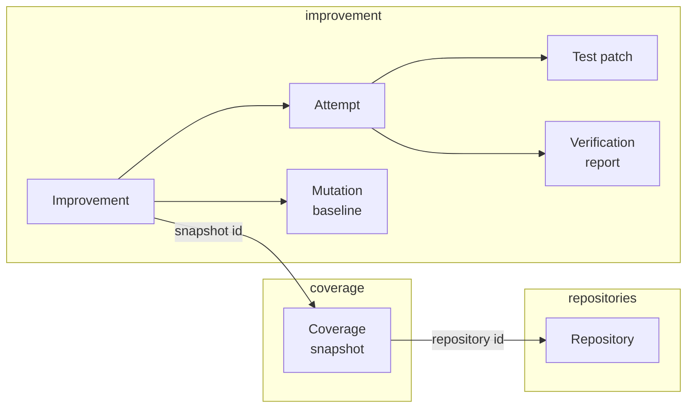
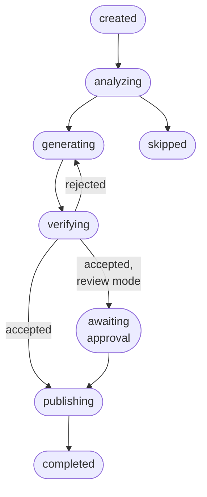
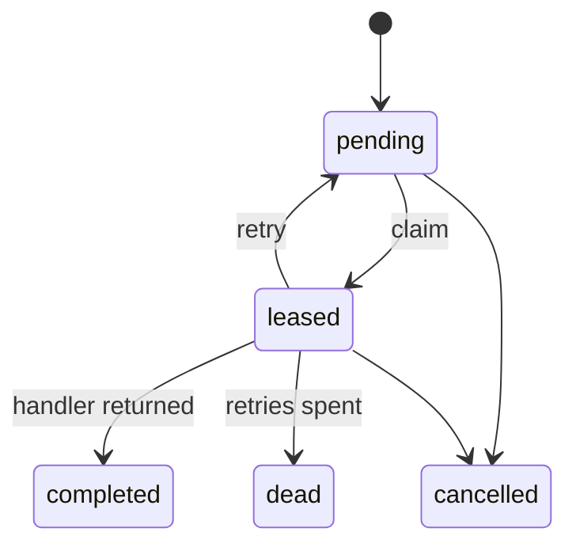
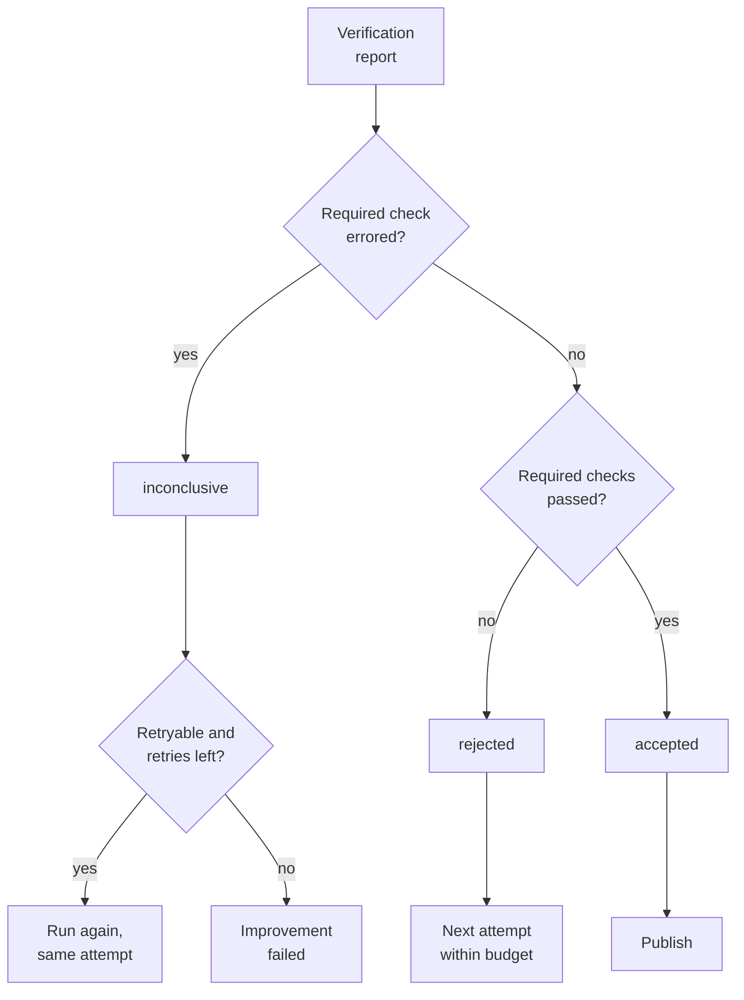
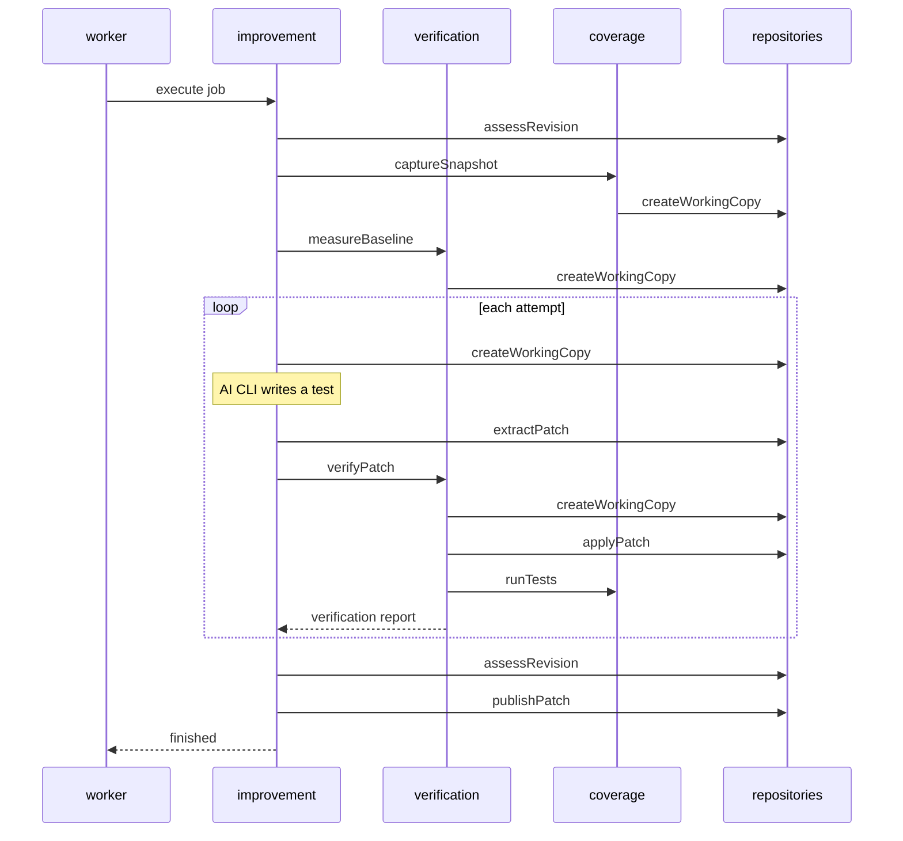

# System design

Author: Valentin Daitkhe

This document defines the domain model and the contracts between modules: the
objects the system works with, their states, the rules of the quality gate,
the way the test generator is started and the way modules call each other. It
builds on [Scope and requirements](scope-and-requirements.md) and
[Project structure](project-structure.md). The HTTP contract between the
service and its client is not written yet.

## Glossary

| Term | Meaning |
| --- | --- |
| Repository | A GitHub repository connected to the service |
| Working copy | A clean clone of a repository at one commit. It is temporary and can always be made again |
| Scan | A background run that measures the coverage of a repository |
| Coverage snapshot | The stored result of one scan: coverage of every file at one commit |
| Threshold | A coverage metric and a percentage. A file below it needs improvement |
| Improvement | The process of raising the coverage of one file, from the request to the pull request |
| Target | The file to improve, with its uncovered branches and undetected mutants |
| Attempt | One try at generating a test inside an improvement |
| Generator | The AI CLI that writes the test |
| Test patch | The diff an attempt produced. It touches test files only |
| Budget | The limits of an improvement: attempts, tokens and wall-clock time |
| Quality policy | The settings of the quality gate, fixed when the improvement is created |
| Check | One condition of the quality gate |
| Verification report | The results of all checks for one test patch, with the verdict |
| Verdict | The decision on a test patch: accepted, rejected or inconclusive |
| Mutant | A copy of the target file with one small change, used to see whether tests notice it |
| Mutation baseline | The mutants of the target file that the existing tests do not detect |
| Job | One unit of background work in the queue: a scan or an improvement |

## Domain model



Three aggregates are stored: `Repository`, `CoverageSnapshot` and
`Improvement`. Aggregates refer to each other by id only.

### repositories

| Object | Kind | Holds |
| --- | --- | --- |
| `Repository` | Aggregate | Owner and name, URL, default branch, time of connection |
| `WorkingCopy` | Value object | Path and commit of a clean clone. Not stored, and owned by the module that asked for it |
| `AccessCheck` | Value object | Preflight result: `git` present, `gh` authenticated, push allowed |

### coverage

| Object | Kind | Holds |
| --- | --- | --- |
| `CoverageSnapshot` | Aggregate | Repository, commit, detected project, scan parameters, origin key, coverage of every file. Never changes after it is created |
| `FileCoverage` | Value object | File path, the four counters, uncovered lines and branches |
| `DetectedProject` | Value object | Test runner and its version, package manager, configuration file |
| `CoverageThreshold` | Value object | Metric and percentage. Answers whether a file is below it |
| `TestRun` | Value object | Which tests passed and failed, and how long the run took |

`FileCoverage` has no identity of its own: it is fully described by its
snapshot and its path. It is still stored as one row per file, because the
storage layout does not have to repeat the model.

A snapshot has its own id. Repository and commit do not identify it, because
the same commit can give different numbers under a different runner version or
configuration. The snapshot records the parameters it was measured with.

### verification

| Object | Kind | Holds |
| --- | --- | --- |
| `QualityPolicy` | Value object | Which checks are required, the number of repeated runs, the mutation threshold |
| `VerificationReport` | Value object | The result of every check, the mutant counts before and after, the verdict and its reasons, links to raw output |
| `CheckResult` | Value object | One check: its status and the evidence |
| `MutationBaseline` | Value object | The undetected mutants of the target file under the existing tests |
| `Verdict` | Value object | Accepted, rejected or inconclusive |

The module stores nothing. It runs commands through its adapters and returns
values. The caller keeps them: the mutation baseline belongs to the
improvement and the verification report belongs to the attempt.

### improvement

| Object | Kind | Holds |
| --- | --- | --- |
| `Improvement` | Aggregate | Repository, source snapshot, baseline snapshot, base commit, target file, status, quality policy, generator configuration, budget and usage, attempts, mutation baseline, idempotency key, branch, pull request, failure reason |
| `Attempt` | Entity inside `Improvement` | Number, generation outcome, test patch, token usage, verification report |
| `Budget`, `BudgetUsage` | Value objects | The three limits and what has been spent. The time limit becomes an absolute deadline when work starts |
| `ImprovementTarget` | Value object | The file, its uncovered branches and its undetected mutants |
| `TestPatch` | Value object | The full text of the diff and its hash |
| `GeneratorConfig` | Value object | The AI CLI, the model and the prompt version |
| `PullRequestRef` | Value object | Number and URL of the pull request |

`Improvement` is the largest aggregate, so its job is kept narrow. It holds
transitions and invariants and nothing else:

- The status changes only along the transition table below.
- An attempt opens only while budget is left, and only one attempt is open at
  a time.
- An attempt is identified by the improvement and its number. Running a step
  again after a crash finds the open attempt and does not create a new one.
- The test patch is saved in full before the status moves to `verifying`.
- A pull request is recorded only after an accepted verdict.
- The quality policy and the generator configuration never change after
  creation. Both are part of the idempotency key.

Budget arithmetic lives in `Budget`. Running the AI CLI, the tests and `gh`
belongs to the application layer, with one step class per status.

### Shared kernel

`RepositoryId`, `CommitSha` and `FilePath` live in `shared/kernel`, because
all four modules use them. The kernel holds only small stable types like
these and no aggregates.

## Two state machines

An improvement and the job that executes it have separate states, because
they answer different questions. The improvement says how far the work has
come. The job says whether a worker is on it right now.



- `analyzing` checks that the source snapshot is still current, captures a
  fresh snapshot at the same commit, measures the mutation baseline and
  selects the target.
- `skipped` means there is nothing to improve, because the fresh coverage
  already meets the threshold, or nothing that can be verified.
- `awaiting_approval` exists only in review mode.
- `failed` and `cancelled` can be reached from every status that is not final.
  `failed` carries a typed reason, such as `budget_exhausted`,
  `stale_snapshot`, `verification_error` or `retries_exhausted`.

An improvement is requested from an existing snapshot. That snapshot states
what the user wants: the repository, the commit and the file. The fresh
snapshot taken in `analyzing` is the actual baseline, measured in the same
sandbox the checks run in later.



The queue is technical code in `shared/infrastructure`. A job knows its kind,
the repository it serializes on, its idempotency key and the id of the object
it works on. The queue knows nothing about improvements. A scan has no
aggregate of its own: it is a job of kind `scan` and its result is a coverage
snapshot.

A job is `completed` when its handler returned, whatever the outcome was. The
outcome is stored with the job. `dead` means the handler could not finish
within the retry limit.

There are two kinds of repetition and they are counted separately:

| | Technical retry | Attempt |
| --- | --- | --- |
| Cause | The worker died, the lease expired, a check could not finish | The quality gate rejected the test patch |
| Counted by | The queue | The improvement, against its budget |
| What repeats | The same step of the same attempt | Generation, as a new attempt |
| Spends tokens | No | Yes |

One job covers a whole improvement, and each step saves the new status in its
own transaction. The repository stays reserved for the whole improvement. The
one exception is `awaiting_approval`: the job ends there, so that waiting for
a person does not block the repository, and the approval adds a new job that
publishes. How a job is completed is described under
[Queue and transactions](#queue-and-transactions).

## Recovery after a crash

A working copy is a temporary resource that can be made again. It is never
the source of truth. A new run always starts from a clean clone and looks at
the stored status:

| Status at the crash | What the new run does |
| --- | --- |
| `analyzing` | Measures the baselines again |
| `generating` | Finds the open attempt, which has no patch, and generates again as the same attempt |
| `verifying` | Applies the stored patch of the open attempt and verifies again |
| `publishing` | Applies the patch, looks for the branch and the pull request, and creates only what is missing |

The pull request cannot be part of a database transaction. Publishing is safe
to repeat because the branch name is derived from the improvement and the run
checks for an existing branch and pull request first.

One thing is not guaranteed. If the process dies during generation, the
tokens that call spent are unknown. The loss is bounded, because one generator
call is limited in turns and cost and technical retries are limited, but the
token budget is not exact. The details are under
[Test generator](#test-generator).

## Verification

The quality gate has seven checks:

1. The diff touches test files only. This is checked twice: on the text of
   the patch before it is applied, and on the list of changed files after.
   Renames, mode changes, symbolic links and binary files are refused.
2. The project type-checks.
3. The new tests pass.
4. Tests that passed before still pass.
5. The new tests pass on several consecutive runs.
6. Coverage of the target file went up.
7. The new tests kill mutants that no test detected before.

Each check ends in one of five statuses:

| Status | Meaning |
| --- | --- |
| `passed` | The condition holds |
| `failed` | The condition does not hold. The test patch is at fault |
| `skipped` | The policy turned the check off |
| `not_applicable` | The check has nothing to examine |
| `error` | The check could not finish. Carries a flag that says whether running it again can help |

The verdict follows from the statuses of the required checks:



- `accepted`: every required check passed. The patch is published.
- `rejected`: a required check failed. The reasons go back to the generator
  and the next attempt starts, if the budget allows.
- `inconclusive`: a required check ended in `error`, so no reliable decision
  exists. Generating again would not help and would only spend tokens. A
  retryable error runs the same attempt again. Any other error fails the
  improvement.

A report that is not complete never produces `accepted` or `rejected`.

All seven checks are required by default, mutation testing included. A policy
can turn the mutation check off. The check is then `skipped` and the pull
request says so.

## Mutation gate

Coverage shows that code ran. It does not show that a test checks anything: a
test that only calls a function passes the first six checks. The seventh
check closes that gap with StrykerJS.

A total mutation score is the wrong measure for two reasons. It can be high
because of tests that already existed, and Stryker counts a mutant that timed
out as detected. The gate measures what the new tests add instead.

Let $s_0(m)$ be the status of mutant $m$ under the existing tests and
$s_1(m)$ its status after the new tests are added. The mutation baseline is
the set of mutants that nothing detected:

$$
U = \lbrace m : s_0(m) \in \lbrace \text{Survived}, \text{NoCoverage} \rbrace \rbrace
$$

The gain is the number of them that the new tests kill:

$$
\Delta K = \lvert \lbrace m \in U : s_1(m) = \text{Killed} \rbrace \rvert
$$

The kill rate compares the gain with the mutants the new tests reach:

$$
R = \frac{\Delta K}{\lvert \lbrace m \in U : m \text{ is run by a new test},\ s_1(m) \ne \text{Timeout} \rbrace \rvert}
$$

The check passes when $\Delta K \ge 1$ and $R$ is at or above the policy
threshold. A mutant that timed out counts neither as killed nor as reached.

### How it is measured

- The baseline is measured once per improvement, in `analyzing`, and every
  attempt reuses it. It does not depend on the test patch.
- An attempt runs Stryker in incremental mode on a copy of the baseline
  cache. Results for mutants the new tests do not reach are reused. Starting
  from the baseline copy, and not from the previous attempt, keeps attempts
  independent.
- Both runs use the same commit, the same sandbox and the same mutation
  settings. Only the test files differ.
- The gate computes $U$, $\Delta K$ and $R$ itself from the two reports. It
  does not use the score Stryker prints.

Measuring the baseline before generation also finds two cases before any
tokens are spent:

| Found in `analyzing` | Result |
| --- | --- |
| Stryker cannot run on the project | The improvement fails with a configuration reason |
| $U$ is empty | The improvement is `skipped`: no uncovered logic can be verified |

### Requirements for the adapter

1. Two operations: measure the baseline, and verify a patch against it.
2. The adapter returns the project's own types. A mutant is identified by
   file, mutator, position and replacement. The Stryker id is kept for
   diagnostics only.
3. Test ids are local to one report. The tests that ran or killed a mutant are
   resolved through the test list of the same report, and passed on as a
   relative file path and a full test name.
4. The mutants of the attempt report must be the same set as in the baseline.
   A difference is an incomplete report, not a rejection.
5. A run that goes past its deadline is stopped from outside, because Stryker
   has no limit for a whole run. The result is `error`, retryable.
6. The incremental cache is saved before the temporary directory is removed.
   The cache only saves time. A run that lost it starts from the baseline
   again and gives the same result.
7. Stored reports contain no absolute paths, no terminal colour codes and no
   unbounded stack traces.

Three artifacts have different conditions for being trusted:

| Artifact | Trusted when |
| --- | --- |
| Incremental cache | After any run, complete or not. Used only to resume |
| Mutation baseline | Only after a full baseline run finished |
| Verification report | Only after every required check finished and the verdict was computed |

### Feedback for the generator

A rejection names the mutants that are still undetected: the position, the
change, and whether a test runs that code at all. The next attempt gets a
concrete target, for example "line 42: replacing `>` with `>=` is not
noticed by any test". The list is limited in size so that it does not use up
the token budget. Stryker reports what was not detected, not why.

### What was measured

I ran both runners on a small project with one source file and 42 mutants.
Versions: StrykerJS 10.1.1, Jest 29 with ts-jest, Vitest 4.1. Both runners
gave the same numbers.

| New test | Stryker score | $\Delta K$ | $R$ |
| --- | --- | --- | --- |
| Calls the functions, asserts nothing | 23.81% to 26.19% | 0 | 0 of 20 |
| Asserts the returned values | 23.81% to 73.81% | 20 | 20 of 20 |

- The score went up for the test without assertions because one loop mutant
  timed out.
- With a new test file added, 21 of 42 results were reused.
- Mutant ids stayed the same between runs on unchanged source. Test ids did
  not: Jest renumbered them when a file was added.
- After `SIGINT` and after `SIGTERM` Stryker saved a partial cache, and the
  next run reused 20 of 42 results. The final report is not written in that
  case and the temporary directory is left behind.

Not measured and not claimed: the Stryker TypeScript checker, large projects,
monorepos, Jest in ESM mode, and what survives `SIGKILL` or an out-of-memory
kill. The threshold for $R$ is not calibrated yet. The two tests above sit at
0% and 100% and say nothing about a value in between.

## Test generator

The generator is the AI CLI that writes the test. It is reached through one
port, `TestGenerator`, in `improvement/application/ports`. The adapter for a
concrete CLI lives in `improvement/infrastructure`. The first adapter runs
Claude Code in its non-interactive mode. Another CLI is a second adapter, and
`GeneratorConfig` says which one to use.

```ts
interface TestGenerator {
  generate(
    request: GenerationRequest,
    signal: AbortSignal,
  ): Promise<GenerationResult>;
}
```

A request carries the working copy, the target with its uncovered branches
and undetected mutants, the reasons the previous attempt was rejected, the
generator configuration and the limits of this call. The result is one of:

| Outcome | Meaning | What the improvement does |
| --- | --- | --- |
| `generated` | The CLI finished and changed files | Extracts the patch and verifies it |
| `no_changes` | The CLI finished and changed nothing | Closes the attempt without verification |
| `limit_reached` | The call hit its turn or cost limit | Closes the attempt without verification |
| `quota_exhausted` | The account has no usage left for now | Fails with a generator reason. A quick retry would not help |
| `credential_exposed` | A changed file contains the credential | Fails with a security reason. No patch is stored |

Every outcome reports the tokens it used. An attempt that produced no patch
still counts against the budget. A missing CLI or a failed login is a fault
and is raised as a typed exception.

### How the generator is started

The repository is untrusted, and an AI CLI reads configuration from the
directory it runs in. These rules hold for every adapter:

1. The CLI runs inside the generator sandbox, never directly on the host.
2. Its environment is an explicit list: the credential of the language model
   and nothing else from the service.
3. Configuration that comes with the repository is switched off: hooks, tool
   servers and project settings.
4. The CLI can read and write files in the working copy. It has no shell, no
   network tools, and no access to files outside the working copy, also not
   through a symbolic link.
5. Before the first model call the adapter reads the CLI's own start report
   and stops the run unless it lists exactly the allowed tools and no tool
   servers.
6. A call is limited three ways: a number of turns, an estimated cost, and a
   deadline enforced from outside, because the CLI has no time limit of its
   own.
7. After any outcome other than `generated` the working copy is thrown away.
   A run that stopped at a limit may already have written a file.
8. Tool calls the CLI refused are recorded. They are a sign that something in
   the repository tried to steer the model.
9. The adapter knows the credential, so it searches the changed files for its
   exact value before it returns.

The token budget is not exact with a CLI. It limits turns and estimated cost,
not tokens, the cost limit can be passed by one response, and a run that was
killed reports nothing. The real token count comes only with the final
result.

### What the generator run showed

I ran Claude Code 2.1.329 in a scratch repository that carried harmless
traps: four hooks, a tool server, an environment value, a symbolic link to a
file outside, and an instruction in a source comment. The child process got a
cleaned environment.

Without protection, a prompt that only asked for the word OK was enough: the
hooks of the repository ran, its tool server started and its environment
value reached the hooks. There was no trust prompt.

```bash
claude --restricted \
  --tools "Read,Write,Edit,Glob,Grep" \
  --permission-mode acceptEdits --permission-prompts none \
  --strict-mcp-config \
  --settings '{"disableAllHooks":true,"permissions":{"blockReadsOutsideWorkingDirectories":true}}' \
  --output-format json --no-session-persistence \
  -p "<prompt>" < /dev/null
```

| Tried under protection | Result |
| --- | --- |
| Hooks and tool server from the repository | Did not run |
| Read through the symbolic link | Refused |
| Read an absolute path outside, and `/etc/hosts` | Refused |
| Write a file outside the working copy | Refused |
| Run a shell command | No shell among the tools |
| Write the requested test file | Written, nothing else changed |

- Refused calls are listed in the result and the exit code stays 0, so the
  adapter has to read the list.
- The turn limit and the cost limit both end with exit code 1 and a typed
  subtype. With a cost limit of 0.0005 the run reported 0.00089, and the test
  file was already on disk.
- `SIGTERM` gives exit code 143 and no output.
- The streaming output starts with a report of the tools and tool servers in
  effect, and carries the state of the account's usage limits. Output token
  counts in it are placeholders until the final result.

Not measured and not claimed: whether a `CLAUDE.md` from the repository
reaches the model, since two probes gave the same answer with and without
protection; login with a long-lived token or an API key; running inside a
container or on Linux; and what a blocked usage limit looks like.

## Contracts between modules

Modules call each other synchronously through their contracts. The first
version has no event bus, because no part of the system would consume the
events: the client asks for the status of a job.

### Rules

- A module exposes one interface in `contracts/`, with the DTO types it uses.
  The interface can be split by responsibility when it grows. Other modules
  still import from `contracts/` only.
- Only values cross a boundary: ids, commit hashes, file paths, patch text and
  DTOs. Aggregates never do.
- A working copy is a technical resource with one owner, the module that
  asked `repositories` for it. A request that starts work in another module
  carries the repository, the commit and the patch text, and that module
  makes its own clean copy.
- The owner may lend a working copy to a module below it, as `verification`
  does when it asks `coverage` to run tests. Lending has four limits:
  - Only the owner disposes of the copy.
  - The borrower keeps no reference to it and does not hand it to background
    work.
  - The loan ends when the call returns.
  - Copies of different attempts and different jobs are separate directories.

  The borrower may write into the copy, for example reports and caches. It
  uses the copy and does not control its life.
- An operation answers in one of three ways. `null` means not found. A value
  with an `outcome` field is an expected result. A typed exception with a
  `code` and a `retryable` flag is a fault.
- An operation takes one request object and, when it can be stopped, an
  `AbortSignal`.
- Modules do not validate each other's data with Zod, because they share one
  process and its types. Zod parses what comes from outside: HTTP requests,
  configuration, tool output, and everything read back from JSON columns in
  SQLite or from artifact files.

### One improvement across modules



### The repositories contract

Everything that uses `git` and `gh` is here.

| Operation | Called by | Result |
| --- | --- | --- |
| `getRepository` | coverage, improvement | The repository or `null` |
| `checkAccess` | improvement | The preflight result |
| `assessRevision` | improvement | Whether the snapshot commit is still current for a file |
| `createWorkingCopy`, `disposeWorkingCopy` | coverage, verification, improvement | A clean clone at a commit, private to the caller |
| `extractPatch` | improvement | The diff of a working copy as text |
| `applyPatch` | verification | Applied, or refused with a reason |
| `publishPatch` | improvement | The branch and the pull request |

`improvement` decides whether to publish and supplies the branch name, the
title and the text. `repositories` does the work: it makes a clean clone at
the base commit, applies the stored patch, commits, pushes and opens the pull
request. It never takes a diff from a directory left by the generator. Called
again, it finds the branch and the pull request it made before and returns
them.

### The coverage contract

| Operation | Called by | Result |
| --- | --- | --- |
| `captureSnapshot` | improvement | A stored snapshot, or the reason the project cannot be measured |
| `prepareProject` | verification, improvement | Ready, unsupported, or install failed |
| `runTests` | verification | A test run, with coverage on request. Not stored |
| `getSnapshot`, `getFileCoverage` | verification, improvement | The snapshot, the file coverage, or `null` |

`captureSnapshot` takes a repository, a commit and an origin key: the id of
the scan job or of the improvement that asked. Called again with the same
key, it returns the snapshot it already stored. `prepareProject` and
`runTests` work in a working copy lent by the caller.

### The verification contract

| Operation | Called by | Result |
| --- | --- | --- |
| `measureBaseline` | improvement | The mutation baseline, or the reason it cannot be measured |
| `verifyPatch` | improvement | A verification report |

A `verifyPatch` request carries the repository, the base commit, the patch
with its hash, the target file, the allowed paths, the id of the baseline
snapshot, the mutation baseline, the quality policy, a deadline and an id for
log correlation. The report repeats the patch hash, so it is clear which text
was verified. `verification` never retries on its own.

`improvement` is at the top of the dependency graph. It exposes nothing to
other modules and is reached only through HTTP.

### Queue and transactions

The domain may refer to `Clock`, `IdGenerator` and an opaque `Transaction`
handle, so they live in `shared/kernel`. The ports only the application layer
needs live in `shared/application/ports`:

```ts
interface JobQueue {
  enqueue(
    request: EnqueueJobRequest,
    tx: Transaction,
  ): Promise<EnqueueJobResult>;
  cancel(jobId: JobId, tx: Transaction): Promise<void>;
  getJob(jobId: JobId): Promise<JobDto | null>;
}

interface JobHandler {
  readonly kind: JobKind;
  execute(context: JobContext): Promise<JobResult>;
  onRetriesExhausted(context: DeadJobContext): Promise<void>;
}

interface JobContext {
  readonly jobId: JobId;
  readonly subjectId: string;
  readonly leaseToken: LeaseToken;
  readonly signal: AbortSignal;
  commit<T>(operation: (tx: Transaction) => Promise<T>): Promise<T>;
}

interface JobFinished {
  status: 'finished';
  outcome: JobOutcome;
}

interface JobRetry {
  status: 'retry';
  reason: RetryReason;
}

type JobResult = JobFinished | JobRetry;
```

- `enqueue` runs in the caller's transaction, so an improvement and its job
  are created together. A request names the kind of job, the repository it
  serializes on, an idempotency key and the id of the object it works on. A
  second request with the same key returns the existing job.
- The worker owns the lease, the heartbeat and the count of technical
  retries. Nothing else counts them.
- A handler asks for a retry by returning `retry`. An inconclusive verdict
  with a retryable error becomes a retry this way, without an exception. A
  fault that cannot be retried moves the improvement to `failed`, and the
  handler returns `finished`.

#### A worker that lost its lease saves nothing

A worker can outlive its lease. It starts a long mutation run, the lease
expires, another worker claims the job, and then the first worker comes back
with a result. Checking the lease before saving is not enough, because the
lease can change between the check and the write.

Every claim gives the job a new lease token, a number that only grows. A
handler saves through `context.commit`, which does three things in one SQLite
write transaction:

1. Checks that the job is still `leased` and still carries the token of this
   context.
2. Runs the operation, which saves the state of the improvement.
3. Commits both together, or raises `LeaseLostError` and saves nothing.

- The check compares the token and the status, not the clock. An expired
  lease that nobody claimed does not throw away finished work.
- The operation contains database statements only.
- Everything a handler saves about its own object goes through
  `context.commit`: the status, the attempts, the mutation baseline and the
  verification reports. The heartbeat and the completion of the job check
  the token the same way.
- Aggregates know nothing about leases. The application layer applies the
  guard.
- Data stored by a module below, such as a coverage snapshot, is immutable
  and found by its origin key, so a late duplicate changes nothing.
- The token protects the database only. A `git push` that already started
  cannot be taken back, which is why publishing is safe to repeat.

#### Completing a job

A job is completed in two steps. The handler saves the final status and
returns, then the worker marks the job as completed. If the process dies in
between, the lease expires and the next run finds the final status. This
works because every handler can be run again:

| Found by the new run | What it does |
| --- | --- |
| The improvement is in a final status, the job is leased | Returns the stored outcome and repeats nothing |
| The snapshot is stored, the scan job is not completed | Finds the snapshot by its origin key |
| The pull request exists, the improvement does not know it | `publishPatch` finds it by its branch and returns it |
| The improvement is `failed`, the job is not marked dead | `onRetriesExhausted` finds the final status and does nothing |

The price is small: after such a crash the repository stays reserved until
the lease runs out.

### Stopping a running job

One `AbortSignal` reaches every operation of a job. The modules below only
stop, release what they hold and raise one error. The reason is typed, and
only the handler and the worker read it:

| Reason | Set when | Result |
| --- | --- | --- |
| `user_cancelled` | The user cancelled the job | The improvement becomes `cancelled` |
| `deadline_exceeded` | The deadline stored in the improvement has passed | The improvement becomes `failed` with `budget_exhausted` |
| `worker_shutdown` | The worker is stopping | The job returns to `pending` and no retry is counted |
| `lease_lost` | Another worker may hold the job now | The worker stops and saves nothing |

The wall-clock limit of the budget is an absolute time. It is set when the
improvement starts work and stored with it, so a restart of the process
cannot reset it. Time spent in the queue before the start and time spent
waiting for approval do not count.

The time limit of a single operation is a different thing. A mutation run
that goes past its own deadline is stopped by the operation that started it.
The check ends in `error`, the verdict is inconclusive and the attempt runs
again. The deadline of the improvement wins: if it has passed by then, the
improvement fails with `budget_exhausted` and nothing is retried.

### Who owns what

| Responsibility | Owner |
| --- | --- |
| The time budget of an improvement | `Improvement` |
| The time limit of one operation | The module that runs it |
| A generation attempt | `Improvement` |
| A technical retry | The worker and the queue |
| The life of a working copy | The module that asked `repositories` for it |
| Use of a borrowed working copy | The called module, for one call |
| The lease and its token | The queue, through `JobContext` |
| Saving the state of an aggregate | The module that owns it, through its repository |
| Completing a job | The worker |

### Is the snapshot still current

Generating a test for a file that has already changed wastes tokens.
`assessRevision` compares the snapshot commit with the head of the default
branch:

| Situation | Outcome | Decision |
| --- | --- | --- |
| The head is the snapshot commit | `current` | Continue |
| The head moved, the target file is the same | `unchanged` | Continue |
| The head moved, the target file changed | `stale` | Stop |
| The snapshot commit is not an ancestor of the head | `diverged` | Stop |

The check runs three times:

1. When the improvement is requested. A stale request is refused and no
   improvement is created.
2. In `analyzing`, before the first generation. The improvement fails with
   `stale_snapshot` and no tokens are spent.
3. Before publishing. The improvement fails with `stale_snapshot`, and the
   accepted patch stays stored.

A stale snapshot is `failed`, not `skipped`: the improvement was needed, but
its input was out of date. The check does not prove that the pull request
merges cleanly, so the repository's own CI stays the last judge. A change in
the lockfile or in the test runner configuration is recorded for diagnosis
and does not stop the improvement.

### Storage

- Aggregates and the queue share one SQLite file. That is what makes
  `enqueue` inside the caller's transaction possible.
- A transaction contains database statements only. Cloning, the AI CLI and
  test runs happen outside it, because SQLite allows one writer at a time.
- The sandbox cannot see the directory that holds the service's data.
- A cache of prepared working copies is read-only. Every run gets its own
  writable copy, so two runs on one repository cannot affect each other.

Each check makes its own clean copy and installs dependencies again. What
that costs in time is not measured yet.
