# Terminal UI

Author: Valentin Daitkhe

What a person sees and types. The client holds no business rule: every
number and every status comes from the service described in
[System design](system-design.md).

The pictures are mock-ups drawn before the code, not screenshots. Names,
numbers and limits in them are examples, and marks added later, such as
an own threshold or a trusted install, are not drawn. The page
[mockups/terminal-ui.html](mockups/terminal-ui.html) holds the first
set. Three of its screens no longer match: the two that connect a
repository, which refused one without the right to push, and the window
that is too small, which asked for 24 rows.

## Two ways in

`coverage-autopilot` in a terminal opens the screens, for a person.
`coverage-autopilot <command>` runs one command with one result and an
exit code, for scripts and CI. Both call the same service. With no
command and no terminal, the tool prints its help and exits with 2.

- **The client keeps nothing.** Closing it stops no job.
- **Unknown is shown as unknown.** A file with no numbers is `N/A` with
  its reason, never 0%.
- **Colour is never the only sign.** Every status is a symbol and a word.
- **Nothing irreversible happens on one key.** A cancel asks first, with
  the safe answer chosen.

## Layout

Every screen has a header with the sections and the state of the
service, a body of one or two panels, and a footer with the path and the
keys that work now. The screens take the whole terminal and give it back
on the way out.

| Size | Body |
| --- | --- |
| 110 columns and more | Two panels |
| 90 to 109 | Two narrower panels, fewer columns in a list |
| 80 to 89 | One panel, the details open in its place |
| Below 80 by 16 | A message that asks for more room. Commands work at any size |

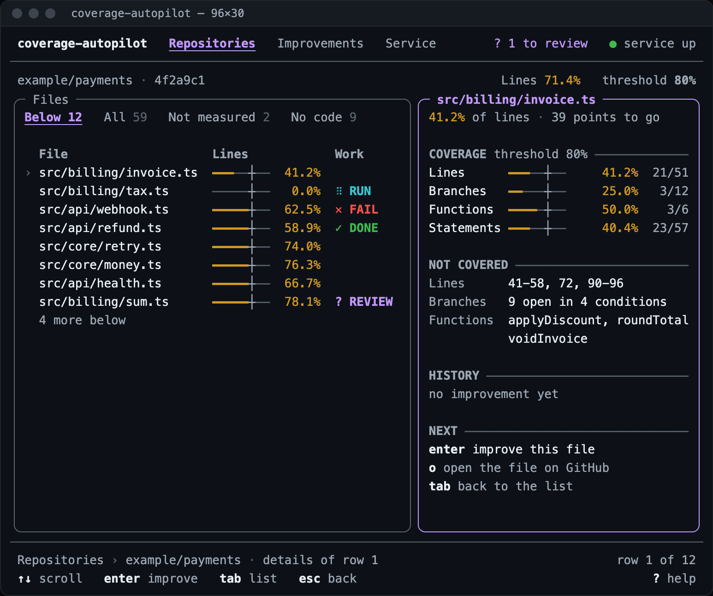

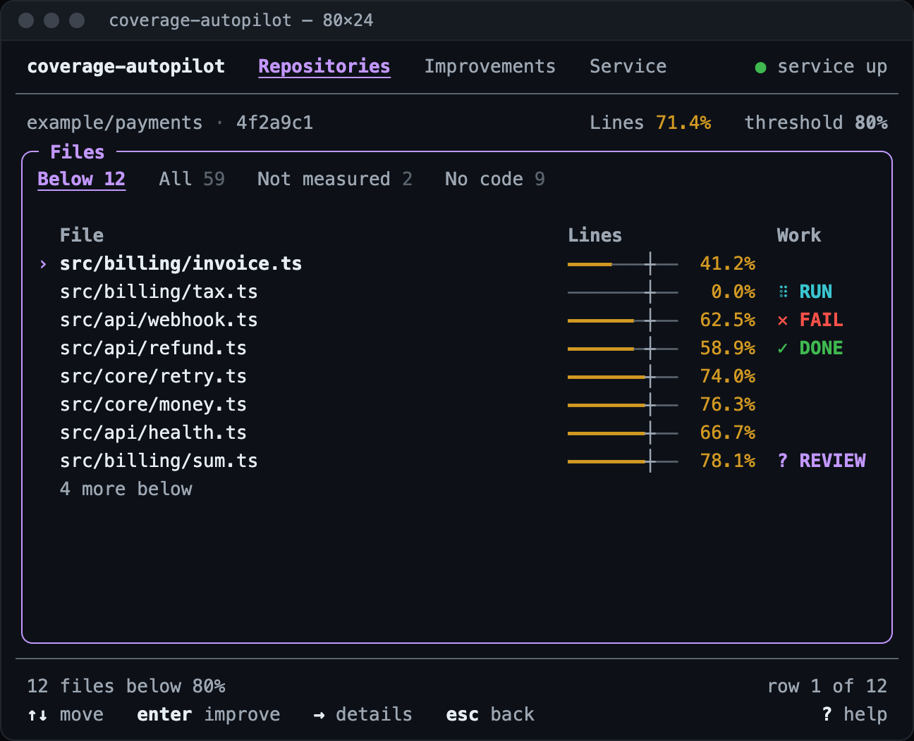

- The terminal's own colours are the theme: magenta for focus, green for
  passed, yellow for below the threshold and rejected attempts, red for
  failures, cyan for running work. `NO_COLOR` or `--no-color` drops them,
  and symbols become ASCII when the locale does not name UTF-8.

## Statuses

| Improvement | Shown as | Beside it |
| --- | --- | --- |
| `created`, `waiting_for_limit` | `○ WAIT` | What it waits for, and until when |
| `analyzing`, `generating`, `verifying`, `publishing` | A spinner and `RUN` | `attempt 2 of 3, writing a test`, or the check that runs |
| `awaiting_approval` | `? REVIEW` | `approve the patch` |
| `completed` | `✓ DONE` | The pull request |
| `failed` | `✕ FAIL` | The reason as a sentence, with its code |
| `cancelled` | `■ CANCEL` | When |
| `skipped` | `– SKIP` | The reason as a sentence |

A scan uses the same words. An attempt is `accepted`, `rejected` in
yellow, or `runs again` when its verdict was inconclusive.

## Screens

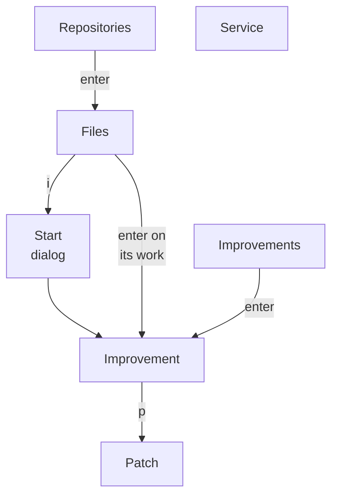

The sections are `1` Repositories, `2` Improvements and `3` Service. Each
section keeps its trail, and a screen comes back as it was left.

**Repositories.** A row shows the line coverage of the latest snapshot,
the files below the threshold, the commit and the age of the scan, or
the step a running scan is at, and `outdated` when the head moved. `a`
connects a repository and runs the access check, `s` scans, `t` sets a
threshold of its own and `i` trusts the install, after a dialog that
says what trusted code can reach.

**Files.** The latest snapshot of one repository, in four lists: below
the threshold, all, not measured and no code, switched with `[` and `]`,
the least covered file first. `i` improves the chosen file, and is
inactive with its reason for a file that has no numbers.

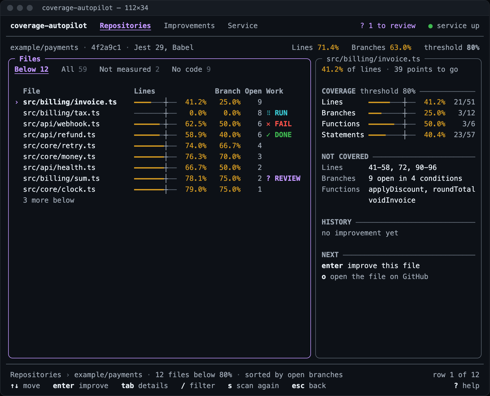

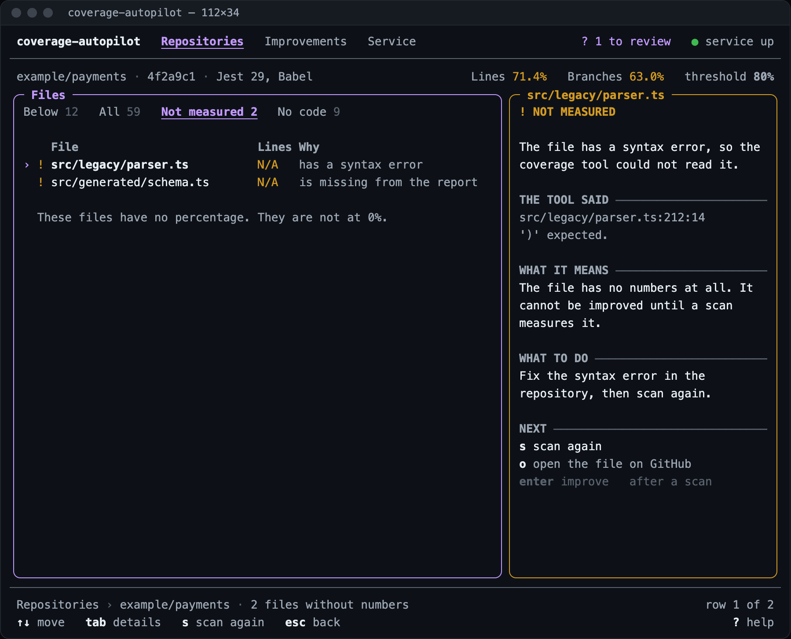

**Start an improvement.** A dialog with the limits the improvement will
get, the defaults and maximums of the service beside them, the choice to
publish at once or wait for approval, and where the result goes: the
repository or a fork.

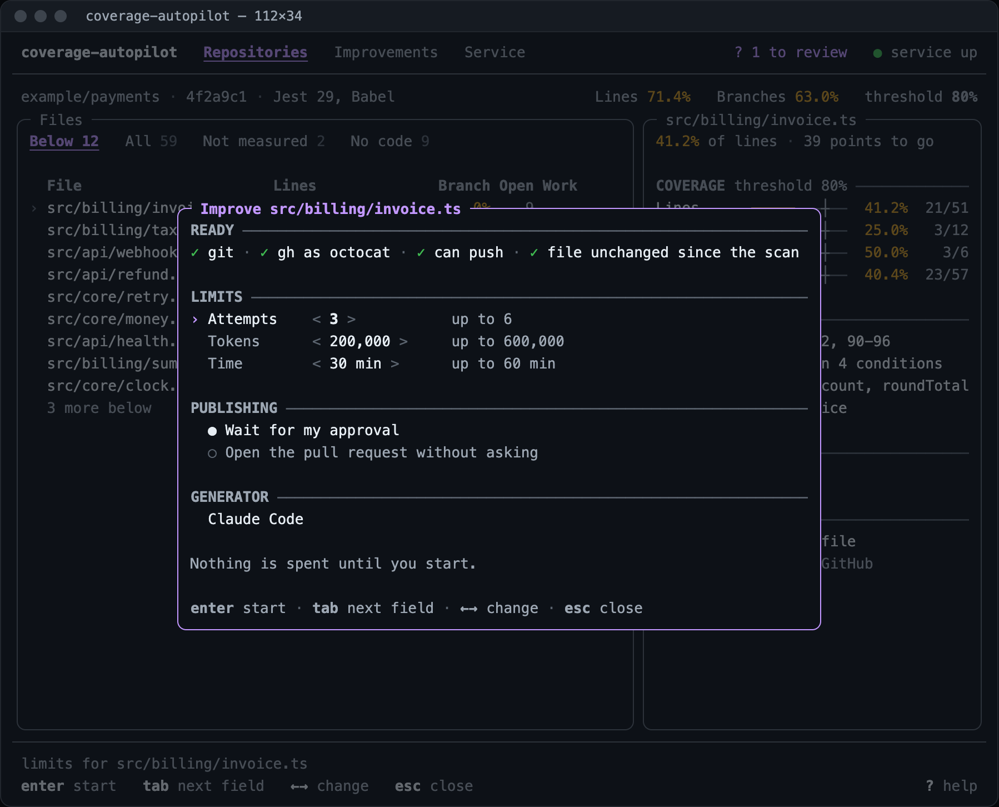

**Improvement.** How far the work has come, asked again about once a
second: each attempt with its verdict and reasons, the seven checks of
the running one, and the budget in use. A final screen names the reason
and offers the next step: the pull request with `o`, the next file with
`n`, or the same file again with larger limits after a spent budget.

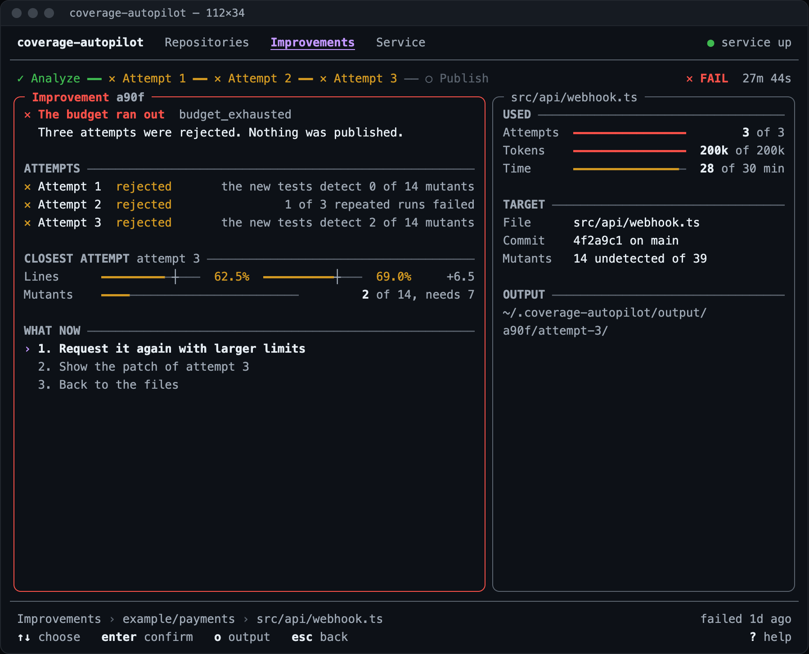

**Patch.** What exactly will be published, with the evidence beside it.
In review mode the question to approve stays at the bottom, and it names
the hash of the patch on the screen. Another stored patch is refused.

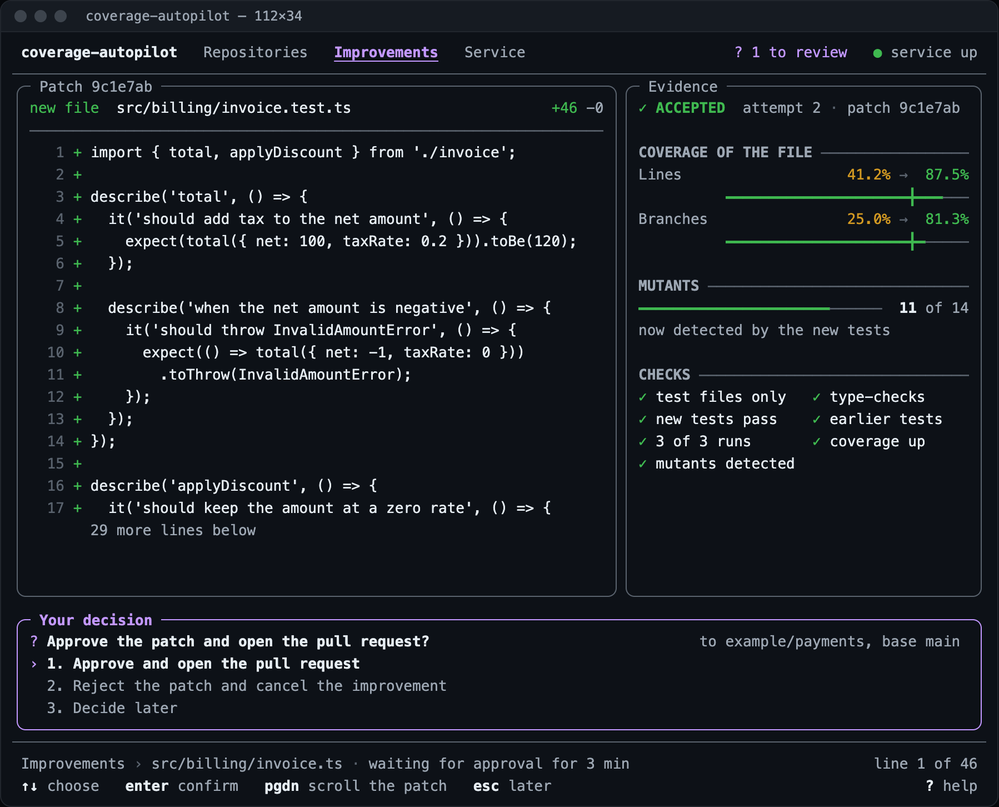

**Improvements.** Every improvement, grouped as `NEEDS YOU`, `RUNNING`,
`WAITING` and `FINISHED`, with filters by status (`f`), repository (`r`)
and path (`/`), and `c` to cancel.

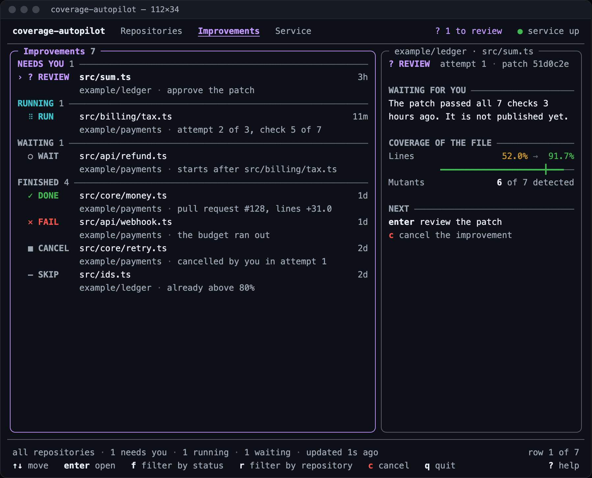

**Service.** Whether everything is in order: the service, the worker,
running work, versions, the account of the generator and its limits, and
`r` to restart an idle service.

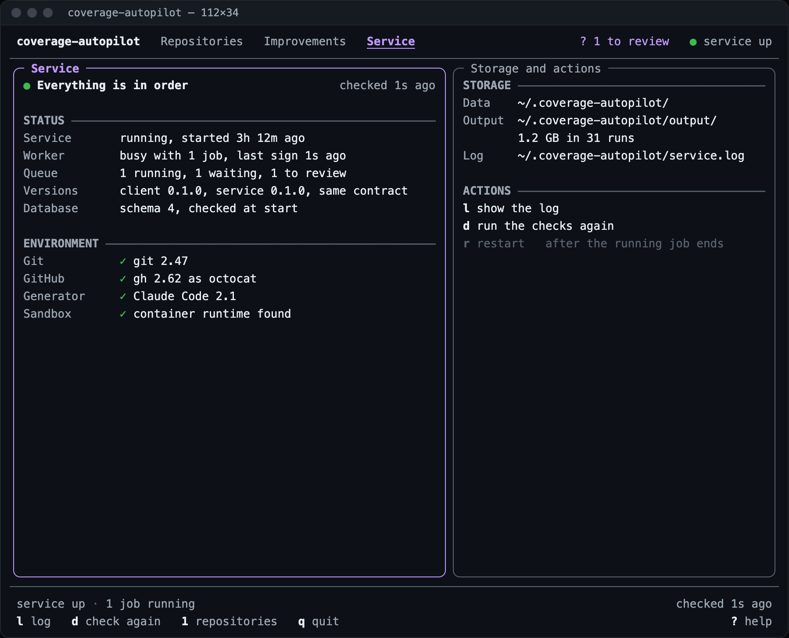

## Keys

| Where | Keys |
| --- | --- |
| Anywhere | `1` `2` `3` sections, `:` commands, `?` keys, `esc` back, `q` quit |
| A list | `↑` `↓` or `j` `k`, `pgup` `pgdn`, `g` `G`, `enter` open, `/` filter, `tab` details |
| A question | `↑` `↓` choose, `1` to `9` pick, `enter` confirm, `esc` close with no change |
| A text field | Letters type, `enter` accepts, `esc` discards |
| Work that ends | `c` cancel, which always asks first |

- `esc` never quits. `q` and `ctrl+c` quit and cancel nothing, and the
  client says which work keeps running.
- A dialog takes every key. `:` lists every action the screen offers
  now, filtered as the person types.

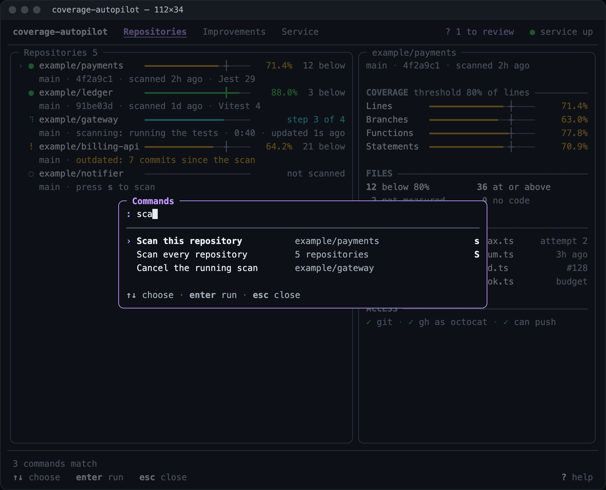

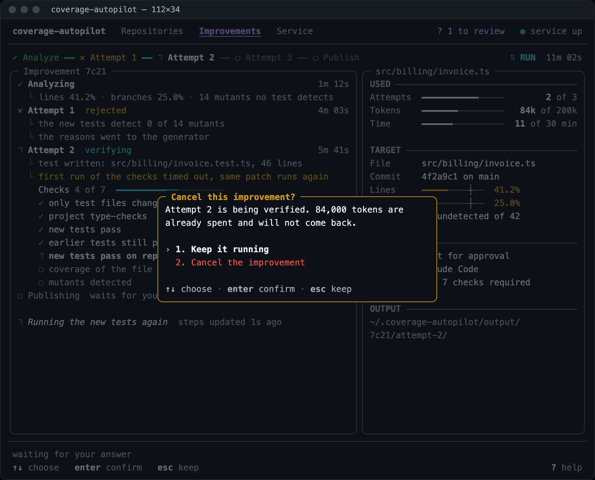

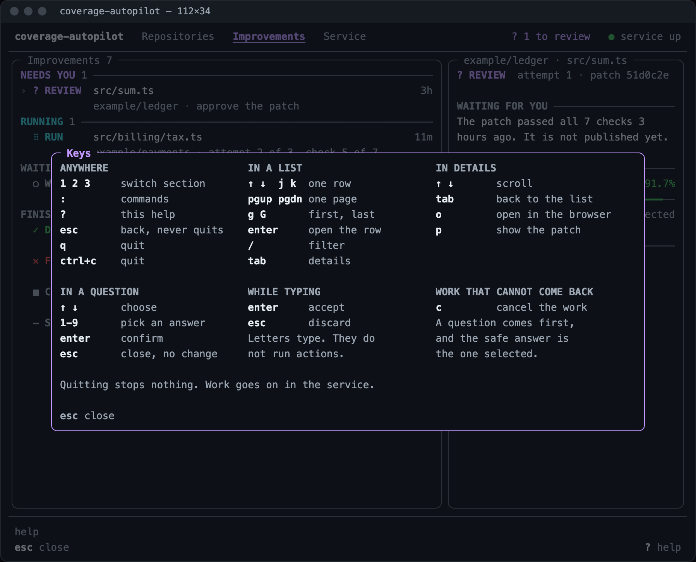

## Commands

| Command | Does |
| --- | --- |
| `repo add <url>` | Connects a repository |
| `repo list` | Lists repositories |
| `repo check <repo>` | Runs the access check and says where a result goes |
| `repo threshold <repo> <percent>` | Sets a threshold of its own, or `default` |
| `repo trust <repo> <mode>` | `trusted`, `sandboxed` or `default` |
| `scan <repo>` | Queues a scan |
| `files <repo>` | Lists the files of the latest snapshot |
| `improve <repo> <file>` | Checks access, then requests an improvement |
| `list` | Lists improvements |
| `status <id>` | Shows one improvement |
| `patch <id>` | Prints the patch and its hash |
| `approve <id> --hash <hash>` | Approves publishing |
| `cancel <id>` | Cancels an improvement, or a scan |
| `doctor` | Shows the state of the service |

A repository is named `owner/name`. `--wait` blocks until the work is
final, `--json` prints JSON, `--isolated` runs a private service for the
one command, and `--no-color` drops colour. `files` takes `--below`,
`--metric` and `--unmeasured`, and `improve` takes `--review`,
`--attempts`, `--tokens` and `--minutes`.

| Exit code | Meaning |
| --- | --- |
| 0 | Done. With `--wait`: completed, skipped, or waiting for approval |
| 1 | The work failed or was cancelled, or the service could not be reached |
| 2 | The command line was wrong |

Standard output holds the result, and only when the code is 0: with
`--wait`, `improve` prints the pull request, or the `approve` command in
review mode. Progress and refusals go to standard error.

## Left out

Mouse support, settings other than a threshold and an install mode,
search inside a patch, a live stream of tool output, more than one
theme, a test that resizes a running client in a real terminal, and
Windows.
