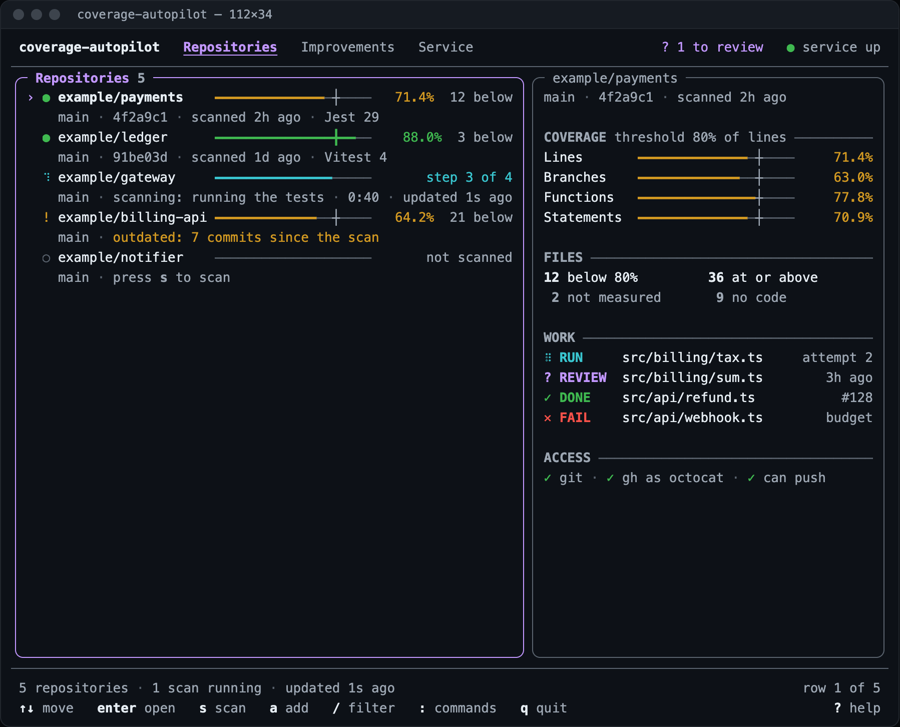
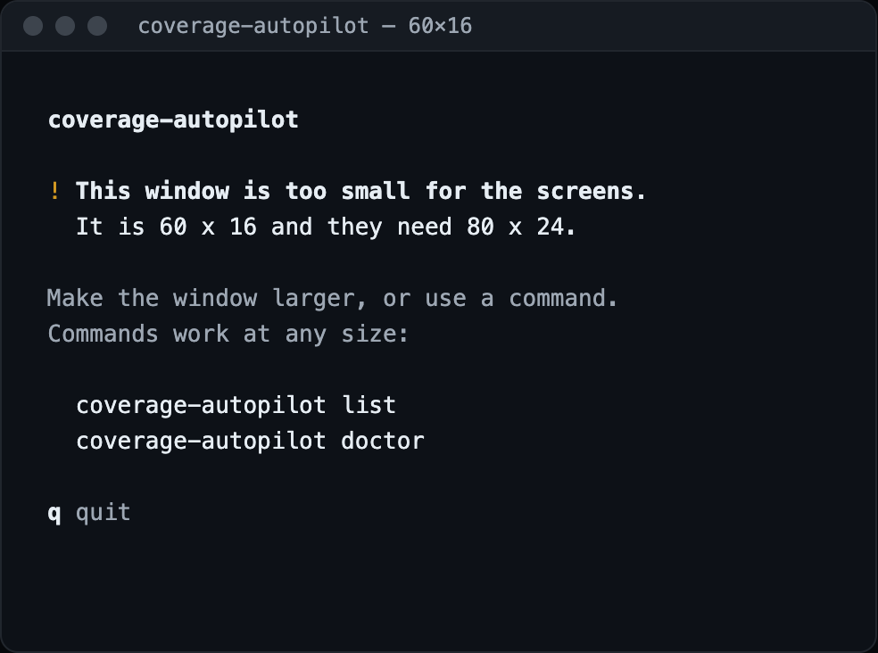
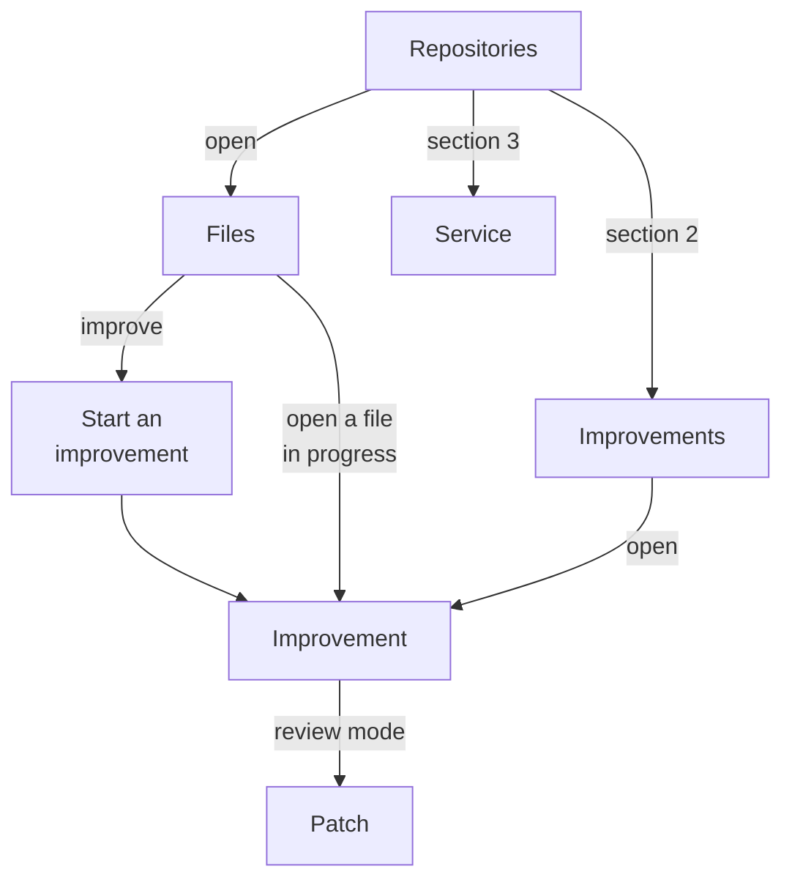
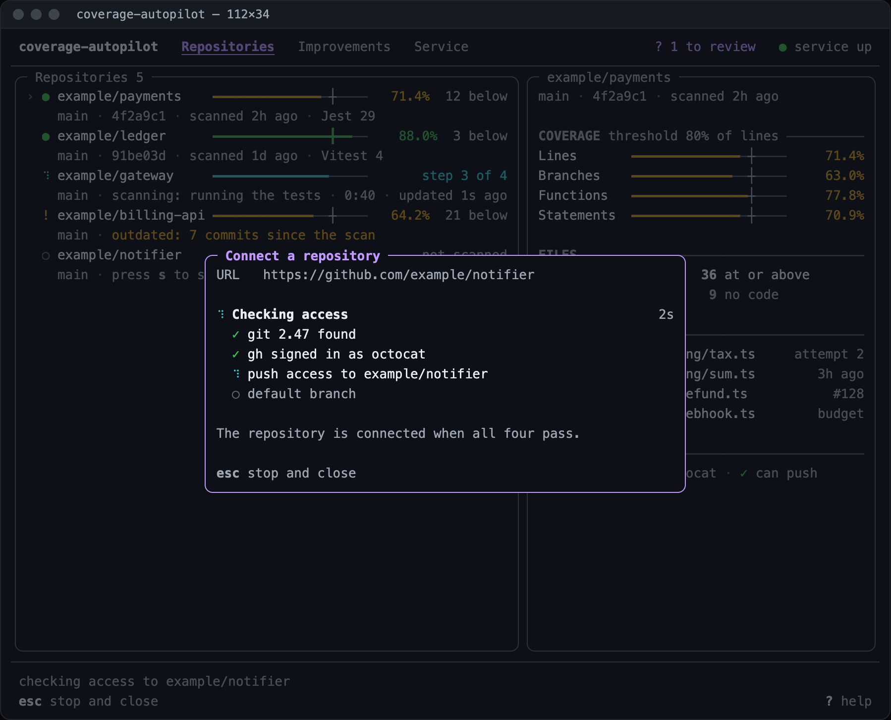
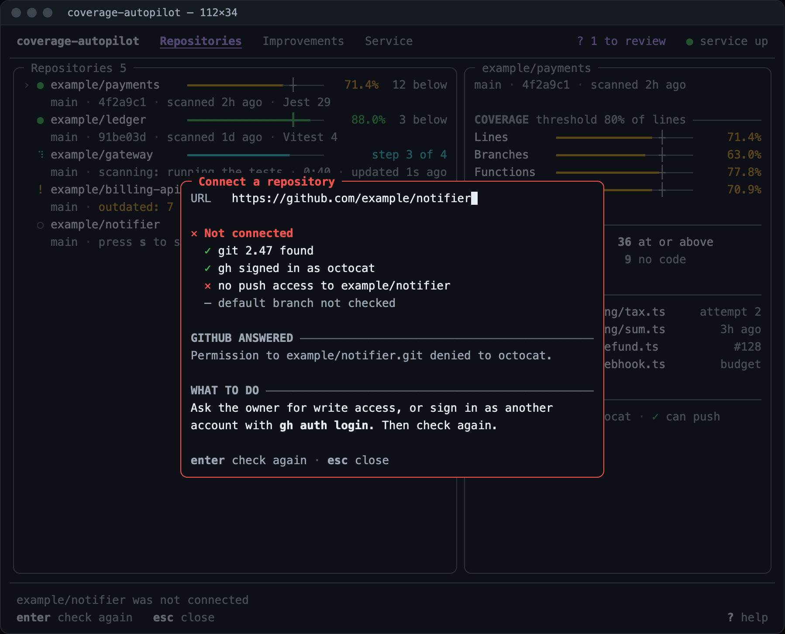
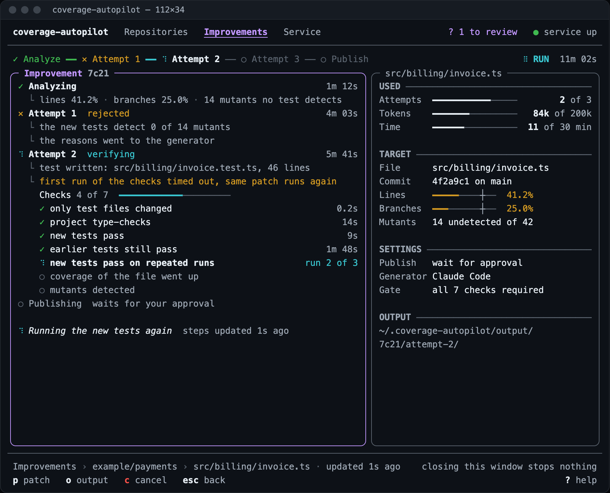
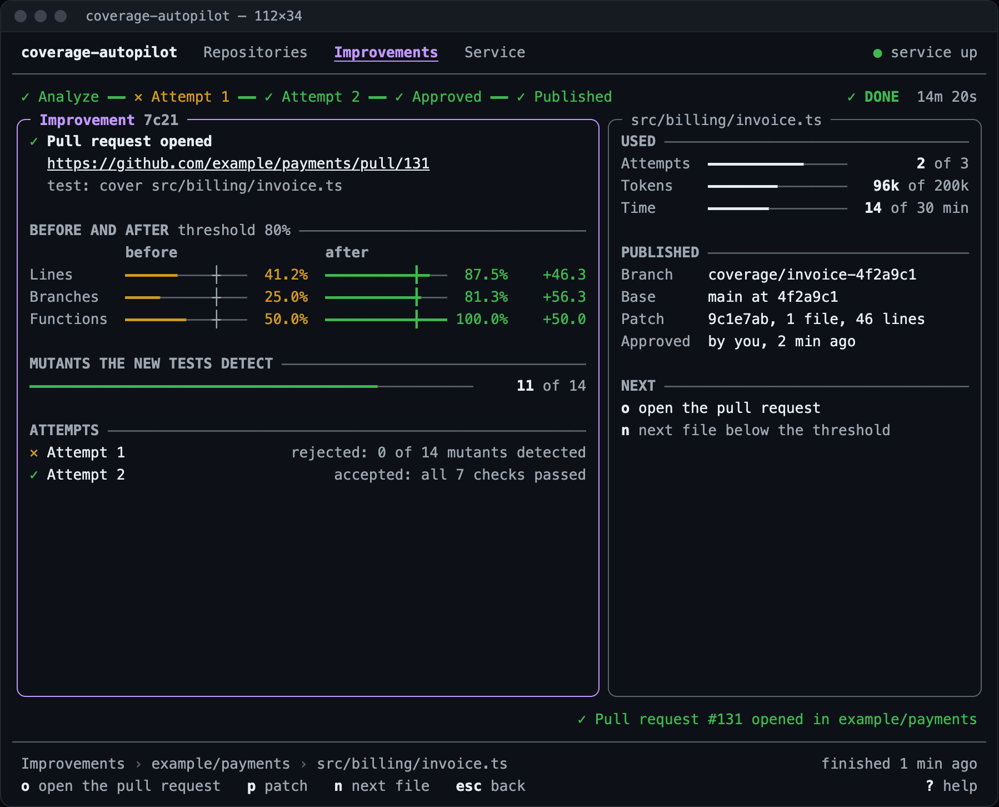

# Terminal UI

Author: Valentin Daitkhe

This document fixes what the user sees and types: the layout, the theme, the
screens, the keys, the words for every status, and the commands for scripts.
It builds on [Scope and requirements](scope-and-requirements.md) and
[System design](system-design.md).

The pictures are mock-ups, not screenshots of a running tool. All of them
are on one static page, [mockups/terminal-ui.html](mockups/terminal-ui.html).
Names, numbers and limits in them are examples.

## Two ways to use the tool

| Started as | What it is | For |
| --- | --- | --- |
| `coverage-autopilot` in a terminal | Interactive screens | A person who looks around and starts work |
| `coverage-autopilot <command>` | One command, one result, an exit code | Scripts and CI |

Both are the same client and call the same service. Everything a screen can
do, a command can do as well.

## Principles

1. **The client keeps nothing.** Every number and every status comes from
   the service. Closing the client stops no job, and opening it again shows
   the same picture.
2. **One screen answers one question.** Which repositories are connected.
   Which files need tests. How far an improvement has come. What will be
   published.
3. **A list on the left, the selected item on the right.** Moving through a
   list updates the right side at once, so most questions are answered
   without opening anything.
4. **Progress is drawn, not described.** Coverage, limits and the steps of
   an improvement are bars and step lines. The number stands next to the
   bar, never in place of it.
5. **Unknown is shown as unknown.** A file that could not be measured is
   never shown as 0%.
6. **Colour is never the only sign.** Every colour comes with a symbol or a
   word, and the tool reads the same without colour.
7. **Red is rare.** It marks work that ended in failure and an action that
   cannot be undone. A rejected attempt is routine and is not red.
8. **A failure says what to do next.** Every final screen names the reason
   and offers the next step as a choice.
9. **Keys are on the screen.** The bottom line lists what can be pressed
   now, and only that.
10. **Nothing irreversible happens on one key.** Cancelling and publishing
    ask first, and the safe answer is selected.

## Layout

Every screen has the same four zones.



| Zone | Rows | Holds |
| --- | --- | --- |
| Header | 1 | The name of the tool, the three sections, what waits for the user, the state of the service |
| Context | 0 or 1 | What the screen is about: the repository and its totals, or the steps of an improvement |
| Body | The rest | One or two panels with rounded borders |
| Footer | 2 | A status line with the path to this screen and the position in the list, then the keys |

The header carries no counters and no key digits. The only number in it is
the count of things that wait for the user, and it is absent when nothing
waits.

### Three widths

| Width | Body | Columns of a list |
| --- | --- | --- |
| 110 columns and more | Two panels | All |
| 90 to 109 | Two panels, both narrower | The less important ones are dropped |
| 80 to 89 | One panel. `→` opens the selected item in its place | The same as in the row above |
| Less than 80 by 24 | A message that asks for more room | None |


- A change of width keeps the selected row, the focus and the scroll
  position.
- The smallest size is a rule of the interactive screens only. A command
  works at any size and without a terminal.



### Focus

A screen has three states for a thing that can be chosen.

| State | Looks like | Means |
| --- | --- | --- |
| Focused | A magenta border and a bold magenta title on the panel. In it, `›` in magenta and the row in bold | This panel takes the keys, and this row is the one they act on |
| Selected | `›` in grey, the row in normal weight | The row is still chosen, and the keys now go to another panel or to a dialog |
| Inactive | The key and its label in grey, with the reason beside them | The action exists and cannot be used now |

- Exactly one panel or dialog has the focus. `tab` moves it between panels.
- An inactive action is shown only where a person would look for it. The
  footer lists only keys that work.
- A dialog is drawn over the screen. Everything behind it is drawn dim and
  takes no keys until the dialog closes.
- A short message about something that just happened appears above the
  footer for a few seconds and takes no keys.

## Theme

### Colour

The client uses the sixteen colours of the terminal, so the user's own theme
decides the exact shade. Nothing has a background colour of its own. The
pictures show one dark theme.

| Role | Means | In the terminal |
| --- | --- | --- |
| Primary text | Content | The default colour |
| Secondary text | Labels, hints, facts of less weight | The default colour, dim |
| Emphasis | A title, the selected row, a key | Bold |
| Accent | Focus, and what waits for the user | Magenta |
| Success | Passed, published, at or above the threshold | Green |
| Warning | Below the threshold, outdated, not measured, a rejected attempt | Yellow |
| Danger | Failed work, and an answer that cannot be undone | Red |
| Running | Work in progress | Cyan |
| Border | Panel borders, rules, the empty part of a bar | Grey |

A link is underlined and has no colour of its own. With `NO_COLOR` or
`--no-color` every role keeps its symbol, its word and its bold, dim or
underline, and loses only the colour.

### Symbols

Every symbol is one terminal cell. There are no emoji. Where the terminal
cannot show Unicode, each symbol has an ASCII replacement.

| Means | Symbol | ASCII |
| --- | --- | --- |
| Passed, done | `✓` | `+` |
| Failed, rejected | `✕` | `x` |
| Needs attention | `!` | `!` |
| Waits for the user | `?` | `?` |
| Running, ten frames on one shared timer | `⠋⠙⠹⠸⠼⠴⠦⠧⠇⠏` | `*` |
| Not started | `○` | `o` |
| On, healthy, chosen | `●` | `*` |
| Cancelled | `■` | `#` |
| Skipped, not applicable | `–` | `-` |
| The selected row or answer | `›` | `>` |
| The result of the step above | `└` | `\` |
| The filled part of a bar | `━` | `=` |
| The empty part of a bar | `─` | `-` |
| The threshold on a bar | `┼` | `\|` |
| Before and after | `→` | `->` |

The set is a first choice. How wide each symbol is drawn has to be checked
in real terminals before it is final. With animation turned off the spinner
is its first frame and does not move.

### Bars

- **Coverage** has two colours: green at or above the threshold, yellow
  below. The threshold is one cell of the bar, drawn as a tick, so every bar
  shows how far the file is from it. The percentage always stands beside
  the bar.
- **A limit in use** is drawn in the default colour, in yellow from 80% and
  in red when it is spent.
- **Steps** of an improvement are joined by short lines: heavy behind a
  finished step, light ahead.
- **A run of steps** such as a scan or the seven checks is a cyan bar with
  "3 of 4" beside it.

A filled cell is heavy and an empty one is light, so a bar reads without
colour too. A file with no numbers has no bar. It shows `N/A` and the
reason. A file with no executable code shows `0/0` and "no code".

### Status

A status is a symbol and a bold word in the colour of its role. It has no
background, so it looks the same in a list, in a title and in a sentence.

| Status of an improvement | Shown as | Colour | Beside it |
| --- | --- | --- | --- |
| `created` | `○ WAIT` | Dim | What it waits for |
| `analyzing` | `⠹ RUN` | Cyan | "analyzing" |
| `generating` | `⠹ RUN` | Cyan | "attempt 2 of 3, writing a test" |
| `verifying` | `⠹ RUN` | Cyan | "attempt 2 of 3, check 5 of 7" |
| `publishing` | `⠹ RUN` | Cyan | "publishing" |
| `awaiting_approval` | `? REVIEW` | Magenta | "approve the patch" |
| `completed` | `✓ DONE` | Green | The pull request |
| `failed` | `✕ FAIL` | Red | The reason as a sentence |
| `cancelled` | `■ CANCEL` | Dim | Who cancelled it and when |
| `skipped` | `– SKIP` | Dim | The reason as a sentence |

A scan is said in the same words: `queued` is `○ WAIT`, `running` is
`⠹ RUN`, `completed` is `✓ DONE`, `failed` is `✕ FAIL` and `cancelled` is
`■ CANCEL`.

An improvement has no status "rejected". That word belongs to one attempt:

| Verdict of an attempt | Shown as | Colour | What follows |
| --- | --- | --- | --- |
| `accepted` | `✓` accepted | Green | Publishing, or the question in review mode |
| `rejected` | `✕` rejected | Yellow | The reasons go to the generator and the next attempt starts |
| `inconclusive` | `!` runs again | Yellow | The same patch is checked again and no attempt is spent |

| Status of a check | Shown as | Colour |
| --- | --- | --- |
| Not started | `○` | Dim |
| Running | The spinner, the name in bold | Cyan |
| `passed` | `✓` | Green |
| `failed` | `✕` | Yellow |
| `error` | `!` with "runs again" | Yellow |
| `skipped`, `not_applicable` | `–` with "off" or "n/a" | Dim |

| Step of the access check | Shown as | Colour |
| --- | --- | --- |
| `passed` | `✓` | Green |
| `failed` | `✕` | Red, because it stops the work |
| `not_run` | `–` with "not checked" | Dim |

| State of a file | Shown as |
| --- | --- |
| `measured` | A bar and a percentage |
| `no_executable_code` | In the list `No code`, as `0/0` |
| `unmeasured` | In the list `Not measured`, as `N/A` with the reason in plain words |

The client never shows the name of a queue job, and a failure reason is a
sentence first. Its stable code stays visible beside it for searching and
for scripts.

### Questions

A question is a dialog with a title, one or two sentences, numbered answers
and a line of keys. The answer that changes nothing is selected first. A
question about something that cannot be undone has a yellow border, and the
answer that destroys work is red.


## Screens



### Repositories

The first screen, shown under [Layout](#layout). It answers which
repositories are connected and what is known about each.

- A row has two lines: the name with its line coverage and the number of
  files below the threshold, then the branch, the commit and the age of the
  scan.
- The right panel shows the four counters, how the files divide into below,
  above, not measured and no code, the latest work, and the access check.
- A scan runs in the background. Its row shows the step it is at, the time
  passed and how fresh that is. The screen can be left at any moment.
- A repository whose default branch moved since the scan is marked
  `outdated`.

Adding a repository takes a URL and one `enter`. The client then checks
access step by step and connects the repository when every step passed.
While the checks run, `enter` does nothing, so a second press cannot connect
the repository twice.



A step that fails stops the rest. The dialog keeps the answer of the tool
that refused, says what to do, and `enter` runs the checks again:



### Files

It answers which files need tests. It shows the latest snapshot of one
repository.


- Four lists: below the threshold, all, not measured, no code. The number
  on each is its size.
- The list is sorted by the number of open branches, the largest first.
- The `Work` column shows the latest improvement of the file.
- The right panel shows the four counters with covered and total counts,
  what exactly is not covered, and the history of the file.

A file that could not be measured has no percentage. Its panel says in plain
words what happened, quotes the tool, and names the next step. Improving it
is shown as inactive until a scan measures it:


| Reason | Said as | What to do |
| --- | --- | --- |
| `parse_failed` | "has a syntax error" | Fix the file, scan again |
| `missing_from_report` | "is missing from the report" | Check the file list of the test runner, scan again |
| `no_counters` | "was reported without numbers" | Scan again. If it repeats, the output of the run is linked |

### Start an improvement

A dialog between the file and the work. It shows the limits the improvement
will get, before anything is spent.


- A limit is a chosen value with its maximum beside it. It is not a bar,
  because nothing is used yet.
- A failed preflight check replaces the keys with the reason and what to
  fix. Nothing can be started until it passes.
- Defaults and maximums come from the service.

### Improvement

It answers how far the work has come and why. This is the screen a user
keeps open. It asks the service again about once a second.



- The step line at the top shows the whole path and the time passed.
- The left panel is the history. A finished step has its result on the line
  below it.
- The running attempt shows the seven checks in the order they run, each
  with its time, and a counter where a check repeats.
- A rejected attempt is yellow and says where its reasons went. A check
  that could not finish is yellow too, with the note that the same patch
  runs again.
- The last line says what the service is doing and how old that knowledge
  is. A worker that stopped reporting does not look busy.
- The right panel shows the limits in use as three bars, the target, the
  settings and where the raw output is stored.

It ends in one of four ways. Completed:



Failed, with the reason, every attempt, the closest one and the next step
as a choice. Only the failure itself is red:


Skipped and cancelled look like the failed screen with a grey border and
one sentence, such as "the fresh measurement is already above the
threshold".

### Patch

It answers what exactly will be published. It appears in review mode, when
an improvement waits for approval.


- An added line has a green `+` and no background, so the code stays easy
  to read.
- The right panel is the evidence for the patch: the verdict, the coverage
  before and after, the mutants now detected and the seven checks.
- The question at the bottom is always visible while the patch scrolls. It
  says what approving does: it approves the patch and opens the pull
  request.
- Approval names the hash of the patch on the screen. If the stored patch
  is another one, the service refuses and the screen reloads.
- Outside review mode the same screen has no question.

### Improvements

All improvements of all repositories, grouped by what they need: the user,
the worker, their turn, or nothing any more.


- `Needs you` is always the first group.
- A waiting improvement says what it waits for.
- A cancelled and a skipped improvement have different words and symbols.
- The right panel shows the selected improvement in short, with the next
  step.

### Service

One screen for the question "is everything in order". It has four parts and
no history: status, environment, storage and actions.


## Keys

A key means one thing in one place. Where the focus is decides which keys
work.


| Where | Keys |
| --- | --- |
| Anywhere | `1` `2` `3` sections, `:` commands, `?` keys, `esc` back, `q` quit |
| A list | `↑` `↓` or `j` `k` one row, `pgup` `pgdn` one page, `g` `G` first and last, `enter` open, `/` filter, `tab` details |
| Details | `↑` `↓` scroll, `tab` back to the list, and the letters of the item: `s` scan, `a` add, `p` patch, `o` open in the browser |
| A question | `↑` `↓` choose, `1` to `9` pick an answer, `enter` confirm, `esc` close with no change |
| A text field | Letters type and run no action. `enter` accepts, `esc` discards |
| Work that cannot come back | `c` cancel. It always opens a question first |

- `esc` goes back or closes. It never quits.
- `q` and `ctrl+c` quit the client. Neither cancels work, and the client
  says how many jobs keep running.
- A dialog takes every key. Nothing behind it reacts.
- `:` opens the list of commands, filtered as the user types. Every action
  of every screen is in it, so nothing depends on remembering a key:


## What every screen handles

| Situation | What the user sees |
| --- | --- |
| The service is not running | "Starting the service" for a moment, then the screen |
| The service cannot start | The reason it wrote, and the path of its log |
| The service is of another version and idle | It is restarted without a question |
| The service is of another version and busy | A line that says which jobs run, and the choice to wait |
| A request fails | The last known content stays, the status line says it is not fresh, and the request is repeated |
| Nothing to show | One sentence and the key that changes it, such as "No repositories yet. Press a to add one." |
| The terminal is narrower than 110 columns | Narrower panels, then one panel, as under [Three widths](#three-widths) |
| The terminal is below 80 by 24 | The screens ask for more room. Commands still work |
| The steps of running work are old | Their age is shown, in yellow after ten seconds |
| The user quits while work runs | "2 improvements keep running" and the command that shows them later |

## Commands

| Command | Does | Prints |
| --- | --- | --- |
| `repo add <url>` | Connects a repository | The repository |
| `repo list` | Lists repositories | One line per repository |
| `repo check <repo>` | Runs the access check | The result of every check |
| `scan <repo>` | Queues a scan | The scan, or with `--wait` the snapshot totals |
| `files <repo>` | Lists files of the latest snapshot | One line per file |
| `improve <repo> <file>` | Requests an improvement | The improvement, or with `--wait` the pull request URL |
| `list` | Lists improvements | One line per improvement |
| `status <id>` | Shows one improvement | Status, attempts, budget, pull request, reason |
| `patch <id>` | Shows the test patch | The diff and its hash |
| `approve <id> --hash <hash>` | Approves publishing | The improvement |
| `cancel <id>` | Cancels a scan or an improvement | The new status |
| `doctor` | Shows the state of the service | Versions, account, worker, paths |

A repository is named as `owner/name`.

| Flag | Meaning |
| --- | --- |
| `--wait` | Block until the work is final |
| `--isolated` | Use a private service for this one command |
| `--json` | Print the result as JSON |
| `--no-color` | No colour. The `NO_COLOR` variable does the same |
| `--below <percent>`, `--metric <name>` | For `files`: another threshold or counter |
| `--unmeasured` | For `files`: the files that could not be measured |
| `--review` | For `improve`: wait for approval before publishing |
| `--attempts`, `--tokens`, `--minutes` | For `improve`: the budget |

- The result goes to standard output and nothing else does. Progress and
  diagnostics go to standard error.
- Started without a command and without a terminal, the tool prints its
  help and ends with code 2.

| Exit code | Meaning |
| --- | --- |
| 0 | The command did what was asked. With `--wait`: `completed` or `skipped` |
| 1 | The work failed or was cancelled, or the service could not be reached |
| 2 | The command line was wrong |

With `--wait` progress is printed as plain lines, one per change:

```text
$ coverage-autopilot improve example/payments src/billing/invoice.ts --wait
analyzing    lines 41.2%, 14 mutants no test detects
attempt 1    rejected: the new tests detect 0 of 14 mutants
attempt 2    accepted: lines 87.5%, 11 of 14 mutants detected
publishing
https://github.com/example/payments/pull/131
```

Only the last line is on standard output, so a script can capture the URL.
A failure prints the error in the shape the service uses:

```json
{ "error": "budget_exhausted", "message": "3 attempts were rejected." }
```

## How it is built

The screens are React components drawn in the terminal by Ink. A command
does not start Ink: it calls the service and prints. Both use the one client
in `api/`, which validates every answer with the schemas of `api-contracts`.

| Folder | Holds |
| --- | --- |
| `screens/` | One folder per screen of this document |
| `components/` | The parts listed below |
| `theme/` | Colour roles, symbols with their ASCII replacements, the status tables, the three widths |
| `hooks/` | Repeating a request it is given on a timer, the keys, the focus, the size of the terminal, the one timer of the spinner. No hook here knows the service |
| `commands/` | One file per command of the table above |
| `api/` | The client for the socket, and starting the service |

| Component | Draws |
| --- | --- |
| `AppShell` | The four zones, and the message for a window that is too small |
| `TabBar` | The three sections in the header |
| `SplitView` | One or two panels, by the width |
| `Panel` | A rounded border with a title, focused or not |
| `DataList` | Rows with a selection, a scroll position and "more below" |
| `StatusIndicator` | A symbol and a word from the status tables |
| `CoverageBar` | A bar with its threshold tick and its percentage |
| `ProgressMeter` | A limit in use, or a run of steps |
| `Timeline` | The steps of an improvement with their results |
| `KeyHints` | The keys of the footer and of a dialog |
| `Dialog` | A panel over the screen: a question or a form |
| `CommandPalette` | The filtered list of commands |
| `DiffViewer` | The added lines of a patch with line numbers |
| `EmptyState` | One sentence and the key that changes it |
| `ErrorDetails` | What happened, what the tool said, what to do |

- A screen holds no business rule. It does not compute a percentage, does
  not decide whether a file can be improved and does not sort by its own
  idea of priority. It shows what the service returned.
- A component never names a colour or a symbol. It names a role, and
  `theme/` turns the role into what the terminal gets.
- Steps of running work come from the service, as
  [Progress of a running job](system-design.md#progress-of-a-running-job)
  describes. The client draws them and shows their age.

Three things the design leans on are in the documentation of Ink 8: a box
can be placed over others at an offset, a hook returns the size of the
terminal and redraws on a change, and a tree can be rendered to a string at
a given width. Not tried yet: all of them in a running client.

## Rules that can be checked

Each rule below can be checked by a test or a lint rule.

| Rule | Checked by |
| --- | --- |
| A colour name or a symbol appears only in `theme/` | A lint rule on the other folders |
| Every status of the API has a row in the status tables | A test that walks the schemas of `api-contracts` |
| Every symbol has an ASCII replacement of the same width | A test over the symbol table |
| A screen rendered without colour still shows every status as a symbol and a word | Rendering to text with colour off |
| Nothing is wider than the terminal at 80, 96 and 112 columns | Rendering every screen to text at each width |
| A change of width keeps the selection and the focus | A test in a real pseudo-terminal that resizes it |
| A dialog takes every key | A test that sends keys while a dialog is open |
| A destructive key opens a question, and the safe answer is selected | A test per destructive action |
| A second `enter` while a command runs starts nothing | A test with a slow fake service |
| A file without numbers is never drawn as a percentage | A test with an unmeasured file |

One set of rendered texts per screen is kept, at its usual width. The other
widths are checked for overflow, not kept as whole pictures.

## Where the look comes from

| Borrowed | From |
| --- | --- |
| A list with the selected item in a second panel, and a status line with the position in the list | gh-dash |
| Sections in the header, a key line that shows only what applies now | ORCH |
| The check symbols, numbered answers with the safe one first, the line that says what runs now | Gemini CLI |
| Rounded panels, the result of a step on the line below it, a question that waits in place | Claude Code |
| Bars drawn as one thin line | The progress bars of Python's Rich |

## What this asks of the service

The steps of running work are already in
[System design](system-design.md#progress-of-a-running-job). The screens
need these things that the routes there do not state yet:

| Need | Why |
| --- | --- |
| A repository answer carries the totals of its latest snapshot and the split of its files | The first screen would otherwise ask once per repository |
| The files of a snapshot come with their state, and the unmeasured files with their reasons and the message of the tool | The four lists of the files screen |
| A file answer carries the uncovered line ranges, the open branches and the names of uncovered functions | The right panel of the files screen |
| The answer of an improvement carries every attempt with its verdict, its times and the paths of the raw output | The improvement screen |
| A waiting improvement says what it waits for | The improvements screen |
| The defaults and maximums of the limits | The dialog that starts an improvement |
| A route that asks an idle service to stop | The version handshake already relies on it |

## Left out of the first version

- Mouse support.
- Editing the configuration from a screen.
- Searching inside a patch and opening it in an editor. `patch <id>` prints
  it, and any pager or editor can take it from there.
- A live stream of tool output. The client shows where the output is
  stored.
- More than one theme. The terminal's own colours are the theme.
- A browser dashboard.
- Windows.
